# NetAssistant - TCP/UDP/MQTT Network Debugging Tool

<div align="center">

**A high-performance, cross-platform network debugging tool built with Rust: TCP/UDP client and server, MQTT 3.1.1/5.0, built-in stress testing and a checksum toolbox**

[](https://www.rust-lang.org)
[](https://github.com/SunJary/NetAssistant/releases/latest)
[](https://github.com/SunJary/NetAssistant/releases)
[](https://github.com/SunJary/NetAssistant/releases)
[](https://opensource.org/licenses/Apache-2.0)

**Free and open source · About 20 MB · No signup**

[⬇️ Windows](https://github.com/SunJary/NetAssistant/releases/latest/download/netassistant-windows-x86_64-setup.exe) ·
[⬇️ macOS](https://github.com/SunJary/NetAssistant/releases/latest/download/netassistant-macos-universal.dmg) ·
[⬇️ Linux](https://github.com/SunJary/NetAssistant/releases/latest/download/netassistant-linux-x86_64.deb) ·
[📖 Documentation](https://netassistant.trydo.top/en/)

[中文](README.md) | English

</div>


## Why NetAssistant

- **One tool for three protocols**: TCP/UDP client and server plus MQTT 3.1.1/5.0, without switching between apps.
- **Fast and light**: Rust + GPUI, startup under 100 ms, memory under 20 MB, message list at 60 fps.
- **A complete debugging loop**: text/hex send, four TCP decoders, reply rules, periodic send, built-in stress testing and CSV reports.
- **Cross-platform and open source**: Windows 10+, macOS 10.15+, Linux (GTK3), Apache-2.0, no account and no cloud upload.

## Core Features

- **TCP/UDP debugging**: client and server modes, IPv4/IPv6, multiple tabs, UDP broadcast with replies from multiple devices, local address binding.
- **Message handling**: text ⇄ hex, raw/line/length-prefix/JSON decoders, JSON beautify, search, favorites, TXT/JSON/CSV export and real-time logging.
- **Automation**: periodic send, line-by-line send, timed tasks, conditional reply rules, and variables such as `${seq}`, `${timestamp}` and `${uuid}`.
- **Stress testing**: TCP/UDP Ping-Pong and throughput modes, short/long connections, QPS, p50/p95/p99, failure breakdown and CSV reports.
- **MQTT client**: 3.1.1/5.0, QoS 0/1/2, TLS and mutual TLS, last-will messages, subscription restore and automatic reconnect.
- **Built-in toolbox**: conversion, checksums (XOR/Sum8/LRC/CRC16/CRC32), hashes, timestamps, JSON, Base64/URL encoding and random generation (UUID / hex / custom charset / SM2, SM4 keys).

See [Features](https://netassistant.trydo.top/en/features) for the full list.

## Quick Start

| Platform | Recommended install |
| ---- | ---- |
| Windows | `winget install SunJary.NetAssistant`, or download the installer |
| macOS | Download the DMG and drag NetAssistant into Applications |
| Linux | Download the deb, then run `sudo apt install ./netassistant-*.deb` |

Direct downloads: [Windows installer](https://github.com/SunJary/NetAssistant/releases/latest/download/netassistant-windows-x86_64-setup.exe) · [macOS DMG](https://github.com/SunJary/NetAssistant/releases/latest/download/netassistant-macos-universal.dmg) · [Linux deb](https://github.com/SunJary/NetAssistant/releases/latest/download/netassistant-linux-x86_64.deb) · [All releases](https://github.com/SunJary/NetAssistant/releases)

Requirements: Windows 10 1709+ (Windows Server 2016 and earlier are not supported), macOS 10.15+, Linux with GTK3 (Ubuntu 22.04+).

Five steps: create a connection → connect or start → choose text or hex → send → configure decoders and reply rules as needed. See the [TCP/UDP debugging tutorial](https://netassistant.trydo.top/en/guide/tcp-udp) for details.

## Screenshots


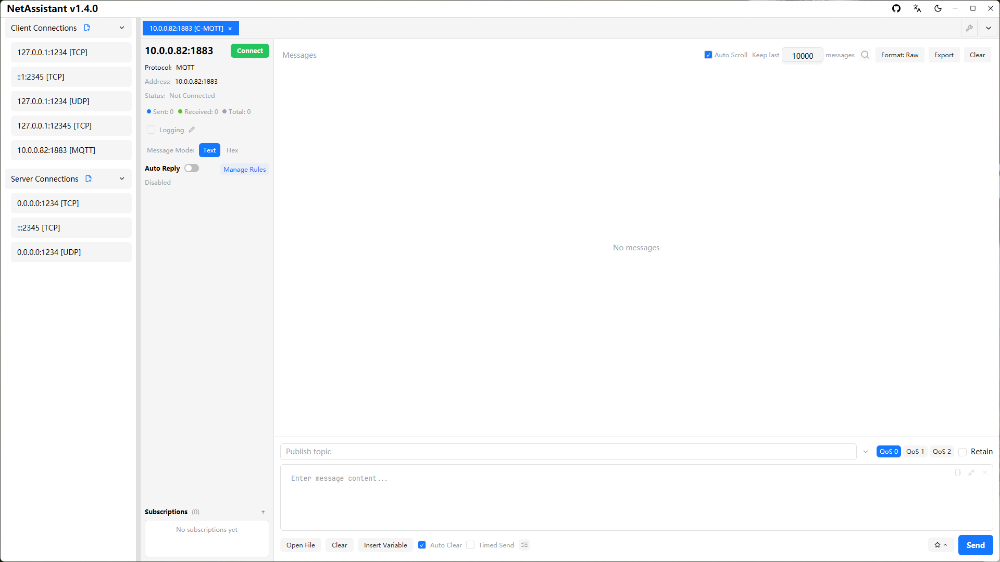


<details>
<summary>More screenshots (17)</summary>

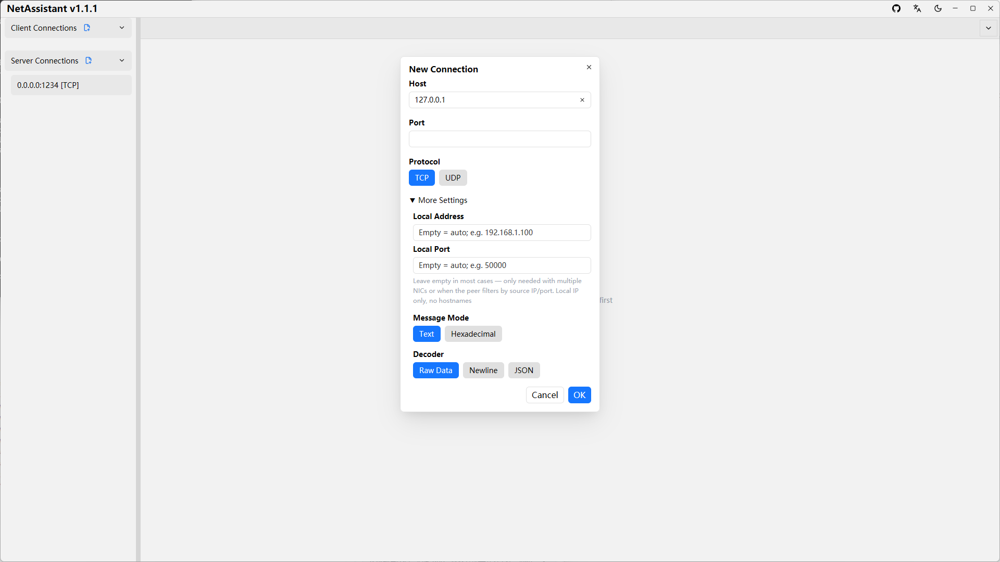

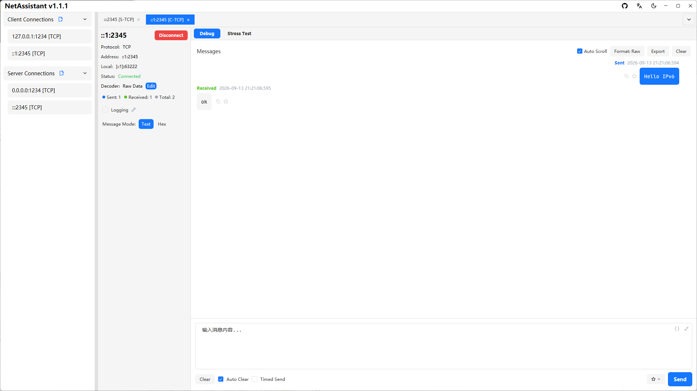

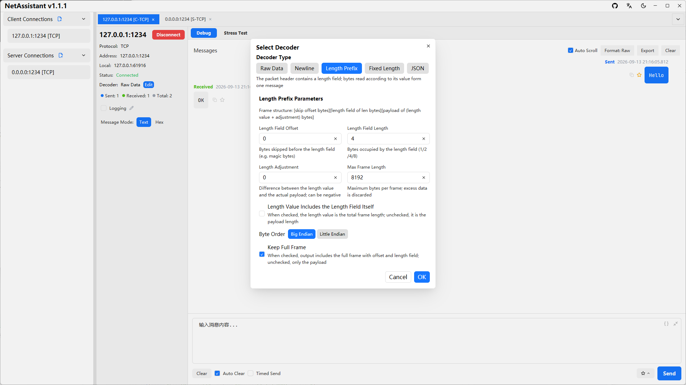

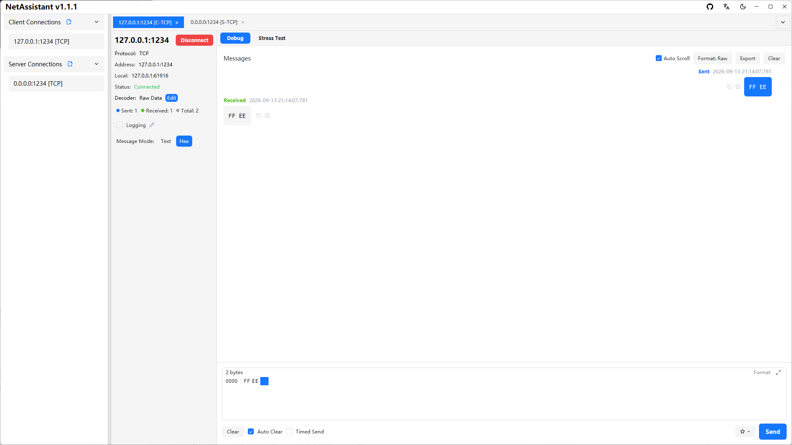

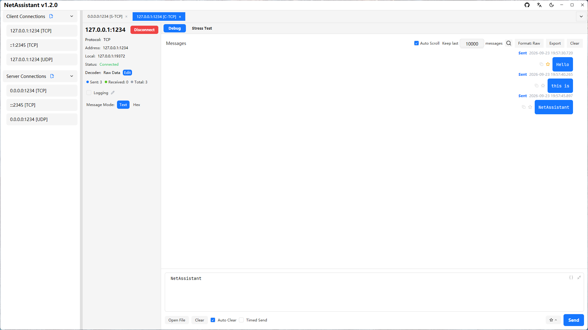

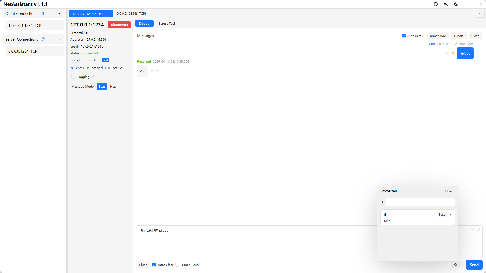

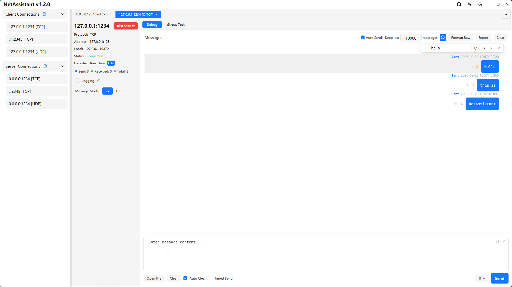

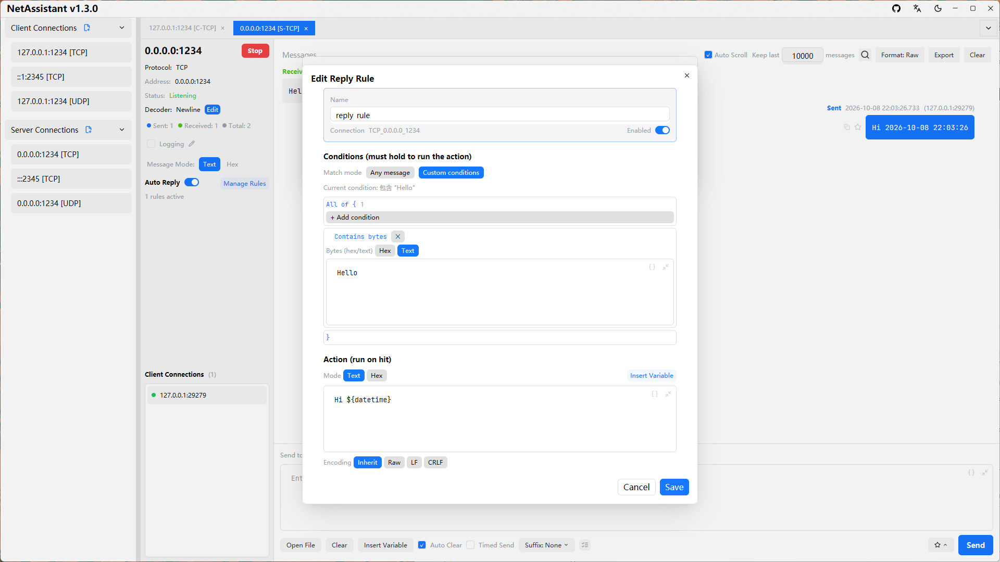

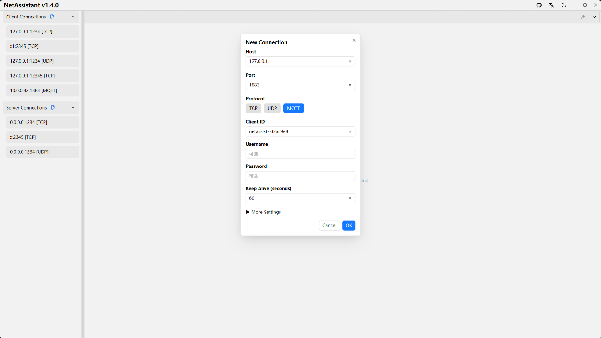


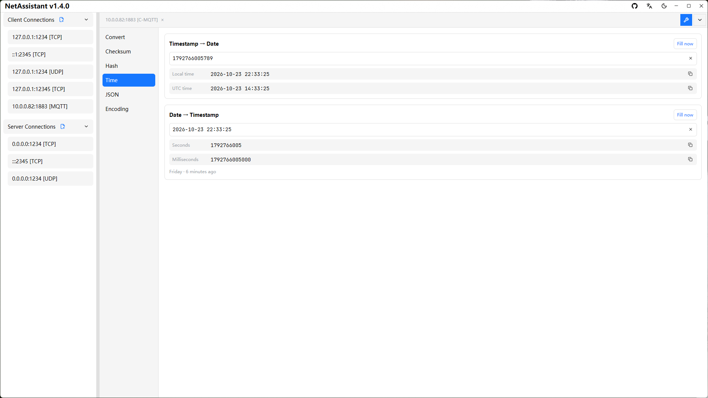

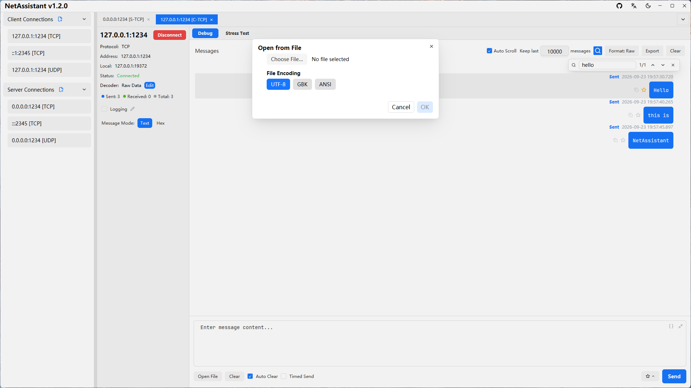

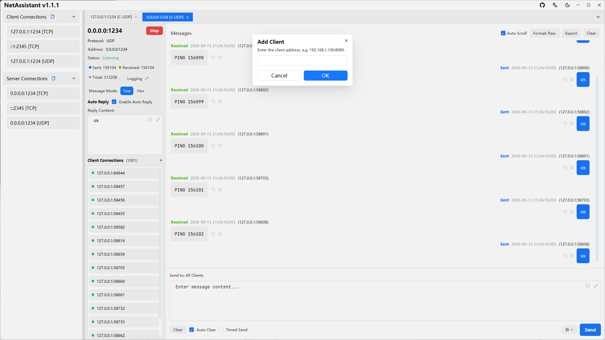

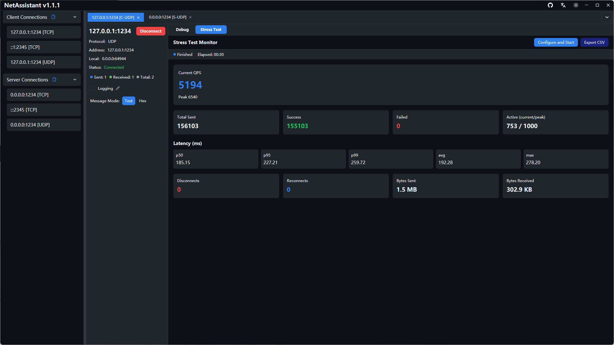

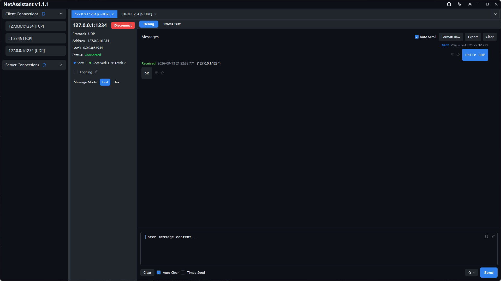


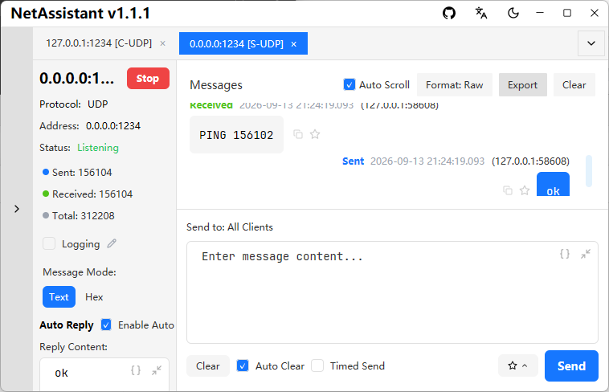

</details>

## Typical Scenarios

- **TCP/UDP integration**: simulate hardware or a server, verify hex payloads, framing and broadcast discovery. → [TCP debug tool](https://netassistant.trydo.top/en/tcp-debug-tool)
- **MQTT integration**: connect to a broker, verify QoS, TLS, last-will messages and subscription restore. → [MQTT client](https://netassistant.trydo.top/en/mqtt-client)
- **Service stress testing**: measure concurrency and latency of your own server, then export a CSV report. → [Stress testing](https://netassistant.trydo.top/en/tcp-stress-test)

## FAQ

**Q: How is this different from NetAssist?**  
A: NetAssistant is cross-platform and open source, with MQTT and stress testing built in. See the [network debugging tool comparison](https://netassistant.trydo.top/en/comparison) for a feature-by-feature breakdown.

**Q: Does it support serial ports?**  
A: No. NetAssistant focuses on network debugging (TCP/UDP/MQTT); use a serial terminal for serial devices.

**Q: Which operating systems are supported?**  
A: Windows 10 1709+, macOS 10.15+, and Linux with GTK3 (for example Ubuntu 22.04+).

**Q: How complete is MQTT support?**  
A: MQTT 3.1.1/5.0, QoS 0/1/2, TLS and mutual TLS, last-will messages, subscription management and automatic reconnect. MQTT over WebSocket, shared subscriptions, user properties and MQTT stress testing are not supported.

**Q: How do I handle TCP sticky packets?**  
A: Choose raw, line, length-prefix or JSON decoders. See [TCP sticky packets](https://netassistant.trydo.top/en/tcp-sticky-packet) for how each works.

**Q: Which protocols can be stress tested?**  
A: TCP and UDP only, in Ping-Pong or throughput mode, with CSV export. MQTT stress testing is not supported.

**Q: Is any data uploaded?**  
A: No. Configuration and logs stay on your machine; there are no accounts and no cloud sync.

**Q: What keyboard shortcuts are available?**  
A: `Ctrl+Enter` to send, `Ctrl+F` to search, `Ctrl+N` for a new connection, `Ctrl+W` to close a tab and `Ctrl+1..9` to switch tabs. Use `Cmd` on macOS.

More questions: [FAQ](https://netassistant.trydo.top/en/faq).

<details>
<summary>Full feature list</summary>

**Connections and protocols**

- TCP/UDP client and server, IPv4/IPv6 dual stack, local address and port binding
- MQTT 3.1.1/5.0: QoS 0/1/2, Clean Session, KeepAlive, last-will messages, session expiry and reason codes
- MQTT TLS: system roots / custom CA / verification skipped, optional client certificate and private key for mutual TLS
- Multiple tabs, connection renaming, duplicate connection (MQTT gets a fresh Client ID)

**Messages and payloads**

- Text/hex modes with automatic UTF-8 conversion; non-printable bytes escaped as `\xNN`
- HEX editor with dual hex/text views
- Raw, line, length-prefix and JSON TCP decoders
- JSON beautify/minify for both send and receive views
- Message search, favorites with notes, double-click to copy source address or topic
- Export to TXT/JSON/CSV; real-time logging with a custom path
- Message count cap (default 10000, `0` = unlimited) to bound memory during long sessions
- File data source: UTF-8 / GBK / ANSI, up to 1 MiB

**Automation and stress testing**

- Periodic send, line-by-line send and timed tasks (heartbeats) with pause/resume/stop
- Reply rules: contains bytes, masks, prefix + length, offset, regex, source CIDR and checksum conditions, arbitrarily nested
- Variables: `${seq}`, `${worker_id}`, `${counter}`, `${timestamp}`, `${uuid}`, `${random:min:max}`, plus `${rx.*}` frame variables
- Stress testing: Ping-Pong / throughput, short/long connections, QPS, active connections, bytes, p50/p95/p99, failure breakdown and CSV export

**Interface and productivity**

- Light/dark theme that follows the system
- Chinese and English interfaces
- Shortcuts for send, search, tabs, new connection and focusing the input
- Client message filtering, UDP manual add client and collapsed mode

</details>

<details>
<summary>Tech stack and performance</summary>

- **Language and UI**: Rust 2024, [GPUI](https://github.com/zed-industries/zed), [gpui-kit](https://crates.io/crates/gpui-kit)
- **Networking and async**: [Tokio](https://tokio.rs/), [rumqttc](https://crates.io/crates/rumqttc)
- **Performance**: startup under 100 ms, memory under 20 MB, message list at 60 fps
- **Architecture**: decoders, reply rules, send tasks and the stress engine are decoupled from the UI for reuse and testing

</details>

<details>
<summary>Roadmap</summary>

- [x] MQTT client with MQTT 5.0 / TLS (v1.5.0)
- [x] Built-in toolbox (v1.4.0)
- [x] File data source, multilingual UI and hex editor
- [ ] SSE debugging
- [ ] WebSocket protocol
- [ ] More encoders and decoders

</details>

## Contributing and Build

Issues and pull requests are welcome. Build from source:

```bash
git clone https://github.com/SunJary/NetAssistant.git
cd NetAssistant
cargo build --release
```

The binary is written to `target/release`. The documentation site uses VitePress: `npm install && npm run docs:build`.

## License

Licensed under the Apache License 2.0. See [LICENSE](LICENSE).

## Links

- Website: [https://netassistant.trydo.top/en/](https://netassistant.trydo.top/en/)
- Repository: [https://github.com/SunJary/NetAssistant](https://github.com/SunJary/NetAssistant)
- Issues: [https://github.com/SunJary/NetAssistant/issues](https://github.com/SunJary/NetAssistant/issues)

## Acknowledgements

Thanks to [GPUI](https://github.com/zed-industries/zed), [gpui-kit](https://crates.io/crates/gpui-kit), [Tokio](https://tokio.rs/) and [Rust](https://www.rust-lang.org/).

---

<div align="center">

**If this project helps you, please give it a ⭐️**

Made with ❤️ by Rust Community

</div>
