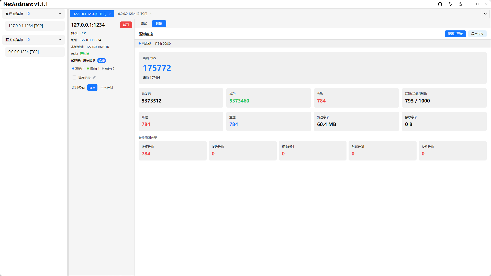
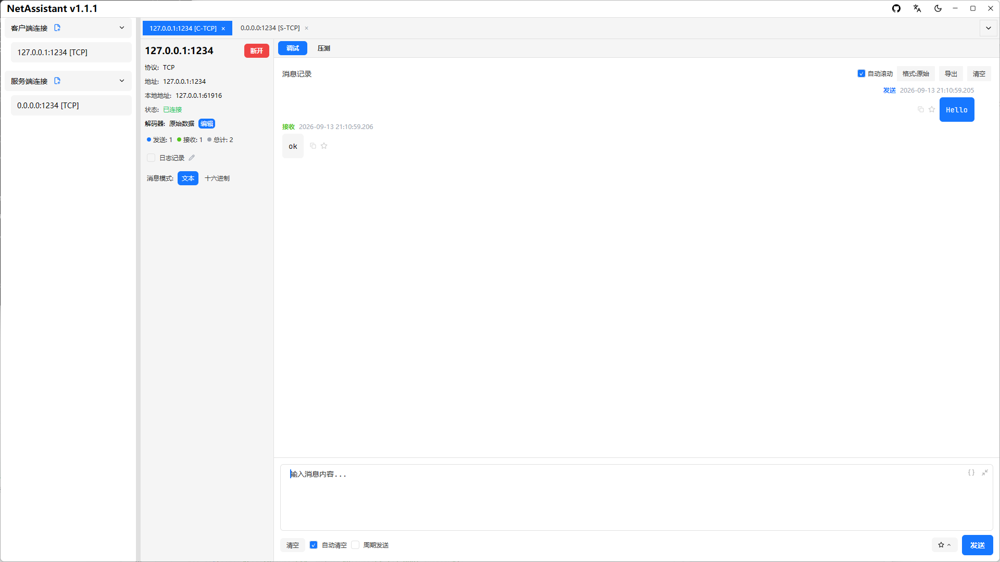

# NetAssist 替代品：NetAssistant 与网络调试助手对比

如果你正在用**网络调试助手（NetAssist）**，可能遇到过这几个问题：只有 Windows 版、闭源、TCP 粘包处理能力有限、压测要另装工具。NetAssistant 是一个免费开源的替代选择，但并不是所有场景都必须换。

这篇页面把两者放在一起，按实际使用场景逐项对比，方便你判断是否值得迁移。

> [下载 Windows 版](/windows-network-debug-tool) · [下载 macOS 版](/mac-network-debug-tool) · [查看全部功能](/features)

## 一句话结论

- **只需要最基础的 TCP/UDP 收发**、习惯 NetAssist 的老界面：继续用 NetAssist 也没问题
- **需要 TCP 粘包解码、内置压测、消息搜索与导出、MQTT**：NetAssistant 更合适
- **使用 macOS 或 Linux**：NetAssist 没有这两个平台的版本，直接用 NetAssistant
- **想要开源可审计、免费使用**：NetAssistant 基于 Apache-2.0 开源

## 核心差异

| 维度 | NetAssistant | 网络调试助手（NetAssist） |
| ---- | ---- | ---- |
| 平台 | Windows / macOS / Linux（x64 + ARM64） | 仅 Windows |
| 开源 | Apache-2.0 | 闭源 |
| TCP 客户端/服务端 | 支持 | 支持 |
| UDP 客户端/服务端 | 支持 | 支持 |
| TCP 粘包解码 | 原始 / 行分隔 / 长度前缀 / JSON | 有限 |
| 内置高并发压测 | QPS + p50/p95/p99 | 无 |
| IPv6 | 完整支持 | 部分支持 |
| MQTT | MQTT 3.1.1 客户端 | 无 |
| 消息搜索/收藏/导出 | 支持，TXT / JSON / CSV | 有限 |
| 自动回复 / 周期发送 | 支持 | 支持 |
| 界面 | GPUI 原生渲染，暗黑模式，多标签 | 传统界面 |

## 逐项对比

### 平台与安装

NetAssist 只有 Windows 版本。NetAssistant 提供 Windows、macOS、Linux 三个平台的原生构建，Windows 上可以用一条 winget 命令安装：

```bash
winget install SunJary.NetAssistant
```

Windows 用户可以直接看[Windows 网络调试助手](/windows-network-debug-tool)，Mac 与 Linux 用户分别看 [macOS 版](/mac-network-debug-tool) 和 [Linux 版](/linux-network-debug-tool)。

### TCP 粘包处理

这是两者最大的差异。NetAssist 对 TCP 粘包/拆包的处理能力有限，遇到变长二进制协议通常只能把接收内容当作原始字节查看。

NetAssistant 在接收侧提供四种解码器：

| 解码器 | 适用场景 |
| ------ | -------- |
| 原始数据 | 不做处理，按收到顺序原样展示 |
| 行分隔 | 以换行符为边界，适合 AT 指令、日志等文本协议 |
| 长度前缀 | 按长度字段分帧，适合二进制协议 |
| JSON | 按完整 JSON 对象分帧，适合 JSON over TCP |


想系统了解粘包的成因和方案，见 [TCP 粘包与拆包](/tcp-sticky-packet)。

### 压力测试

NetAssist 不提供内置压测。NetAssistant 内置 TCP/UDP 压测引擎，支持 Ping-Pong 与吞吐模式，实时展示 QPS、p50/p95/p99 延迟、失败原因分类，并可导出 CSV 报告。



### 消息管理与导出

NetAssistant 的报文以聊天式记录展示，支持关键字搜索、收藏与备注、实时日志、TXT/JSON/CSV 导出。长时间联调时，比在原始文本框里滚动查找更方便。



### MQTT 与多协议

NetAssist 专注于 TCP/UDP。NetAssistant 在同一个工具里增加了 MQTT 3.1.1 客户端，支持订阅管理、QoS 0/1/2、retain、遗嘱消息与自动回复；MQTT 5.0 与 TLS 暂不支持。

### 自动化能力

两者都支持自动回复和周期发送。NetAssistant 的回复规则条件更细：可按键、JSON 字段、正则、来源地址、校验值等组合匹配，并支持内联试跑。

### 开源与可维护性

NetAssist 是闭源软件，遇到问题只能等更新。NetAssistant 基于 Apache-2.0 开源，源码托管在 GitHub，可以自行编译、提交 issue 或参与贡献。

## 什么时候继续用 NetAssist

公平地说，NetAssist 仍然适合这些场景：

- 只需要最基础的 TCP/UDP 收发和十六进制显示
- 已经习惯它的界面和操作方式，不想迁移
- 只在 Windows 上使用，且没有粘包解码、压测、MQTT 需求

NetAssistant 不是要证明 NetAssist 不能用，而是补齐它在粘包处理、压测、消息管理和跨平台上的空白。

## 从 NetAssist 迁移到 NetAssistant

1. **安装**：Windows 执行 `winget install SunJary.NetAssistant`，或从[下载页](/download)获取安装包
2. **新建连接**：协议、角色（客户端/服务端）、远端地址和端口与 NetAssist 保持一致
3. **选择解码器**：文本协议选「行分隔」，二进制协议选「长度前缀」，JSON 协议选「JSON」
4. **保存配置**：连接配置会自动保存，下次启动直接使用

目前不支持直接导入 NetAssist 的配置文件，需要重新创建连接；一般几分钟可以完成。

## 常见问题

### NetAssist 有 Mac 版吗？

没有。NetAssist 仅提供 Windows 版本。Mac 与 Linux 用户可以使用 NetAssistant，它提供 macOS 与 Linux 原生构建。

### NetAssistant 能完全替代 NetAssist 吗？

基础 TCP/UDP 收发、十六进制模式、自动回复和周期发送都能覆盖，并额外提供四种粘包解码器、内置压测、消息搜索与导出、MQTT 3.1.1。如果你只需要最基础的收发，继续用 NetAssist 也可以。

### Windows 上哪个网络调试助手更好用？

取决于需求。只需要最简单的收发，NetAssist 足够；需要粘包解码、QPS 与延迟分位数压测、消息管理、MQTT 或跨平台，NetAssistant 更合适。

### 收费吗？

不收费。NetAssistant 基于 Apache-2.0 许可证开源，全部功能免费使用。

### 数据会上传到云端吗？

NetAssistant 不依赖云端服务，收发数据在本机与目标端之间传输；源码开源，可自行审计。

### 支持 IPv6 吗？

支持。创建连接时地址可填 IPv4 或 IPv6，例如 `::1`、`fe80::xxxx`。

### 支持 MQTT 吗？

NetAssistant 支持 MQTT 3.1.1 客户端；NetAssist 不提供 MQTT 功能。MQTT 5.0、TLS 与 MQTT over WebSocket 暂不支持。

## 相关页面

- [Windows 网络调试助手](/windows-network-debug-tool)
- [macOS 网络调试助手](/mac-network-debug-tool)
- [Linux 网络调试助手](/linux-network-debug-tool)
- [TCP 粘包与拆包](/tcp-sticky-packet)
- [全部工具对比](/comparison)
