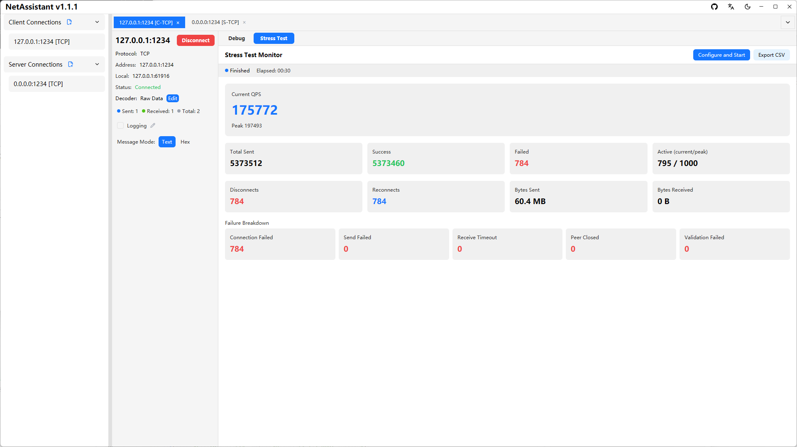
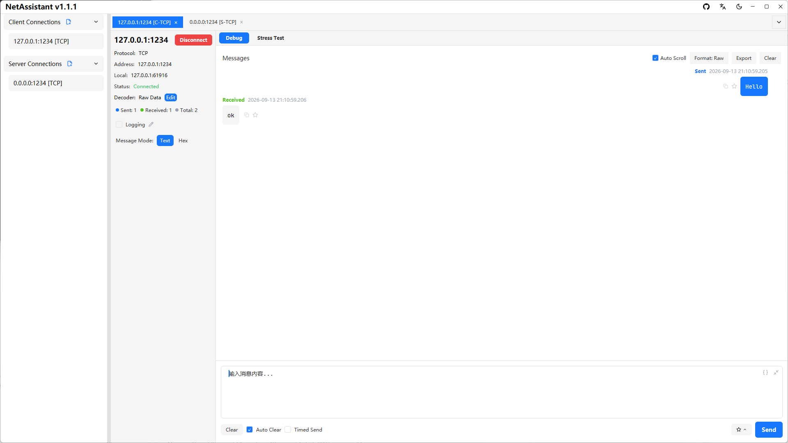

# NetAssist Alternative: NetAssistant vs NetAssist

If you use **NetAssist (网络调试助手)**, you may have run into its limits: Windows only, closed source, limited TCP sticky-packet handling, and no built-in stress testing. NetAssistant is a free, open-source alternative, but replacing NetAssist is not always necessary.

This page compares both tools by real usage scenarios so you can decide whether migration is worth it.

> [Download for Windows](/en/windows-network-debug-tool) · [Download for macOS](/en/mac-network-debug-tool) · [All features](/en/features)

## Bottom line

- **Only need basic TCP/UDP send and receive** and prefer the classic UI: NetAssist is still fine
- **Need sticky-packet decoding, built-in stress testing, message search/export or MQTT**: NetAssistant is the better fit
- **Using macOS or Linux**: NetAssist is not available, so use NetAssistant
- **Want open source and free access**: NetAssistant is Apache-2.0 licensed

## Key differences

| Dimension | NetAssistant | NetAssist |
| ---- | ---- | ---- |
| Platforms | Windows / macOS / Linux (x64 + ARM64) | Windows only |
| Open source | Apache-2.0 | Closed source |
| TCP client/server | Yes | Yes |
| UDP client/server | Yes | Yes |
| TCP sticky-packet decoders | Raw / line / length-prefix / JSON | Limited |
| Built-in stress testing | QPS + p50/p95/p99 | No |
| IPv6 | Full support | Partial |
| MQTT | MQTT 3.1.1 client | No |
| Message search/favorites/export | TXT / JSON / CSV | Limited |
| Auto-reply / periodic send | Yes | Yes |
| UI | Native GPUI rendering, dark mode, tabs | Traditional |

## Detailed comparison

### Platforms and installation

NetAssist is Windows-only. NetAssistant ships native builds for Windows, macOS and Linux. On Windows, install it with one command:

```bash
winget install SunJary.NetAssistant
```

See the [Windows guide](/en/windows-network-debug-tool), [macOS guide](/en/mac-network-debug-tool) or [Linux guide](/en/linux-network-debug-tool) for platform-specific steps.

### TCP sticky-packet handling

This is the biggest difference. NetAssist has limited support for TCP sticky and split packets, so variable-length binary protocols usually end up as a raw byte view.

NetAssistant provides four receive-side decoders:

| Decoder | Best for |
| ---- | ---- |
| Raw | Show incoming bytes as-is |
| Line-delimited | Newline-framed text such as AT commands or logs |
| Length-prefix | Binary protocols with a length field |
| JSON | Complete JSON objects over TCP |


For the underlying causes and solutions, see [TCP sticky packets](/en/tcp-sticky-packet).

### Stress testing

NetAssist has no built-in load testing. NetAssistant includes a TCP/UDP stress engine with Ping-Pong and throughput modes, live QPS, p50/p95/p99 latency, failure breakdown and CSV export.



### Message management and export

NetAssistant presents traffic as a chat-style log with search, favorites, notes and TXT/JSON/CSV export. That is much easier to work with during long debugging sessions than scrolling a raw text box.



### MQTT and protocol coverage

NetAssist focuses on TCP/UDP. NetAssistant adds an MQTT 3.1.1 client with subscription management, QoS 0/1/2, retain, last-will messages and auto-reply. MQTT 5.0 and TLS are not supported yet.

### Automation

Both support auto-reply and periodic sending. NetAssistant adds finer reply conditions: key, JSON field, regex, source address and checksum combinations, with inline testing.

### Open source and maintainability

NetAssist is closed source, so fixes depend on the vendor. NetAssistant is Apache-2.0 open source on GitHub; you can build it yourself, file issues or contribute.

## When NetAssist is still the right choice

To be fair, NetAssist remains a good option if:

- You only need basic TCP/UDP send/receive and hex display
- You are comfortable with its UI and do not want to migrate
- You only work on Windows and do not need decoders, load testing or MQTT

NetAssistant is not trying to prove NetAssist is unusable. It fills the gaps in sticky-packet handling, stress testing, message management and cross-platform support.

## Migrating from NetAssist

1. **Install**: run `winget install SunJary.NetAssistant` on Windows, or get an installer from the [download page](/en/download)
2. **Create the connection**: keep the same protocol, role (client/server), remote address and port
3. **Choose a decoder**: line-delimited for text protocols, length-prefix for binary protocols, JSON for JSON over TCP
4. **Save**: connection settings are persisted automatically

Direct import of NetAssist configuration files is not supported; connections need to be recreated, which usually takes a few minutes.

## FAQ

### Is there a Mac version of NetAssist?

No. NetAssist is Windows-only. NetAssistant offers native macOS and Linux builds.

### Can NetAssistant fully replace NetAssist?

It covers basic TCP/UDP send/receive, hex mode, auto-reply and periodic sending, and adds four sticky-packet decoders, built-in stress testing, message export and MQTT 3.1.1.

### Which is better on Windows?

NetAssist is enough for basic send/receive. NetAssistant is better for sticky-packet decoding, QPS and latency-percentile stress testing, message management, MQTT or cross-platform work.

### Is NetAssistant free?

Yes. It is open source under Apache-2.0 and all features are free.

### Is data uploaded to the cloud?

NetAssistant does not depend on a cloud service; traffic goes between your machine and the target endpoint, and the source code is open for audit.

### Does it support IPv6?

Yes. IPv4 and IPv6 addresses such as `::1` or `fe80::xxxx` are supported in both client and server modes.

### Does it support MQTT?

NetAssistant includes an MQTT 3.1.1 client; NetAssist does not provide MQTT. MQTT 5.0, TLS and MQTT over WebSocket are not supported yet.

## Related pages

- [Windows network debugging tool](/en/windows-network-debug-tool)
- [Mac network debugging tool](/en/mac-network-debug-tool)
- [Linux network debugging tool](/en/linux-network-debug-tool)
- [TCP sticky packets](/en/tcp-sticky-packet)
- [All tool comparisons](/en/comparison)
