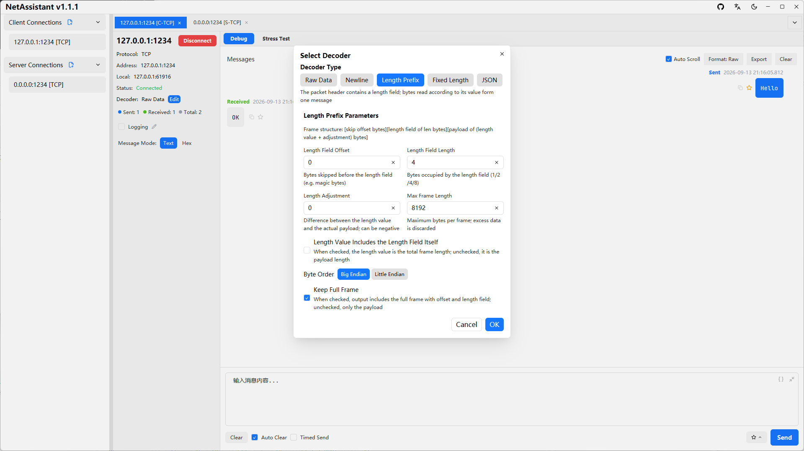
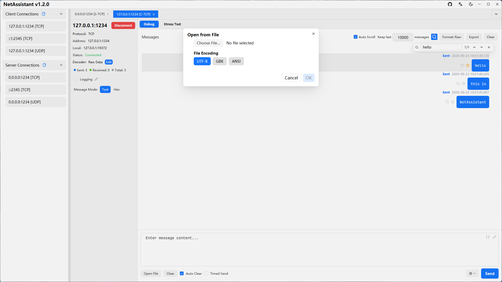
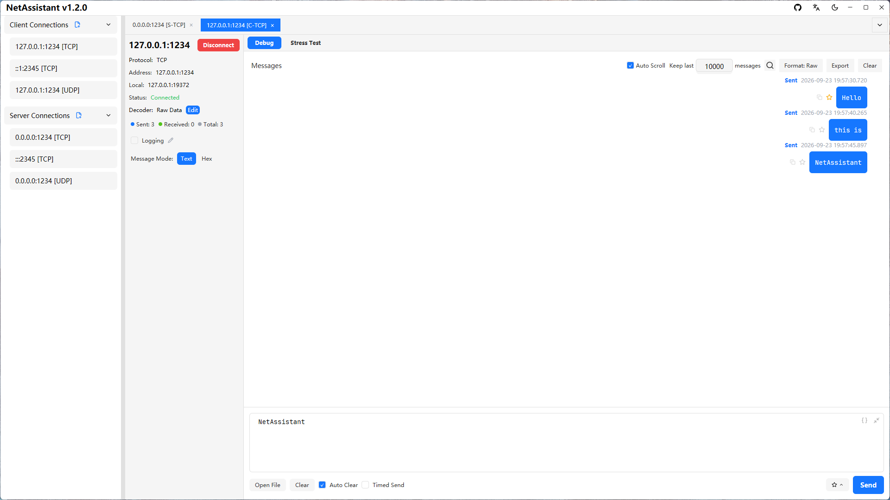
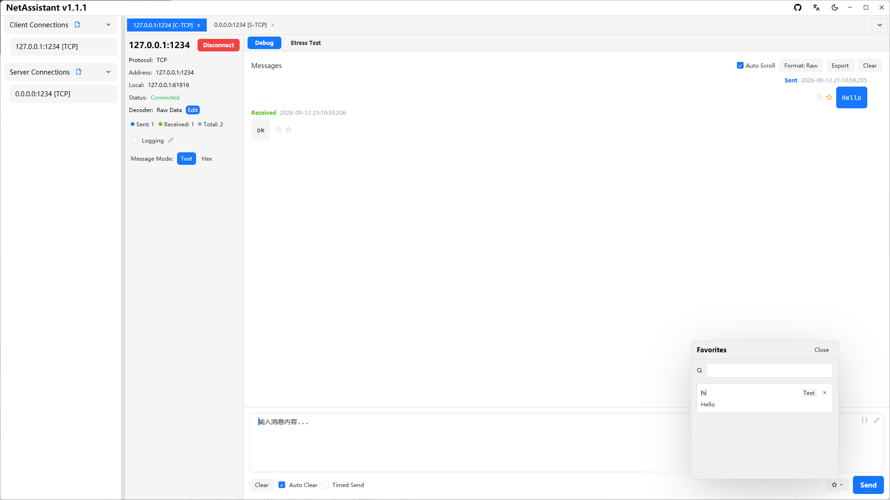
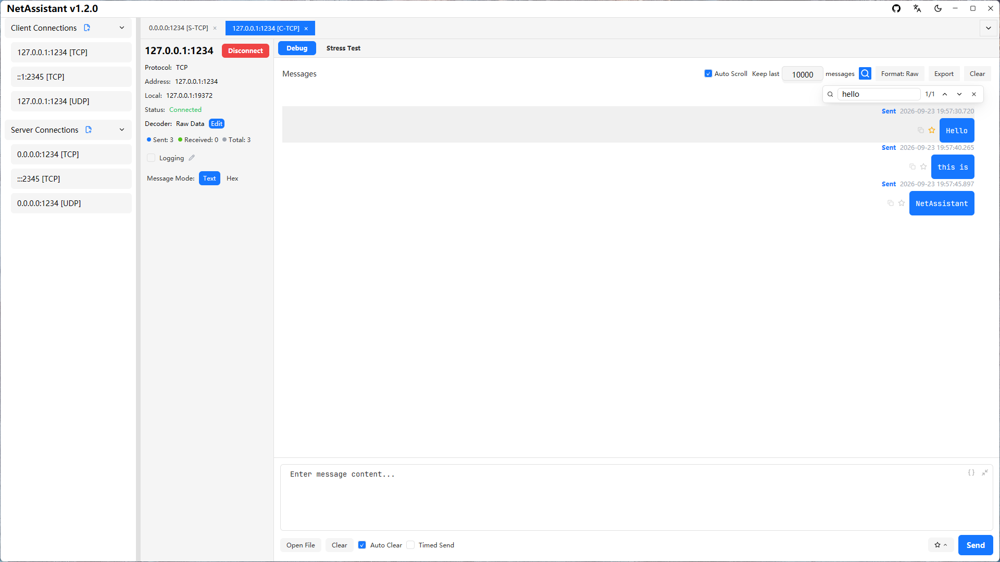
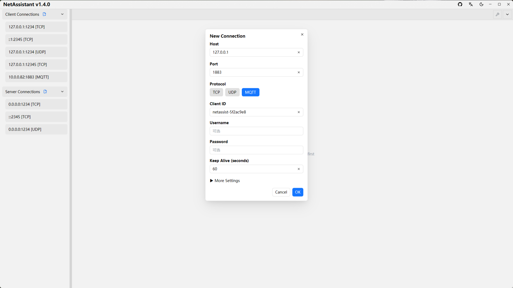
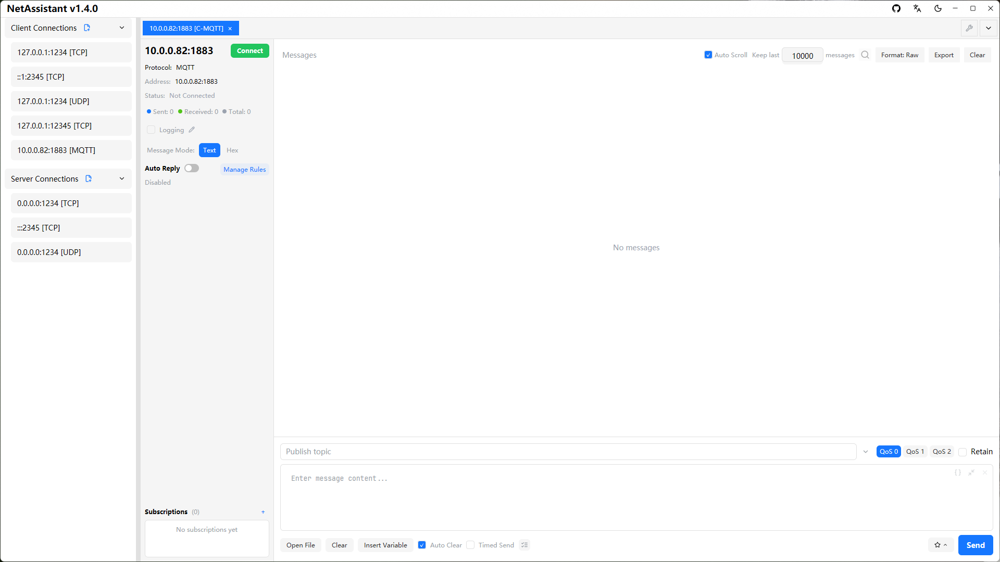
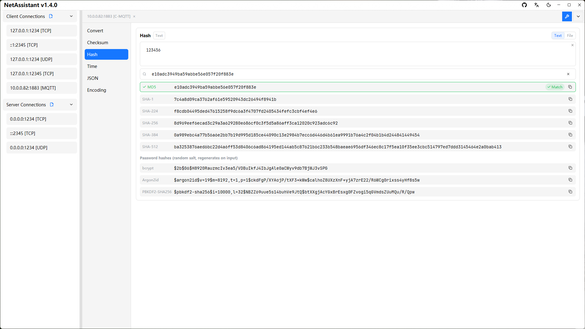
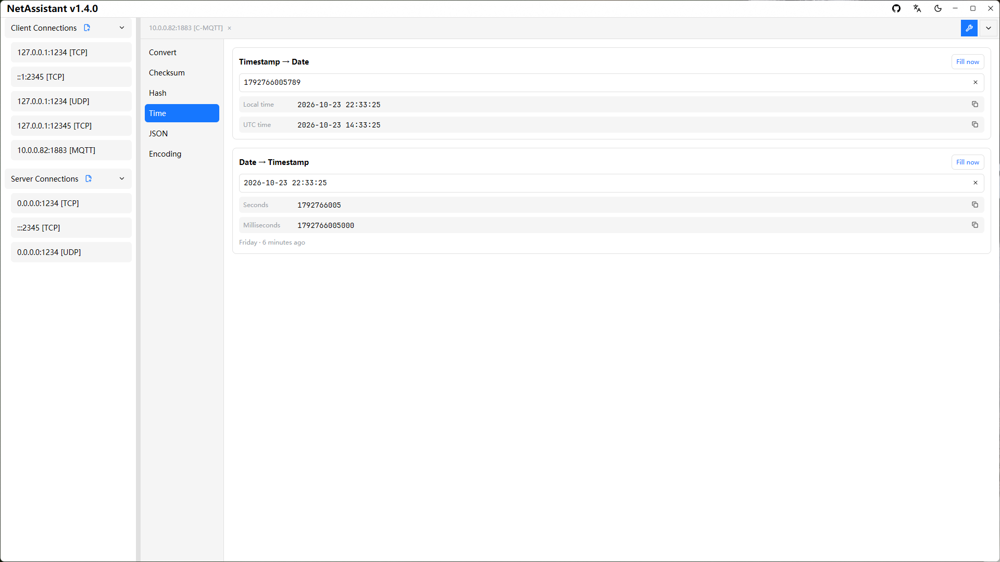
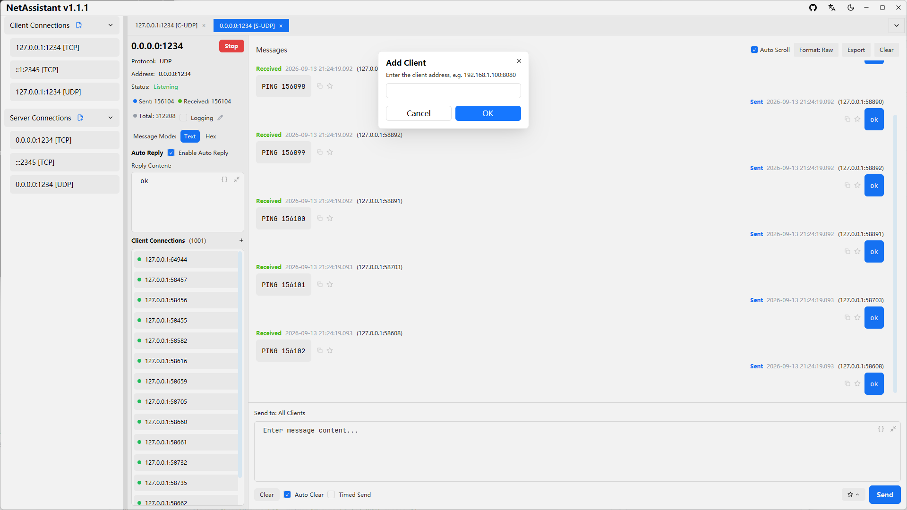

# Features

NetAssistant is a high-performance, modern **cross-platform** network debugging tool built with Rust, designed for developers and available on Windows, Linux and macOS, with native builds for both x64 and ARM64.

## Core Features

- **Multi-protocol support**: full support for TCP/UDP client and server modes, plus an MQTT 3.1.1 client
- **Built-in toolbox**: open it from the wrench icon at the right of the tab bar; switch between Convert / Checksum / Hash / Time / JSON / Encoding groups, results appear as you type and every row has a copy button
- **IPv4/IPv6 dual stack**: supports both IPv4 and IPv6, adapting to any network environment
- **Multiple TCP decoders**: raw data, line-delimited, length-prefix and JSON decoders for different protocol formats, effectively solving TCP sticky packet issues
- **JSON formatting**: the send box offers "Prettify/Minify" buttons in text mode to format the outgoing payload; the receive area can switch between Raw/Prettified/Minified display formats globally, with non-JSON content shown as-is
- **Chat-style message log**: intuitive display of packet exchanges for easier debugging and analysis
- **Persistent configuration**: connection configs are saved automatically and restored on the next launch
- **File data source**: read a local file into the send box as a payload, with UTF-8 / GBK / ANSI encoding selection and content preview, human-readable file size, and a 1 MiB limit
- **ASCII ↔ Hex conversion**: switching between text and hex mode converts the content as UTF-8; the context menu's "Convert to Hex / Convert to Text" shows the result in a window you can copy from; non-printable bytes are escaped as `\xNN`, and round-tripping is byte-for-byte

## Message Management

- **Copy message**: quickly copy a single message to the clipboard, in either text or hex format
- **Selectable message text**: drag-select, double-click a word or triple-click a line in a bubble and copy with `Ctrl/Cmd+C`; the context menu copies the selection or the full message and runs text ⇄ Hex conversion or six checksum algorithms on it, with the highlight following the mouse live
- **Double-click to copy source**: double-click a message's source address to copy `ip:port`; on MQTT connections, double-click the topic pill to copy the raw topic
- **Favorite messages**: add important messages to favorites with optional remarks, and locate them quickly via keyword search
- **Real-time logging**: once enabled manually, all sent and received messages are written asynchronously to a log file in real time (flushed to disk per message), with a customizable save path; the log is flushed and closed automatically on disconnect
- **Manual export anytime**: export the current message history to TXT/JSON/CSV files at any time for archiving, sharing and further analysis
- **Smart UDP broadcast reply display**: optimized for host workstation / IoT device discovery scenarios — send a command to a broadcast address and receive replies from all devices; replies from unexpected addresses are highlighted in red so no important response is lost
- **Connection config editing**: saved connection configs can be edited directly, no need to delete and recreate
- **Message search**: `Ctrl+F` or the toolbar magnifier opens a non-modal search overlay with a live `i/n` match counter; jump ring-wise with `Enter` / `Shift+Enter` or the up/down buttons, and the matching row is highlighted and scrolled into view
- **Message count cap**: configure "Keep last N" messages (default 10000, `0` = unlimited); once exceeded the oldest messages are dropped to bound memory usage. It is linked to auto-scroll, so nothing is dropped while auto-scroll is off

## Automated Testing

- **Reply rules**: a per-connection rule engine that matches incoming frames by byte-level conditions (contains bytes, fixed exact/masked, prefix + length range, byte/integer at offset, suffix, regex, source address with CIDR, JSON fields, checksum validation, and more, arbitrarily nested with all/any/not) and replies automatically; JSON field conditions accept paths such as `data.items[0].temp` with `== / != / > / >= / < / <= / contains / exists`; replies support received-frame and dynamic variables and can set their own encoding; rules are scoped per connection with enable/disable, drag-to-reorder, trigger counts and an inline test run
- **Message variables**: the send box, timed tasks and reply rules all share general variables such as `${seq}`, time, `${uuid}` and `${random:min:max}`, plus received-frame variables `${rx.*}`, `${rx.json:path}` JSON field access, checksums generated at send time and `${= expression }`
- **Send tasks and timed tasks**: send imported files or pasted lines one per line (with interval, looping and round limits); each connection can add a timed task to send a heartbeat at a fixed interval — both show progress in the task panel with pause/resume/stop
- **Periodic send**: repeat the current send-box content at a set interval for long-run stability testing or device heartbeat simulation
- **Stress testing**: built-in TCP/UDP high-concurrency stress test engine, see the [Stress Testing Guide](/en/guide/stress)

## MQTT Debugging

- **MQTT 3.1.1 client**: integrated into the client connection system — choose MQTT when creating a connection and fill in the broker address and port (default 1883), Client ID, optional username/password and KeepAlive; "More Settings" holds Clean Session and last-will settings (topic / payload / QoS / retain)
- **Subscription management**: add / edit / unsubscribe at runtime without reconnecting; subscriptions are scoped per connection and restored automatically after an automatic reconnect
- **Publishing**: set topic, QoS (0/1/2) and retain in the send area while the payload keeps using text / hex mode; the dropdown at the right of the topic input reuses recent topics for this connection (with QoS and retain), persisted per connection with up to 20 entries
- **Message display**: every message carries a topic pill (retain is marked), and double-clicking the pill copies the raw topic; the existing log, search, export, JSON formatting and reply rules all work as before
- **Auto reply**: replies are published back to the topic the message arrived on; periodic send also uses the current publish topic
- **Protocol constraints**: decoders and the suffix selector are hidden for MQTT, and stress testing, line-send tasks and timed tasks are not offered; the first version does not support TLS, MQTT 5.0 or MQTT over WebSocket

## Built-in Toolbox

Click the wrench icon at the right of the tab bar to open the toolbox. It is a permanent tab that cannot be closed; groups switch on the left, each keeps its own input, and results appear as you type:

- **Convert**: separate text → Hex and Hex → text blocks
- **Checksum**: type hex bytes and get XOR / Sum8 / LRC / CRC16-Modbus / CRC16-CCITT-FALSE / CRC32 instantly
- **Hash**: MD5 / SHA-1 / SHA-224 / SHA-256 / SHA-384 / SHA-512 digests; bcrypt / Argon2id / PBKDF2-SHA256 password hashes (random salt); file digests (select multiple algorithms, single read pass) and hash comparison (paste a hash to auto-detect the algorithm by length and mark a match)
- **Time**: timestamp → date (local / UTC, auto-detecting seconds and milliseconds), date → timestamp (seconds / milliseconds, with weekday and relative time), ISO 8601 support and "Fill now"
- **JSON**: beautify / minify with a JSON5 fallback (unquoted keys, single quotes, trailing commas, comments) when strict JSON parsing fails
- **Encoding**: Base64 encode / decode and URL encode / decode

## Modern Interface

- **Dark mode**: adapts to the system theme automatically for a comfortable night-time experience
- **Multi-tab management**: manage multiple connections at once, easy to switch and compare
- **Per-client message view**: in server mode, view messages of a specific client
- **Manual client addition for UDP**: in UDP server mode, add client addresses manually to proactively send data to a specific address
- **Keyboard shortcuts**: `Ctrl+Enter` to send, `Ctrl+Tab` / `Ctrl+1..9` / `Ctrl+W` to manage tabs, `Ctrl+F` to search messages, `Ctrl+N` for a new connection and `Ctrl+K` to focus the message input — all working regardless of the current focus

## Technical Highlights

### ⚡ Blazing Performance

- **Powered by Rust**: zero-cost abstractions, memory safety, no garbage collection
- **Tokio async runtime**: high-performance event loop based on epoll/kqueue, supporting million-level concurrent connections

### 🎨 Modern Interface

- **GPUI framework**: GPU-accelerated rendering and text rendering, smooth 60fps experience
- **Adaptive theme**: automatically follows the system light/dark mode
- **Responsive design**: adaptive layout that fits different screen sizes

### 🔧 Architecture

- **Standalone stress engine**: pure logic layer with zero GPUI dependency, easy to reuse and test; token-bucket-based rate limiting for precise send-rate control
- **Decoupled core logic and UI**: message handlers are independent of the UI layer; the network protocol layer and the UI layer are cleanly separated

## Benchmarks

During development, NetAssistant was stress-tested against itself using the built-in stress engine, which helped discover and optimize several performance bottlenecks (batched message updates, batched log writes, etc.):

| Metric | Result |
| ------ | ------ |
| Startup time | < 100ms |
| Memory footprint | < 20MB |
| UI responsiveness | 60fps rendering |

## Use Cases

- **Developer communication verification**: backend developers simulate hardware sending data before integrating with it; test communication logic and data formats between client and server to verify server correctness and robustness
- **Hardware device testing**: hardware engineers test sensors, controllers and other devices; embedded developers verify the network protocol stack implementation and transmission efficiency of resource-constrained systems
- **Service performance stress testing**: evaluate concurrency throughput, latency distribution and stability of your own server, and locate performance bottlenecks quickly
