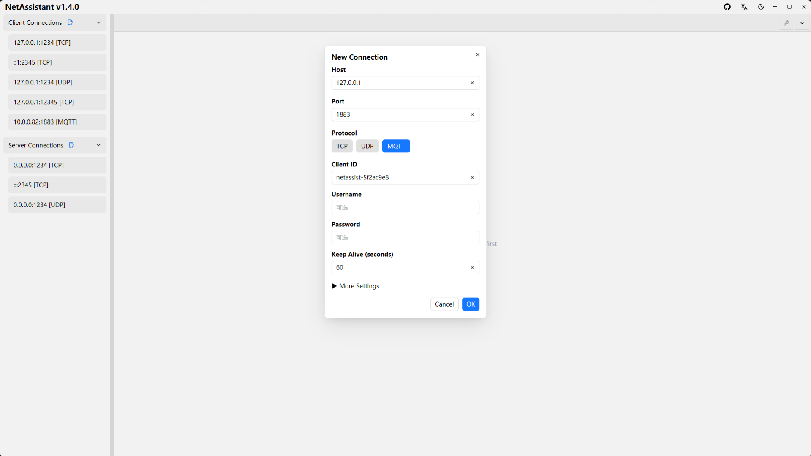

# MQTT Tutorial: From a Connection to Your First Message

The fastest way to check whether a device is publishing or a platform command is being delivered is to connect an MQTT client to the broker, subscribe to the topic and watch the traffic. This tutorial walks through the whole flow with NetAssistant: create a connection, connect, subscribe, publish and verify, followed by TLS and local-broker testing.

> Already connected but receiving nothing? Jump to [MQTT troubleshooting](/en/mqtt-troubleshooting).

## Before you start

1. Install NetAssistant: on Windows run `winget install SunJary.NetAssistant`, or use the [download page](/en/download) for other platforms.
2. Have a broker ready: local Mosquitto, EMQX, or a cloud IoT platform, with its address, port and credentials.
3. Know the topic you want to subscribe to or publish to; check the device or platform docs instead of guessing.

## Step 1: Create an MQTT connection

Click `+ New` on the left, choose **MQTT** as the protocol, then fill in:

| Field | Description |
| ----- | ----- |
| Host / port | Broker hostname and port; 1883 for plain MQTT, 8883 for TLS |
| Client ID | Must be unique per broker; when empty, 5.0 forces a clean start |
| Username / password | Required when the broker enables authentication; leave empty for anonymous access |
| KeepAlive | Heartbeat interval, 60 seconds by default; raise it on unstable networks |
| Protocol version | 5.0 (default) or 3.1.1, depending on what the broker supports |

Additional settings hold Clean Session and last-will messages (topic / payload / QoS / retain). The connection name is optional; when set, the list and tab title show it, which helps separate environments.



## Step 2: Connect to the broker

Click `Connect`. On success the detail page shows the broker, protocol version and connection state; on failure a readable reason appears in the top-right corner:

- 3.1.1 returns a CONNACK error code (unsupported protocol version, identifier rejected, authentication failed and so on)
- 5.0 shows a specific reason code, such as `0x86` for a bad username or password and `0x87` for not authorized
- TLS problems such as an expired certificate, hostname mismatch or untrusted chain are reported separately

If the connection never establishes, start with [the quick checks](/en/mqtt-troubleshooting#three-quick-checks).


## Step 3: Subscribe to a topic

In the **Subscriptions** block on the left, click `＋` and enter a topic and QoS. Common wildcard forms:

- `device/+/status`: `+` matches a single level, so it matches `device/1/status` but not `device/1/2/status`
- `device/#`: `#` matches multiple levels and must be the last segment
- `$SYS/#`: system topics that start with `$` must be subscribed explicitly; `#` does not match them

Every subscription has its own switch: it only lights up after the broker confirms it (SUBACK), and a failure or a 10-second timeout turns it off with a reason. For a first test, subscribe to `test/#`, then narrow down to the real topics.

## Step 4: Publish a message

In the send area, enter a topic, choose QoS and retain, type the payload and publish:

- **QoS 0**: at most once, fastest, messages may be lost
- **QoS 1**: at least once, may duplicate, the usual choice for device telemetry
- **QoS 2**: exactly once, highest overhead, for commands that must not repeat
- **retain**: the broker keeps the last message and delivers it to new subscribers immediately

Subscribe before publishing so the message shows up in your own message view. The dropdown at the right of the topic input remembers recent topics together with QoS and retain.

## Step 5: Verify and save

The message view labels every entry with its topic and marks retained messages; double-click a topic label to copy the raw topic. Connection configs are saved automatically and are ready on the next launch.

When publishing fails, the top-right notification names the target topic and reason (MQTT 5 distinguishes cases such as not authorized); identical notifications are shown once per 3 seconds while the log still records every entry.

## Connect over TLS (optional)

If the broker listens on 8883 or requires encryption, enable TLS and choose how to verify the certificate:

- **System roots**: the broker uses a certificate from a public CA
- **Custom CA**: self-built CA or private chain, as a PEM file
- **Skip verification**: for self-signed development certificates only; traffic is still encrypted but identity is not verified

For mutual TLS, also provide a client certificate and private key (PEM, in pairs). See [MQTT TLS configuration](/en/mqtt-tls) and [MQTT over TLS](/en/mqtt-client#mqtt-over-tls) for the details.

## Run a local broker

If you do not have a broker yet, Mosquitto is enough to verify the flow. Create `mosquitto.conf`:

```ini
listener 1883
allow_anonymous true
```

Start it:

```bash
mosquitto -c mosquitto.conf -v
```

Then connect to `127.0.0.1:1883` in NetAssistant, subscribe to `test/#` and publish to `test/hello`. This configuration is for local testing only; enable authentication and TLS in production.

## FAQ

### What is the default MQTT port?

Plain MQTT uses 1883 and TLS uses 8883. Enable TLS when connecting to 8883, otherwise the handshake fails. MQTT over WebSocket is not supported.

### Can I use any client ID?

It must be unique per broker. Reusing an ID kicks the previous connection offline; duplicating a connection in NetAssistant generates a new client ID automatically.

### Why do I get no messages after subscribing?

Check that the subscription switch is on and the publish topic matches the filter, then check retained, QoS, ACL and session settings. See [MQTT troubleshooting](/en/mqtt-troubleshooting) for the full flow.

### Does NetAssistant support MQTT over WebSocket?

No. It connects over TCP only; use MQTTX or another client for WebSocket endpoints.

### Should I choose MQTT 5.0?

Most brokers work with 3.1.1. Choose 5.0 for session expiry, receive maximum or more specific reason codes; user properties, Will Delay and shared subscriptions are not provided.

## Next steps

- Connection or subscription problems: [MQTT troubleshooting](/en/mqtt-troubleshooting)
- Full capabilities and settings: [MQTT client](/en/mqtt-client)
- How it differs from MQTTX: [MQTTX alternative comparison](/en/comparison-mqttx)
- [Download NetAssistant](/en/download)
