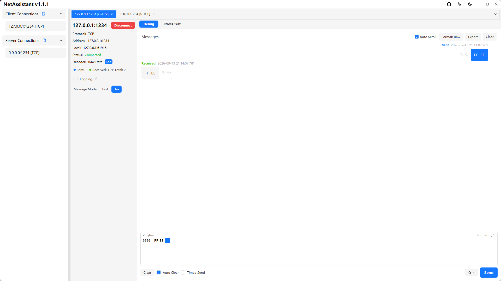
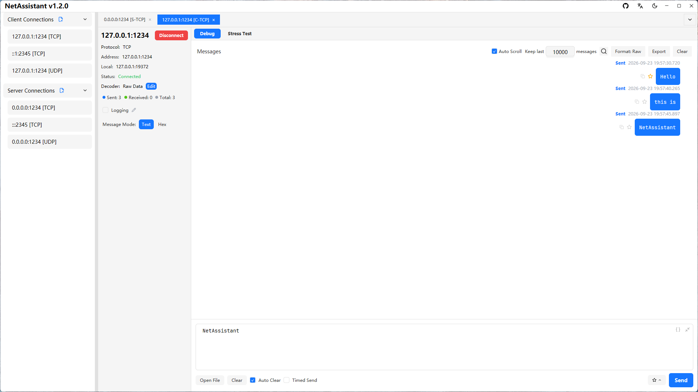

# Hex Send: Control Every Byte You Put on the Wire

Text mode is fine for JSON, AT commands and logs, but binary protocols do not understand strings. Frame headers like `AA 55`, register addresses like `0x00 0x0A` and terminators like `0D 0A` must go out as bytes. NetAssistant's **hex mode** sends raw bytes—it does not send the characters "AA 55" as text.

> [Download NetAssistant](/en/download) · [TCP debug tool](/en/tcp-debug-tool) · [All features](/en/features)

## Who it is for

- **Binary protocol integration**: custom headers, lengths, command bytes and checksums
- **Device commands**: frames containing `0x00` or non-printable data
- **Protocol replay**: paste a frame from a capture or manual and resend it unchanged
- **Checksum checks**: compute a CRC before sending and compare it with the response

## Text vs hex mode

| Mode | What `41 42` sends | Best for |
| ---- | ---- | ---- |
| Text | UTF-8 bytes for `4`, `1`, space, `4`, `2` | JSON, AT commands, readable logs |
| Hex | The two bytes `0x41` `0x42` | Binary frames, fixed-length protocols, checksums |

The most common mistake is writing a frame in hex but forgetting to switch modes, so the peer receives an ASCII string. Check the mode before sending, and check the display format in the receive area.

## Conversion and escaping

- Switching the send area between text and hex converts the payload as UTF-8
- The message context menu offers **Convert to Hex / Convert to Text**, with the result in a window you can copy from
- The toolbox's Convert group has separate text → hex and hex → text blocks
- Non-printable bytes are escaped as `\xNN`, and round-tripping is byte-for-byte
- Six checksums can be applied to a selection or a whole message: XOR / Sum8 / LRC / CRC16-Modbus / CRC16-CCITT-FALSE / CRC32

## A complete send workflow

Take a custom frame `AA 55 | length | command | data | CRC16`:

1. Assemble the bytes without the checksum, e.g. `AA 55 04 01 00 02 03 04`
2. Paste them into the toolbox Checksum group and read the CRC16 result
3. Append the checksum in the byte order your protocol requires
4. Switch to hex mode, paste the full frame and send
5. Keep the receive area in hex display and compare the response byte by byte

Enable periodic send for repeated commands, or use reply rules to return a fixed frame when request bytes match.

## File source

For long frames exported from firmware or a packet capture, skip manual copy-paste: the file source loads a local file into the send area, supports UTF-8 / GBK / ANSI decoding with a preview, shows a readable file size and accepts up to **1 MiB** per file.

## FAQ

### What is the difference between text and hex send?

Text encodes input as UTF-8; hex interprets it as hexadecimal bytes and sends them verbatim.

### How do I convert between text and hex?

Switching modes converts the whole payload; the message menu and toolbox provide one-off conversions, byte-for-byte.

### How are non-printable bytes displayed?

They are escaped as `\xNN`, for example `0x00` becomes `\x00`.

### Can I send file content?

Yes. The file source supports UTF-8 / GBK / ANSI with a 1 MiB limit.

### Does it support hex send over serial?

No. Hex send/receive works over TCP/UDP/MQTT; NetAssistant has no serial support.

## Related pages

- [Modbus TCP debugging](/en/modbus-tcp)
- [TCP debug tool](/en/tcp-debug-tool)
- [TCP sticky packets](/en/tcp-sticky-packet)
- [Windows network debugging tool](/en/windows-network-debug-tool)
- [All features](/en/features)
- [Download NetAssistant](/en/download)
