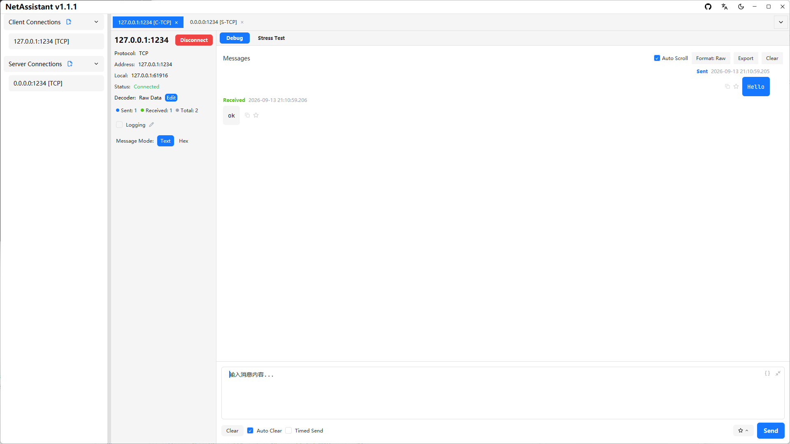
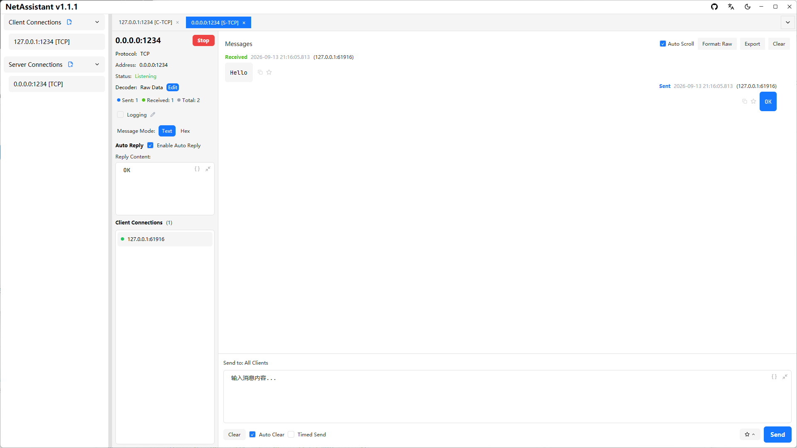
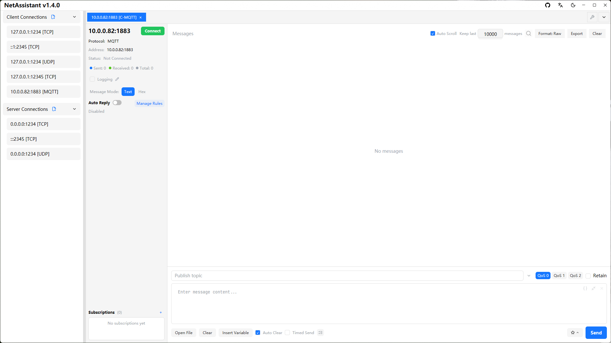
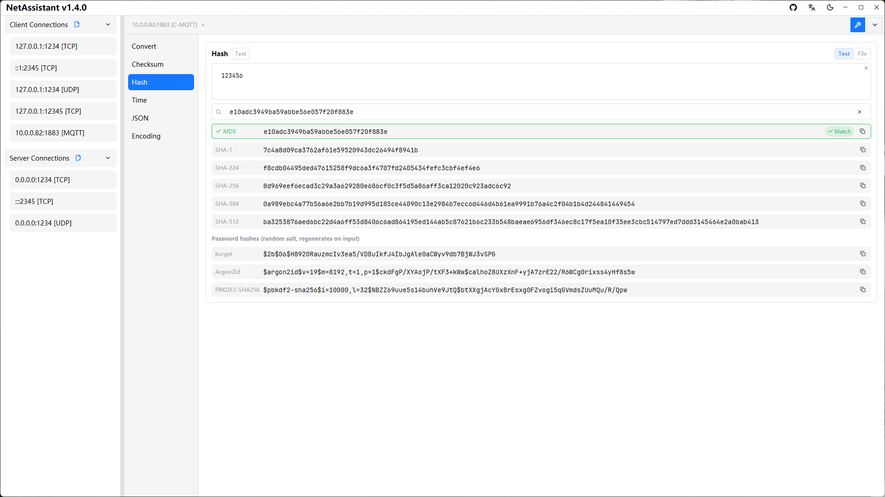
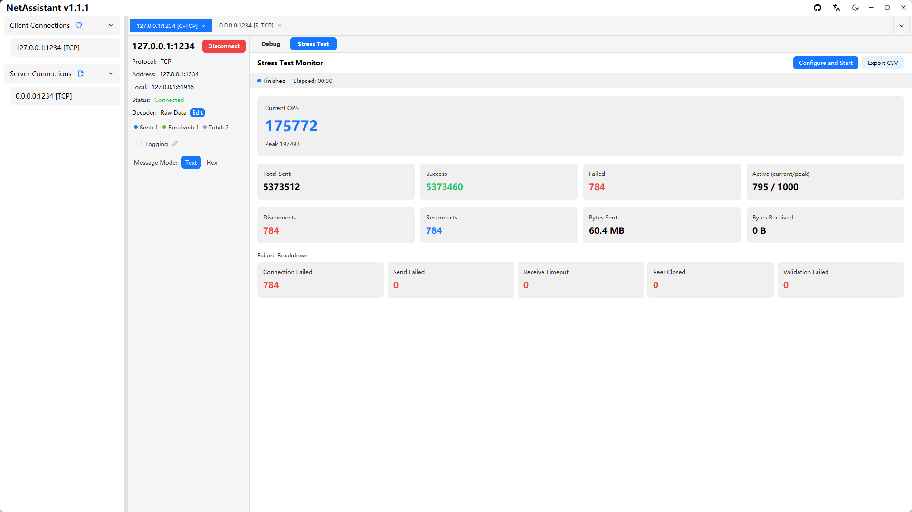
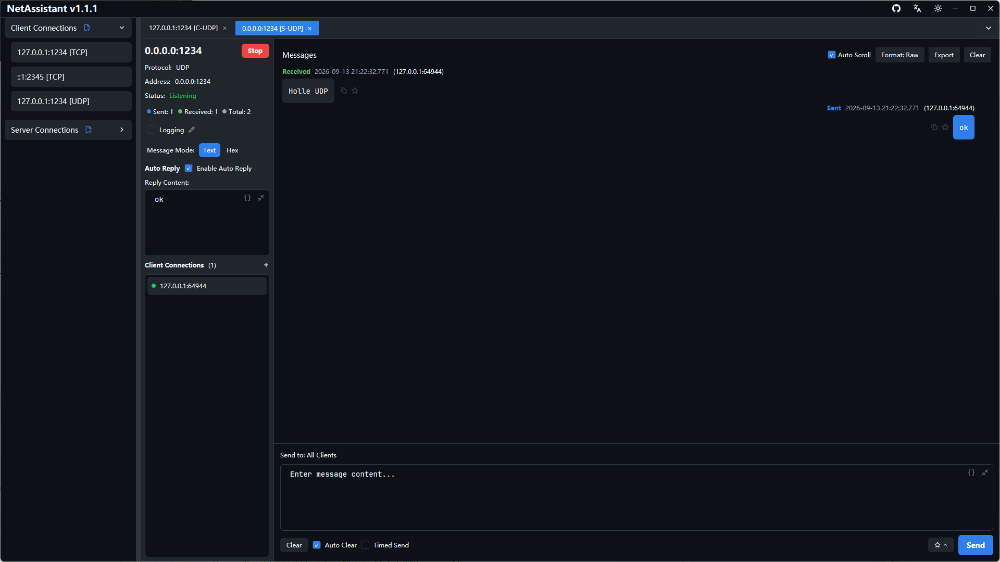

## Screenshots

### Client Mode

### Server Mode

### MQTT Client

### Built-in Toolbox

### Stress Testing

### Dark Mode

## Why NetAssistant

- **Blazing performance**: Rust + Tokio async runtime, startup < 100ms, memory footprint < 20MB, million-level concurrent connections
- **Built for debugging**: from network app development to hardware and embedded debugging, covering the entire communication verification workflow
- **Cross-platform**: full support for Windows, Linux and macOS, with native builds for both x64 and ARM64
- **Open source and free**: released under the Apache-2.0 License, contributions welcome

For more details, see [Features](/en/features); to get started, read the [Guide](/en/guide/). To see how it compares with NetAssist and similar tools, check the [Comparison](/en/comparison).

## Download by platform

- [Windows network debugging tool](/en/windows-network-debug-tool): one-command winget install, Windows 10/11 on x64 and ARM64
- [Mac network debugging tool](/en/mac-network-debug-tool): universal DMG for Apple Silicon and Intel
- [Linux network debugging tool](/en/linux-network-debug-tool): deb, AppImage and tar.gz for x86_64 and ARM64

## Popular guides

- [NetAssist alternative: comparison and migration](/en/compare/netassist)
- [TCP debug tool: send, receive and framing](/en/tcp-debug-tool)
- [UDP debug tool: connectionless send and multi-device replies](/en/udp-debug-tool)
- [Socket debug tool: port listening and reachability](/en/socket-debug-tool)
- [Hex send: HEX payloads and text conversion](/en/hex-send)
- [Modbus TCP debugging: frames and CRC16](/en/modbus-tcp)
- [TCP sticky packets: causes, four solutions and debugging](/en/tcp-sticky-packet)
- [MQTT client: a lightweight MQTT 3.1.1 debugging tool](/en/mqtt-client)
- [TCP/UDP stress testing: QPS and p99 latency](/en/tcp-stress-test)
- [UDP broadcast device discovery: LAN search and troubleshooting](/en/udp-broadcast-device-discovery)
