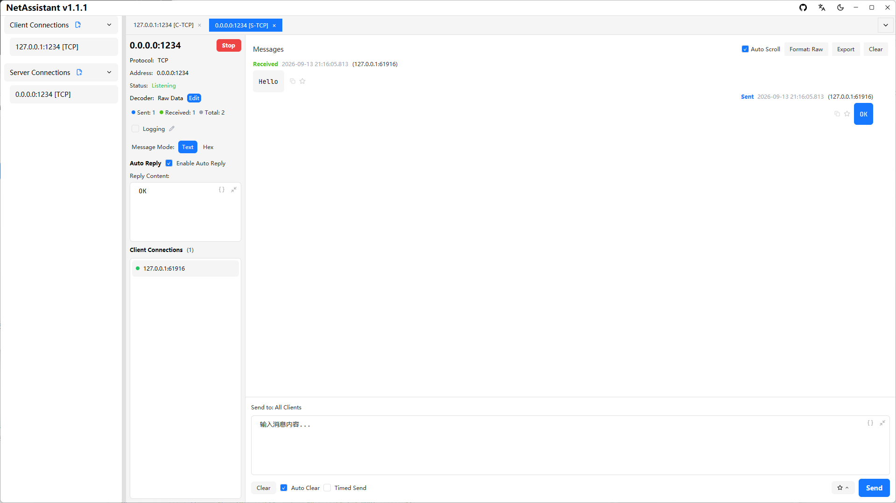

# Linux Network Debugging Tool: TCP/UDP Debugging and Stress Testing

Linux has plenty of network tools, but most of them are command-line utilities such as `nc`, `socat` and `tcpdump`: flexible, but without a clear view of the packet exchange, manual handling of TCP sticky packets and no built-in stress testing.

NetAssistant is a graphical Linux network debugging tool, free and open source, available as **deb, AppImage and tar.gz** for x86_64 and ARM64 (including Raspberry Pi). TCP/UDP client and server, four sticky-packet decoders, MQTT 3.1.1 debugging and high-concurrency stress testing live in one app.

> [Download for Linux](/en/download) · [All features](/en/features) · [Getting started](/en/guide/)



## Why Linux users choose NetAssistant

- **Graphical send/receive debugging**: see packet exchanges like a chat instead of assembling `nc` arguments
- **Receive-side decoders**: raw, line-delimited, length-prefix and JSON decoders split messages by protocol boundary
- **Built-in stress testing**: QPS and p50/p95/p99 latency without deploying a separate load generator
- **Consistent across platforms**: the same workflow on Windows, macOS and Linux, with saved configurations
- **ARM64 support**: native aarch64 builds for Raspberry Pi 5, ARM servers and similar devices

## Install on Linux

### Recommended: deb package (Debian / Ubuntu and derivatives)

1. Download `netassistant-linux-x86_64.deb` from the [download page](/en/download)
2. Install it and let apt resolve dependencies:

```bash
sudo apt install ./netassistant-linux-x86_64.deb
```

3. Launch it from the application menu or run `netassistant` in a terminal

### AppImage (portable, for Fedora / Arch and others)

```bash
chmod +x netassistant-linux-x86_64.AppImage
./netassistant-linux-x86_64.AppImage
```

If it reports a FUSE error on first run:

```bash
sudo apt install libfuse2
```

### tar.gz (lightweight)

```bash
tar -xzf netassistant-linux-x86_64.tar.gz
chmod +x netassistant
./netassistant
```

The bare binary requires GTK3. If it reports a missing `libgtk-3.so.0`:

```bash
sudo apt install libgtk-3-0
```

### ARM64 / Raspberry Pi

Replace `x86_64` with `aarch64` in the filename, for example `netassistant-linux-aarch64.deb`, `netassistant-linux-aarch64.AppImage` or `netassistant-linux-aarch64.tar.gz`. The ARM64 build is an automated artifact that has not been fully tested on physical devices.

## Core features

### TCP/UDP client and server

Create TCP client, TCP server, UDP client and UDP server connections with IPv4/IPv6, multi-tab debugging and local address/port binding.

### TCP sticky packets and four decoders

TCP sticky packets are one of the most common issues when debugging Linux servers. NetAssistant provides raw, line-delimited, length-prefix and JSON decoders on the receive side.


### Built-in stress testing

Evaluate concurrency, latency distribution and stability: Ping-Pong and throughput modes, real-time QPS, p50/p95/p99, failure breakdown and CSV export. See the [stress testing guide](/en/guide/stress).

### MQTT debugging

An MQTT 3.1.1 client with subscription management, QoS 0/1/2, retain, last-will messages and auto-reply.

### Built-in toolbox

Convert, checksum, hash, time, JSON and encoding tools in a permanent tab, including hex/text conversion, CRC16/CRC32, MD5/SHA, timestamp conversion and Base64/URL encoding.

## NetAssistant vs command-line tools

| Dimension | NetAssistant | nc / socat | Wireshark / tshark |
| ---- | ---- | ---- | ---- |
| Form | Graphical app | Command line | Packet capture and analysis |
| Packet exchange view | Chat-style log with search, favorites and export | Manual output handling | Per-packet view |
| TCP sticky-packet decoders | Raw / line / length-prefix / JSON | Custom parsing required | Partial stream reassembly |
| Built-in stress testing | QPS + p50/p95/p99 | No | No |
| Scripting | No | Strong | Strong (tshark) |
| Best for | GUI debugging and protocol validation | Scripts, pipes and servers | Capture-based troubleshooting |

`nc` and `socat` are better for scripting and headless environments; Wireshark is better for packet capture. NetAssistant fills the gap for **graphical send/receive, sticky-packet decoding and live load metrics**.

## Typical use cases

- **Embedded Linux / Raspberry Pi**: debug TCP/UDP directly on the device and verify sensor or control commands
- **Server debugging**: act as a client or server to validate protocol formats and error handling
- **IoT device discovery**: send a UDP broadcast discovery command and highlight replies from unexpected addresses
- **Teaching and labs**: run network programming labs on a Linux desktop without a Windows VM

## System requirements

| Item | Requirement |
| ---- | ---- |
| OS | Ubuntu 22.04 or later, or another mainstream distribution |
| Architecture | x86_64 or ARM64 (aarch64) |
| Graphics | GTK3 required; a Vulkan-compatible GPU is recommended |
| Installation | deb, AppImage or tar.gz |
| License | Apache-2.0, free to use |

## FAQ

### How do I install NetAssistant on Linux?

On Debian or Ubuntu, download the deb package and run `sudo apt install ./netassistant-linux-x86_64.deb`. Other distributions can use the AppImage or tar.gz package. See the [download page](/en/download).

### How do I fix the AppImage FUSE error?

Install `libfuse2` with `sudo apt install libfuse2`, then run the AppImage again.

### What if libgtk-3.so.0 is missing?

Install GTK3 with `sudo apt install libgtk-3-0`. The bare binary and tar.gz packages require it.

### Does the Linux build support ARM64 and Raspberry Pi?

Yes. aarch64 deb, AppImage and tar.gz packages are available.

### Does NetAssistant have a CLI?

No, it is a graphical application. For scripted tests, use `nc`, `socat` or `iperf`; NetAssistant is for GUI debugging, sticky-packet decoding and live metrics.

## Related pages

- [Windows network debugging tool](/en/windows-network-debug-tool)
- [Mac network debugging tool](/en/mac-network-debug-tool)
- [TCP/UDP debugging guide](/en/guide/tcp-udp)
- [Download NetAssistant](/en/download)
