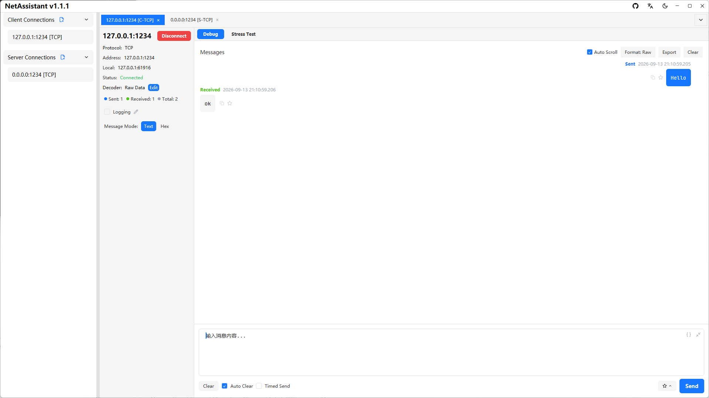
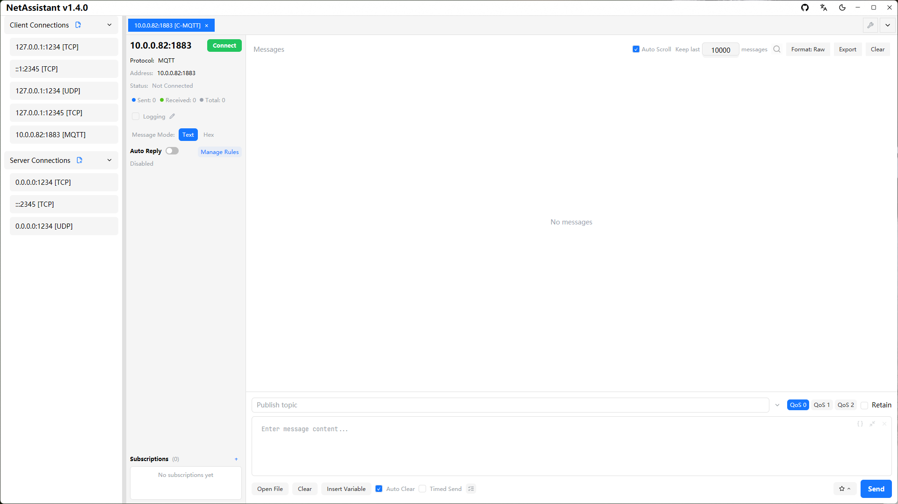

# Mac Network Debugging Tool: TCP/UDP Debugging on macOS

Developers who move from Windows to Mac often run into the same problem: **NetAssist is Windows-only**, and there are not many Mac tools that combine a TCP/UDP client, server, sticky-packet handling and stress testing in one place.

NetAssistant is a native macOS network debugging tool for Apple Silicon and Intel. It is free and open source, and brings TCP/UDP client and server, four TCP decoders, MQTT 3.1.1 debugging, hex send/receive and high-concurrency stress testing into one app.

> [Download for macOS](/en/download) · [All features](/en/features) · [Getting started](/en/guide/)

## Why Mac users choose NetAssistant

- **NetAssist has no Mac version**: continue with a familiar debugging workflow on macOS
- **Native build**: Rust + GPUI, not an Electron wrapper, with fast startup and low memory usage
- **Apple Silicon support**: a universal DMG runs on M1/M2/M3 and Intel Macs
- **Complete feature set**: TCP/UDP client and server, decoders, MQTT, toolbox and stress testing
- **Consistent experience**: dark mode follows the system, multi-tab connections and saved configurations

## Install on macOS

### Recommended: universal DMG

1. Download `netassistant-macos-universal.dmg` from the [download page](/en/download)
2. Open the DMG and drag NetAssistant into Applications
3. If macOS says the developer cannot be verified, right-click NetAssistant and choose Open, or allow it in System Settings > Privacy & Security

This is the normal prompt for an app that is not notarized. It does not mean the app is damaged, and you do not need to disable Gatekeeper.

### Alternative: zip

Download `netassistant-macos-universal.zip` and extract it. Executable permissions are preserved.

## Core features

### TCP/UDP client and server

Create TCP client, TCP server, UDP client and UDP server connections on macOS, with IPv4/IPv6, multi-tab debugging and local address/port binding.

### TCP sticky packets and four decoders

The receiver supports raw, line-delimited, length-prefix and JSON decoders, splitting messages by protocol boundary. Both send and receive support text and hex modes.

### Built-in stress testing

Test your own server without installing another tool: real-time QPS, p50/p95/p99 latency, failure breakdown and CSV export. See the [stress testing guide](/en/guide/stress).

### MQTT debugging

An MQTT 3.1.1 client with subscription management, QoS 0/1/2, retain, last-will messages and auto-reply.

### Built-in toolbox

Convert, checksum, hash, time, JSON and encoding tools in a permanent tab, so you do not have to switch between the browser and editor while debugging.

## NetAssistant vs other Mac tools

| Dimension | NetAssistant | Packet Sender | Wireshark |
| ---- | ---- | ---- | ---- |
| Focus | TCP/UDP send/receive debugging | Multi-protocol send/receive | Packet capture and analysis |
| Client/server | TCP and UDP | Yes | Not for interactive send/receive |
| Receive-side decoders | Raw / line / length-prefix / JSON | No | Partial stream reassembly |
| Built-in stress testing | QPS + latency percentiles | Basic | No |
| Scripting/CLI | No | Yes | tshark |
| License | Apache-2.0 | Open source | GPL |

Packet Sender covers more protocols, including SSL/DTLS, HTTP and CLI automation. Wireshark is the tool for packet capture. NetAssistant is built for **quick TCP/UDP send/receive, sticky-packet handling and stress testing on a Mac**.

## Typical use cases

- **Embedded and IoT**: UDP broadcast discovery, hex send/receive and highlighting replies from unexpected addresses
- **Backend verification**: act as a TCP/UDP client or server to validate communication logic
- **Learning and teaching**: run TCP/UDP labs on a Mac without a Windows virtual machine
- **Cross-platform work**: keep the same workflow on Windows, Linux and macOS

## System requirements

| Item | Requirement |
| ---- | ---- |
| OS | macOS 10.15 or later |
| Architecture | Apple Silicon and Intel (universal) |
| Installation | Universal DMG or zip |
| License | Apache-2.0, free to use |

## FAQ

### Is there a Mac version of NetAssist?

NetAssist is Windows-only. NetAssistant is a native macOS network debugging tool that can replace it for TCP/UDP debugging.

### Does NetAssistant support Apple Silicon?

Yes. The universal DMG runs on Apple Silicon and Intel Macs with macOS 10.15 or later.

### How do I open an app that macOS cannot verify?

Right-click NetAssistant and choose Open, or allow it in System Settings > Privacy & Security. This is normal for an app that is not notarized.

### How is NetAssistant different from Packet Sender?

Packet Sender covers more protocols, including SSL/DTLS, HTTP and CLI automation. NetAssistant focuses on TCP/UDP debugging with sticky-packet decoders and stress testing. See the [comparison](/en/comparison) or the [NetAssist alternative guide](/en/compare/netassist).

### Does it support MQTT?

Yes, MQTT 3.1.1 with subscriptions, QoS 0/1/2, retain and last-will messages. MQTT 5.0, TLS and MQTT over WebSocket are not supported yet.

## Related pages

- [Windows network debugging tool](/en/windows-network-debug-tool)
- [Linux network debugging tool](/en/linux-network-debug-tool)
- [TCP/UDP debugging guide](/en/guide/tcp-udp)
- [Download NetAssistant](/en/download)
