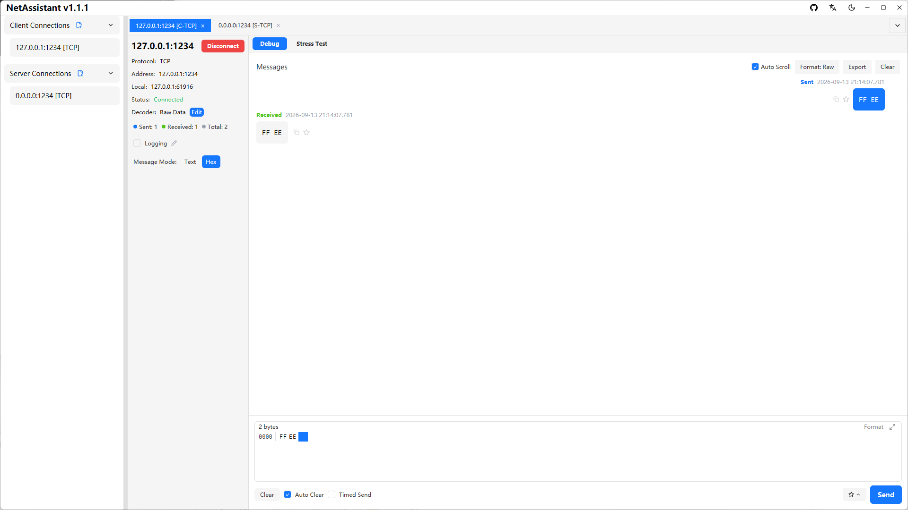
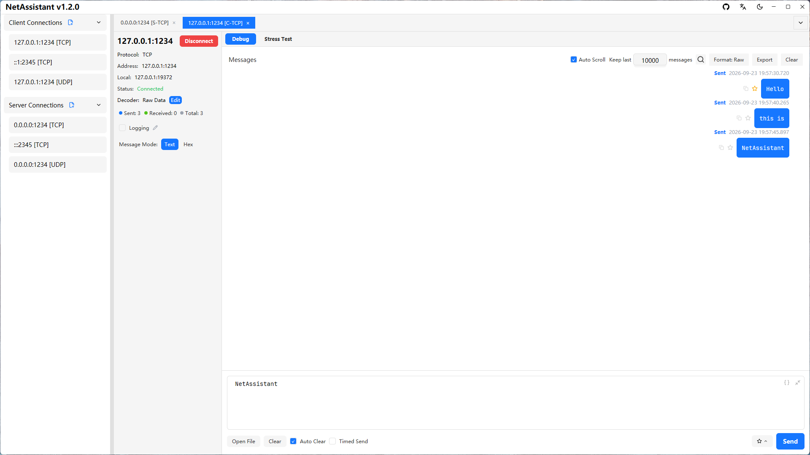

# Modbus TCP Debugging: Talk in Hex Frames

First, the boundary: **NetAssistant is not a Modbus protocol client**. It does not understand function codes, register addresses or data models, and it ships no point table. It provides a TCP connection and hex send/receive—you build the bytes to the Modbus specification, and the tool sends them verbatim and shows the response. For integration work where every byte matters, that is often more direct.

> [Download NetAssistant](/en/download) · [TCP debug tool](/en/tcp-debug-tool) · [All features](/en/features)



## Who it is for

- **PLC and gateway integration**: check that port 502 responds and that frames are structured correctly
- **Protocol development**: compare requests and responses byte by byte, including MBAP length and unit ID
- **Fault reproduction**: replay a single frame to decide whether the problem is the frame or the application
- **Quick checks**: avoid installing a full Modbus master for one debugging session

## Modbus TCP frame layout

A Modbus TCP frame is an MBAP header followed by a PDU:

| Field | Length | Meaning |
| ---- | ---- | ---- |
| Transaction ID | 2 bytes | Pairs request and response; a counter works well |
| Protocol ID | 2 bytes | Always `00 00` for Modbus |
| Length | 2 bytes | Number of following bytes (unit ID + PDU) |
| Unit ID | 1 byte | Slave address, often used behind gateways |
| Function code | 1 byte | e.g. 03 read holding registers, 06 write single register |
| Data | N bytes | Start address, quantity or value |

Note: **Modbus TCP has no CRC**. Integrity comes from TCP and the MBAP length field. `CRC16-Modbus` is a Modbus RTU checksum and belongs at the end of an RTU frame only.

## Example: read holding registers

Read 10 holding registers starting at address 0 from unit 1:

```text
00 01 00 00 00 06 01 03 00 00 00 0A
```

- `00 01`: transaction ID
- `00 00`: protocol ID
- `00 06`: length = unit ID (1) + function code (1) + data (4)
- `01`: unit ID
- `03`: read holding registers
- `00 00`: start address
- `00 0A`: quantity, 10 registers

A normal response might be:

```text
00 01 00 00 00 05 01 03 02 00 64
```

`00 64` is 100 in decimal. If the function code becomes `83`, the slave returned an exception; consult the device manual for illegal address, illegal quantity or permission issues.

## How to do it in NetAssistant

1. Create a TCP client and connect to the device on port 502
2. Switch the send area to hex mode and paste the complete frame
3. Send and inspect the response; keep hex display on for byte-level comparison
4. For polling, enable periodic send and set the interval to your sampling period
5. To simulate a slave, create a TCP server on port 502 and use reply rules to return a fixed hex response when request bytes match



## Where CRC16-Modbus fits

Modbus RTU frames over serial end with a 2-byte CRC, low byte first. The toolbox's Checksum group provides `CRC16-Modbus`: paste the hex bytes without the CRC to get the value. Since NetAssistant has no serial support, this is mainly useful to:

- Verify an RTU frame captured in a trace or documented in a manual
- Prepare RTU bytes for a gateway or protocol converter

Modbus TCP frames neither need nor carry this checksum.

## FAQ

### Is NetAssistant a Modbus protocol client?

No. It provides TCP connectivity and hex send/receive; you construct function codes and data yourself.

### Does Modbus TCP need a CRC?

No. MBAP includes a length field and TCP guarantees integrity; CRC16-Modbus is for RTU frames.

### How do I build a request?

Concatenate transaction ID + 0000 + length + unit ID + function code + data, then send it in hex mode.

### Can it simulate a Modbus slave?

At the byte level: listen on 502 with a TCP server and return canned hex through reply rules. Register models and exception codes need a real device or a dedicated simulator.

### Why is the device not responding?

Check that the port is 502, the unit ID is correct, the length field matches the actual byte count, and whether the device expects RTU over TCP framing.

## Related pages

- [Hex send](/en/hex-send)
- [TCP debug tool](/en/tcp-debug-tool)
- [TCP sticky packets](/en/tcp-sticky-packet)
- [Windows network debugging tool](/en/windows-network-debug-tool)
- [All features](/en/features)
- [Download NetAssistant](/en/download)
