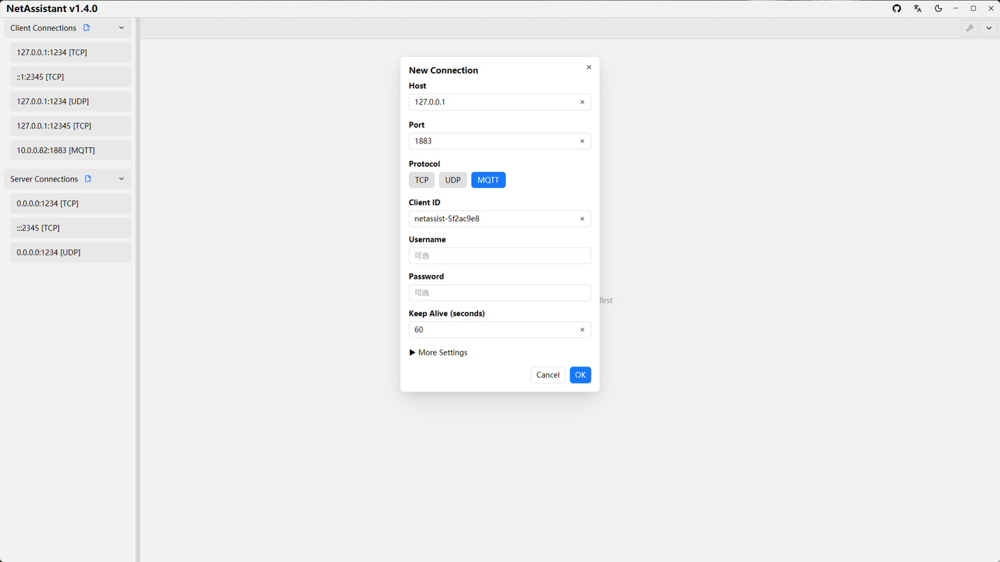
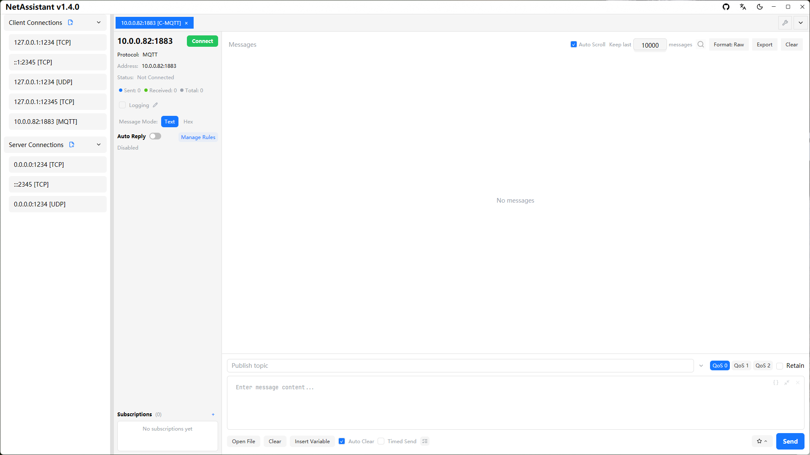

# Lightweight MQTT Client: Subscribe, Publish and Debug

If you only need to connect to a broker occasionally to check whether a device is publishing, whether the topic is right or whether QoS is working, installing an Electron client is overkill. NetAssistant includes an **MQTT 3.1.1 client** in the same app as its TCP/UDP tools, built with Rust and using about 20MB of memory.

To be clear: it is built for basic MQTT debugging, **not a full MQTTX replacement**. MQTT 5.0, TLS, WebSocket and scripting are not supported yet.

> [Download NetAssistant](/en/download) · [Detailed MQTTX comparison](/en/comparison-mqttx) · [All features](/en/features)

## Who it is for

- **IoT and embedded developers**: verify device reporting, platform commands and topic design
- **Backend developers**: connect to a broker quickly and confirm the subscription path
- **Developers who want fewer apps**: keep TCP/UDP and MQTT debugging in one tool
- **Low-memory environments**: avoid a several-hundred-MB client for occasional MQTT checks

**Not ideal for**: MQTT 5.0 properties, mutual TLS, WebSocket, scripting or large-scale connection management. Use MQTTX, EMQX or another dedicated client for those.

## Core features

### Connection settings

Create an MQTT connection with broker address and port (default 1883), client ID, username/password and keep-alive. Additional settings cover clean session and last-will messages (topic / payload / QoS / retain).

### Subscription management

Add, edit or remove subscriptions at runtime without reconnecting. Subscriptions are isolated per connection and restored automatically after reconnect. The list fills the sidebar and scrolls when needed; hover to see the full topic, double-click to copy it.

### Publishing

Set topic, QoS (0/1/2) and retain; payload supports text and hex modes. The topic dropdown reuses recent topics for the current connection, including QoS and retain, with up to 20 entries per connection.

### Message view and management

Each message shows a topic tag, with a marker for retained messages. Double-click a topic tag to copy the raw topic. The existing message log, search, export, JSON formatting and reply rules all work in MQTT mode.

### Auto-reply and periodic send

Auto-reply publishes the response back to the topic that received the message. Periodic send also uses the current publish topic, which is handy for heartbeats or simulated platform commands.

## Quick start

1. Create a connection and choose **MQTT**
2. Enter broker address, port, client ID and credentials
3. After connecting, add a subscription such as `device/+/status`
4. Fill in topic, QoS, retain and payload, then publish
5. Inspect incoming messages; use search or export when debugging

## NetAssistant vs MQTTX

| Dimension | NetAssistant | MQTTX |
| ---- | ---- | ---- |
| Stack | Rust + GPUI native | Electron + Vue |
| Memory | About 20MB | Several hundred MB |
| MQTT version | MQTT 3.1.1 | MQTT 3.1.1 / 5.0 |
| TLS / WebSocket | Not yet | Yes |
| Scripting | No | Yes |
| Connection management | Basic multi-connection | More advanced |
| TCP/UDP debugging integration | Same app | Separate app |
| Price | Free and open source | Free |

Bottom line: **choose NetAssistant for basic MQTT 3.1.1 debugging, and MQTTX for the full MQTT ecosystem**. See the [MQTTX comparison](/en/comparison-mqttx) for details.

## FAQ

### Does NetAssistant support MQTT 5.0?

Not yet. It implements MQTT 3.1.1 for basic subscribe, publish and device debugging.

### Does it support TLS or WebSocket?

Not yet. It connects to the broker over plain TCP only.

### Can it replace MQTTX?

It covers basic subscribe, publish and lightweight debugging. For MQTT 5.0, TLS, scripting or large-scale connection management, MQTTX is better.

### Does it support QoS 2 and retain?

Yes. Publishing supports QoS 0/1/2 and retain; subscriptions are managed at runtime and restored after reconnect.

### Is it free?

Yes. NetAssistant is open source under Apache-2.0 and all features are available.

## Related pages

- [MQTTX comparison](/en/comparison-mqttx)
- [TCP/UDP stress testing](/en/tcp-stress-test)
- [All features](/en/features)
- [Download NetAssistant](/en/download)
