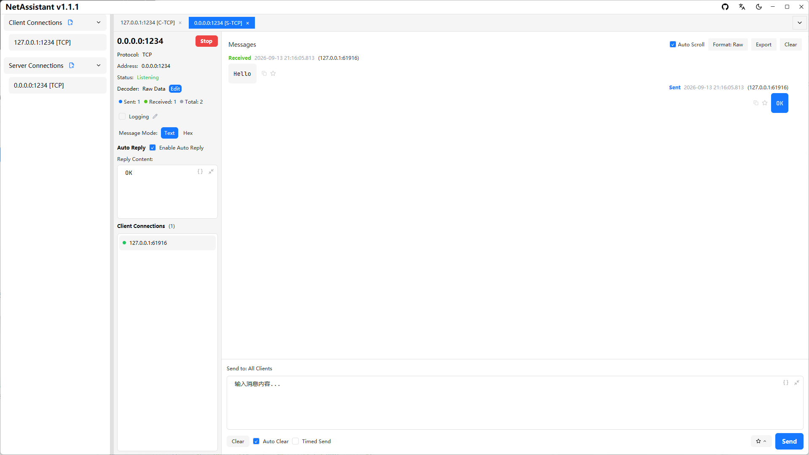
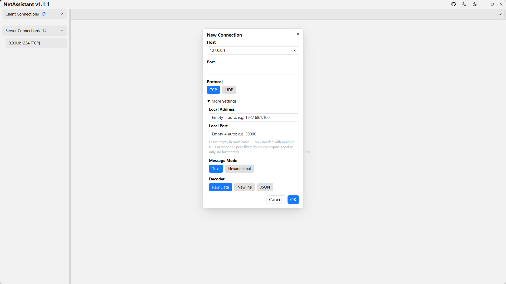

# Socket Debug Tool: From Port to Raw Bytes

Socket debugging means working directly with TCP/UDP endpoints: connect to a port or listen on one yourself, then check whether the connection is established and whether bytes flow. NetAssistant provides exactly that—TCP/UDP client and server, local address binding, IPv4/IPv6 and hex payloads.

> [Download NetAssistant](/en/download) · [TCP/UDP debugging guide](/en/guide/tcp-udp) · [All features](/en/features)

## Who it is for

- **Reachability checks**: confirm a service is listening and a firewall allows it
- **Client/server simulation**: validate the path before real devices or services exist
- **Multi-NIC hosts**: bind a local address and verify the source IP used
- **Protocol integration**: exchange raw bytes without framework noise

## What the tool covers

| Capability | Description |
| ---- | ---- |
| TCP client | Connect to `ip:port` and verify handshake and traffic |
| TCP server | Listen on a local port and manage multiple connections |
| UDP client | Send datagrams to a target without connecting |
| UDP server | Listen locally and show the source address of each datagram |
| Local bind | Choose the source or listening address for multi-NIC hosts |
| IPv4 / IPv6 | Both address families are supported |

## Common troubleshooting flows

### The port will not connect

1. Connect with a TCP client to the target `ip:port`
2. Connection refused: the host is reachable but nothing is listening
3. Timeout: more likely a firewall drop, routing issue or wrong address
4. Start a local TCP server on the same port to rule out the tool itself

### Listening fails

- Another process already owns the port; test with a high port
- Ports below 1024 need elevated privileges on some systems
- The bound address does not belong to a local interface
- Security software blocks the listen operation

### Data arrives but is unreadable

Switch to hex mode to inspect raw bytes. For inbound pushes, remember that TCP is a byte stream and may need [framing decoders](/en/tcp-sticky-packet).

## Not a serial port tool

A socket debug tool works with network endpoints; a serial assistant works with COM ports, baud rates and serial frames. They solve problems at different layers. NetAssistant does **not** debug serial ports or Unix domain sockets. For RS-232/RS-485, AT commands over serial or local inter-process sockets, use a serial tool or the operating system utilities.

## Quick start

1. Create a connection and choose TCP or UDP, client or server
2. Enter the target address and port, or the listening port
3. On multi-NIC hosts, optionally bind a local address
4. After connecting or listening, type a payload and choose text or hex
5. Watch messages and connection state, and export the log if needed

## FAQ

### What is a socket debug tool for?

Working directly with TCP/UDP endpoints to connect, listen, exchange raw bytes and inspect connection state.

### Can it debug serial ports or Unix domain sockets?

No. Only TCP/UDP/MQTT network connections are supported.

### What if listening on a port fails?

Check port ownership, privileges, bound address and firewall rules; a high port rules out permissions quickly.

### Can it test whether a port is reachable?

Yes. A successful TCP connection means the port is reachable; refused usually means no listener, timeout suggests a firewall or route issue.

## Related pages

- [TCP debug tool](/en/tcp-debug-tool)
- [UDP debug tool](/en/udp-debug-tool)
- [TCP sticky packets](/en/tcp-sticky-packet)
- [Windows network debugging tool](/en/windows-network-debug-tool)
- [All features](/en/features)
- [Download NetAssistant](/en/download)
