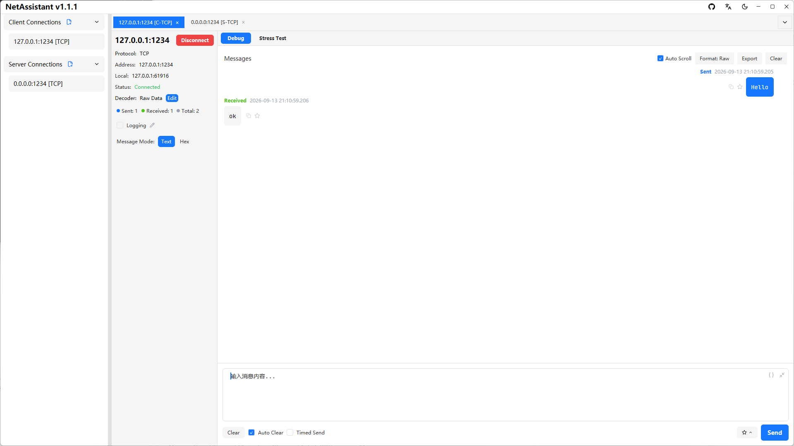
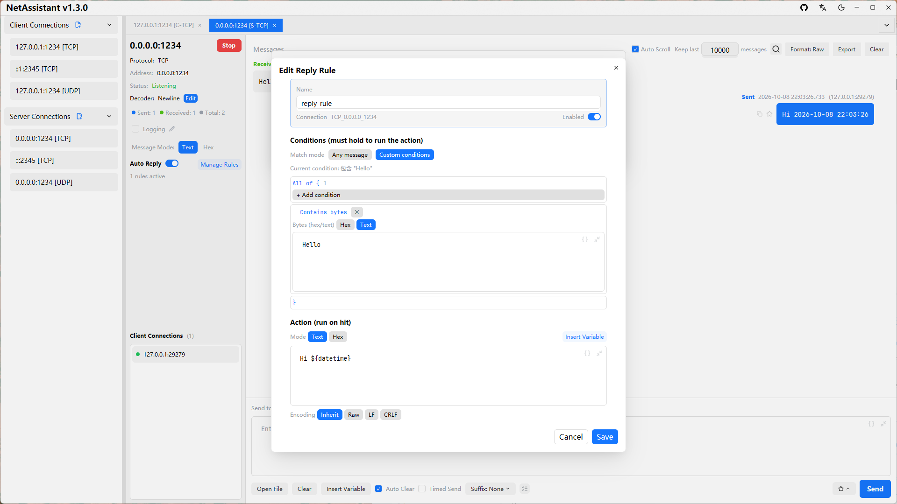

# TCP Debug Tool: Connect, Frame and Respond

TCP debugging usually gets stuck in three places: the port will not connect, the received bytes look glued together, or a request gets no reply. NetAssistant puts all three in one window: client and server connections, four decoders, reply rules and periodic send.

> [Download NetAssistant](/en/download) · [TCP/UDP debugging guide](/en/guide/tcp-udp) · [All features](/en/features)

## Who it is for

- **Embedded and IoT developers**: debug TCP devices, gateways and DTUs
- **Backend developers**: send a raw request to an in-house service without writing a throwaway script
- **Protocol integrators**: inspect frames byte by byte in hex
- **Anyone simulating a server**: listen on a local port and wait for devices to connect

## Three connection modes

| Mode | Purpose | Typical use |
| ---- | ---- | ---- |
| TCP client | Connect to a remote address and port | Devices, service endpoints |
| TCP server | Listen on a local port and accept connections | Simulate a platform or device service |
| Local bind | Choose the source address or NIC | Multi-NIC hosts, source IP checks |

Both IPv4 and IPv6 are supported. Server mode keeps multiple client connections, each with its own send and receive view.

## Fixing sticky packets: four decoders

TCP does not preserve message boundaries. The decoder decides when a message is complete.

| Decoder | Boundary rule | Good for |
| ---- | ---- | ---- |
| Raw | Show whatever arrives | Custom binary protocols, raw inspection |
| Line | Split on newline characters | Text protocols, AT commands, log streams |
| Length prefix | Read a length field, then that many bytes | Binary protocols, TLV, custom frames |
| JSON | Split on complete JSON objects | JSON line protocols, RPC debugging |

Picking the wrong decoder is the most common reason messages look stuck together. Decoders only affect display and splitting; they do not change the bytes sent. See [TCP sticky packets](/en/tcp-sticky-packet) for causes and troubleshooting.

## Sending and automatic replies

- **Text / hex modes**: text is sent as UTF-8; hex sends raw bytes, which matters for frames containing `0x00` or non-printable data
- **Line ending**: inherit, none, LF or CRLF, so you do not have to append newlines by hand
- **Periodic send**: repeat at a fixed interval for heartbeats or simulated device reports
- **Reply rules**: match incoming messages by bytes, JSON, regex or checksum and reply automatically to emulate a server
- **File source**: load a payload from a local file with UTF-8 / GBK / ANSI decoding, up to 1 MiB

## Quick start

1. Create a connection and choose TCP client or server
2. Enter the target address and port, or the local listening port
3. After connecting, pick the decoder that matches your protocol
4. Type a payload and choose text or hex mode
5. Add a reply rule for automatic responses, or enable periodic send
6. Use search to find a message or export the log as TXT / JSON / CSV

## When to stress test

Once functional checks pass, use the built-in [TCP/UDP stress testing](/en/tcp-stress-test) to measure QPS and p99 latency instead of installing JMeter or wrk.

## FAQ

### What problems does a TCP debug tool solve?

Reachability, correct message framing and quick response validation—the core of most TCP integration work.

### Why does received data arrive glued together?

TCP is a byte stream with no message boundaries. Define boundaries with newlines, length prefixes or JSON and select the matching decoder.

### Can it act as both client and server?

Yes, both modes are supported, and server mode can manage multiple client connections.

### Does it support IPv6?

Yes, both client and server modes work with IPv4 and IPv6.

### Does it support serial ports or Unix sockets?

No. NetAssistant handles TCP/UDP/MQTT network connections only and is not a serial port tool.

## Related pages

- [TCP sticky packets](/en/tcp-sticky-packet)
- [TCP/UDP stress testing](/en/tcp-stress-test)
- [Socket debug tool](/en/socket-debug-tool)
- [UDP debug tool](/en/udp-debug-tool)
- [Windows network debugging tool](/en/windows-network-debug-tool)
- [All features](/en/features)
