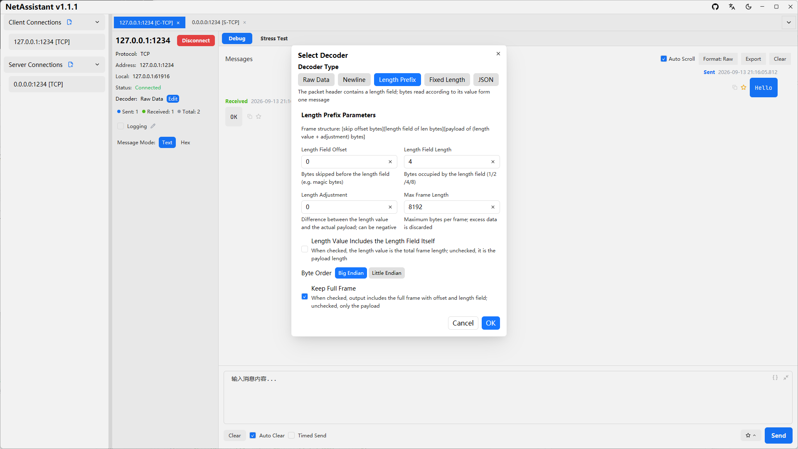

# TCP Sticky Packets: Causes, Four Solutions and Debugging

**Short answer**: TCP is a byte stream and does not preserve message boundaries. Sticky packets are not a TCP bug; they happen when the application has not defined where a message starts and ends. The fix is application-layer framing: fixed length, delimiter, length prefix or a self-describing format.

## What sticky and split packets look like

Suppose a client sends three messages:

```text
Message A: hello
Message B: world
Message C: netassistant
```

A receiver calling `recv` may see:

| Case | Content returned by one recv | Symptom |
| ---- | ---- | ---- |
| Normal | `hello`, `world`, `netassistant` in three reads | Expected |
| Sticky | `helloworldnetassistant` in one read | Multiple messages merged |
| Split | `hel`, then `loworld` | One message split |
| Mixed | `hellowor`, then `ldnetassistant` | Both at once |

Sticky and split packets are the same problem: **the receiver cannot determine message boundaries from the byte stream alone**.

## Why it happens

- **TCP is a byte stream**: it guarantees ordered, reliable bytes, not the sender's `write` boundaries
- **Nagle's algorithm**: small writes may be coalesced before transmission
- **MSS/MTU limits**: large messages are segmented at the IP/TCP layer
- **Receive buffer**: the kernel may merge multiple arrivals, so one `recv` can return several messages
- **Back-to-back writes**: a loop of small `send` calls is a common trigger

The key point: disabling Nagle or sleeping between sends only reduces the probability. It does not guarantee one `send` maps to one `recv`.

## Four framing solutions

### 1. Fixed length

Every message has the same length, padded with spaces or zeros if needed.

- Pros: simplest and fastest to parse
- Cons: wastes bandwidth and is inflexible
- Best for: fixed-format binary commands and legacy industrial protocols

### 2. Delimiter

Use a special character or sequence as the end marker, such as `\n`, `\r\n`, `\0` or a custom delimiter.

- Pros: readable and easy to inspect
- Cons: content must escape the delimiter; not suitable for binary data
- Best for: AT commands, logs, JSON Lines and other text protocols

### 3. Length prefix

Prefix each message with a fixed-size length field. The receiver reads the length first, then exactly that many payload bytes.

```text
+----------+------------------+
| 4B length|   N bytes payload |
+----------+------------------+
```

- Pros: binary-friendly, efficient and unambiguous
- Cons: both sides must agree on byte order, field size and maximum frame length
- Best for: custom binary protocols, RPC, game protocols and IoT device protocols

### 4. Self-describing format

Use JSON, Protobuf or MessagePack so the parser can tell when a complete object ends. Note that JSON over TCP still needs framing, usually a newline or a length prefix.

- Pros: extensible and easy to evolve
- Cons: higher parsing cost; JSON is verbose
- Best for: configuration, business messages and debugging APIs

### Comparison

| Solution | Boundary | Pros | Cons | Typical use |
| ---- | ---- | ---- | ---- | ---- |
| Fixed length | Fixed byte count | Simplest, fastest | Inflexible, wasteful | Fixed commands |
| Delimiter | Special character | Readable | Escaping needed, not binary-safe | Text protocols, logs |
| Length prefix | Length field | Binary-friendly, efficient | Byte order and limits must be defined | Custom binary protocols |
| Self-describing | Structure itself | Extensible | Parsing cost and size | JSON/Protobuf messages |

## Code examples

### Length prefix: Python receiver

```python
import struct

MAX_FRAME = 1024 * 1024  # 1 MiB, prevents memory abuse

def recv_exact(sock, n):
    buf = b""
    while len(buf) < n:
        chunk = sock.recv(n - len(buf))
        if not chunk:
            raise ConnectionError("connection closed")
        buf += chunk
    return buf

def recv_frame(sock):
    header = recv_exact(sock, 4)
    (length,) = struct.unpack(">I", header)  # big-endian uint32
    if length > MAX_FRAME:
        raise ValueError(f"frame too large: {length}")
    return recv_exact(sock, length)
```

The sender writes `struct.pack(">I", len(payload)) + payload`.

### Delimiter: split on newline

```python
buffer = b""

while True:
    chunk = sock.recv(4096)
    if not chunk:
        break
    buffer += chunk
    while b"\n" in buffer:
        line, buffer = buffer.split(b"\n", 1)
        handle(line)  # process one complete line
```

Keep the unfinished tail in `buffer`; do not clear it after every `recv`.

## Debugging sticky packets with NetAssistant

NetAssistant provides four receive-side decoders, so you can compare raw bytes with framed messages:

1. Create a TCP client or server connection
2. Choose **Raw / Line-delimited / Length-prefix / JSON** as the decoder
3. Send test traffic and check whether the receive view splits messages correctly
4. Switch to hex mode to inspect length fields, delimiters and byte order
5. Use search, favorites and export to investigate long-running sessions



The length-prefix decoder needs the field size and byte order; the line decoder needs a delimiter; the JSON decoder frames complete JSON objects.

## Common misconceptions

- **"Sticky packets are a TCP bug"**: no. TCP provides a byte stream; framing belongs to the application
- **"A bigger receive buffer fixes it"**: buffer size changes timing, not message boundaries
- **"Sleep after every send"**: only lowers the probability, does not guarantee correctness
- **"UDP has sticky packets too"**: UDP is datagram-oriented and preserves message boundaries; it has loss, reordering and fragmentation issues instead
- **"HTTP has no problem, so TCP is fine"**: HTTP defines Content-Length, chunked encoding or frame lengths. That is exactly application-layer framing

## FAQ

### What is the difference between sticky and split packets?

Sticky packets merge multiple messages into one read; split packets divide one message across reads. Both mean the application has not defined message boundaries.

### Why does it work locally but fail in production?

Local tests often have small writes and large gaps, so one `send` tends to map to one `recv`. In production, Nagle, buffer coalescing, latency and concurrency change read boundaries.

### Should a length prefix be big-endian or little-endian?

Either works if both sides agree, but big-endian network byte order is the common convention. Use a 4-byte unsigned integer and enforce a maximum frame size.

### What delimiter should I use?

Choose a sequence that cannot appear in the payload. Text protocols commonly use `\n` or `\r\n`; if the payload can contain it, escape it or use a length prefix instead.

### Why does HTTP not have sticky packets?

HTTP defines message boundaries at the application layer with `Content-Length`, chunked encoding or length-prefixed frames.

### Does UDP have sticky packets?

No. UDP preserves message boundaries, but it can lose, reorder or duplicate datagrams and may fragment above the MTU.

## Related pages

- [TCP/UDP debugging guide](/en/guide/tcp-udp)
- [TCP debug tool](/en/tcp-debug-tool)
- [All features](/en/features)
- [NetAssist alternative comparison](/en/compare/netassist)
- [Download NetAssistant](/en/download)
