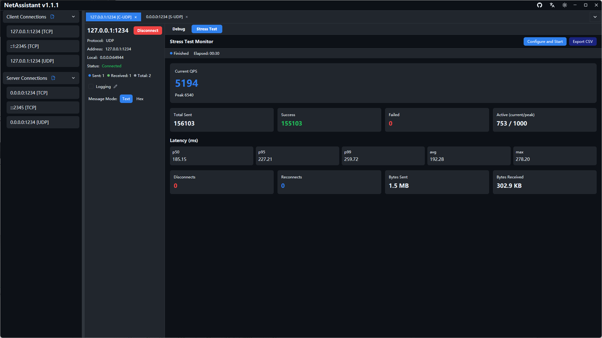
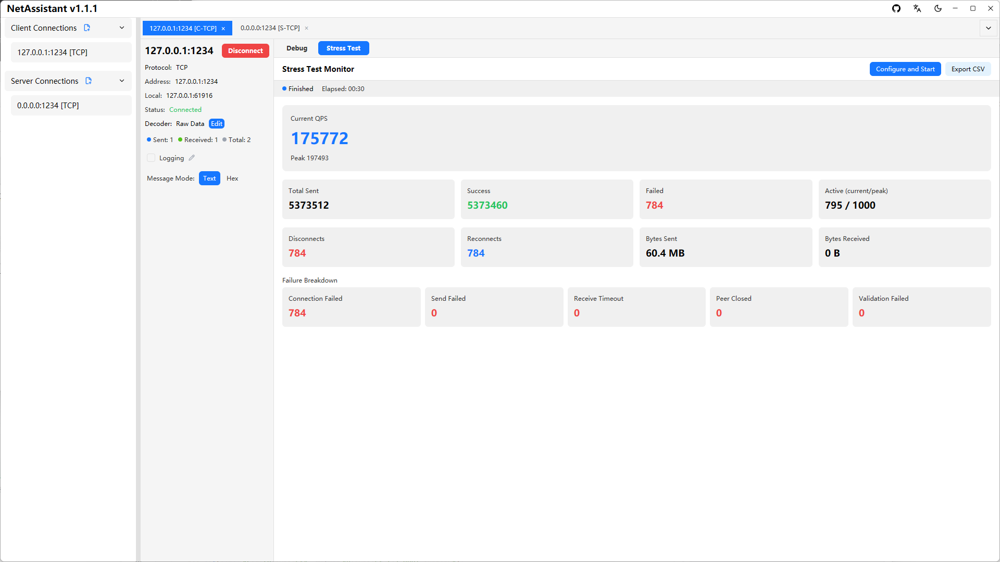

# TCP/UDP Stress Testing: QPS, p99 Latency and Failure Breakdown

You cannot judge whether a server handles concurrency by intuition. NetAssistant includes a built-in TCP/UDP stress engine: enter the target, concurrency and payload, and watch QPS, p50/p95/p99 latency and failure reasons without installing JMeter, wrk or writing a script.

The engine runs independently, uses a token bucket to control send rate, and supports Ping-Pong and throughput modes with short or long connections.

> [Download NetAssistant](/en/download) · [Stress testing guide](/en/guide/stress) · [All features](/en/features)

## When to use it

- **Your own TCP/UDP server**: validate throughput and latency under concurrency
- **Device concurrency**: simulate many clients connecting, sending heartbeats and reconnecting
- **Soak testing**: send traffic for a long time and watch failures, disconnects and resource usage
- **Before/after comparison**: compare QPS and p99 with the same configuration

## Two modes

| Mode | Behavior | Metrics | Best for |
| ---- | ---- | ---- | ---- |
| Ping-Pong | Send and wait for a response | RTT, p50/p95/p99, average/max latency | Request-response protocols and API performance |
| Throughput | Send without waiting | QPS, success rate, traffic | Maximum throughput and one-way push |

Connections can be **short-lived** (new connection per request) or **long-lived** (reuse connections). Short connections capture connection-setup cost; long connections are better for sustained throughput.

## Configuration steps

1. Open the **Stress** tab
2. Enter target address, port, concurrent clients, send rate and payload
3. Use payload templates so requests are not all identical
4. Optionally set a line ending (inherit / none / LF / CRLF)
5. Choose the stress mode and connection mode
6. Start the test; settings are saved and restored next time

## Payload templates

| Template | Meaning |
| ---- | ---- |
| `${seq}` | Global sequence number |
| `${worker_id}` | Worker ID |
| `${counter}` | Local counter |
| `${timestamp}` | Timestamp |
| `${uuid}` | Random UUID |
| `${random:min:max}` | Random integer |

Templates help avoid server-side deduplication, caching or coalescing that could skew results.

## Live metrics

- **QPS**: current and peak
- **Send statistics**: total / success / failure
- **Connection statistics**: active (current/peak), disconnects/reconnects
- **Traffic**: bytes sent and received
- **Latency percentiles**: p50 / p95 / p99 / average / max (Ping-Pong only)
- **Failure breakdown**: connect failure / send failure / receive timeout / peer closed / checksum failure

Failure breakdown is more useful than a single failure count: connect failures often mean port, firewall or backlog issues; receive timeouts suggest a slow server; peer-closed errors point to server-side disconnects.

## CSV reports

Export a CSV report after the test with QPS, latency percentiles, success/failure counts and failure reasons. You can stop a running test at any time.

## NetAssistant vs JMeter and wrk

| Dimension | NetAssistant | JMeter / wrk |
| ---- | ---- | ---- |
| Form | GUI, ready to use | Script/config driven |
| Protocol | Raw TCP/UDP | Mostly HTTP; TCP via plugins or scripts |
| Learning curve | Low, fill in parameters | Higher, requires scenarios and scripts |
| Distributed testing | No | Yes |
| CI integration | Not suitable | Suitable |
| Best phase | Development, quick validation | Full load-testing programs and regressions |

NetAssistant is for **quick stress testing during development**, not a replacement for JMeter or wrk. Use a dedicated load-testing platform for distributed, scripted and long-term regression testing.

## Practical tips

- Warm up at low load before increasing concurrency
- Keep the load generator and target on the same network segment when possible
- Watch server CPU, memory, connection count and error logs during the test
- Use long connections for throughput and short connections for setup cost
- Never stress test services you do not have permission to test

## FAQ

### How do I stress test a TCP server?

Open the stress page, enter the target, concurrency, send rate and payload, choose the mode and connection type, then start.

### Should I look at QPS or p99 latency?

Both. QPS shows throughput; p99 shows tail latency. Looking at only one can lead to the wrong conclusion.

### Does it support UDP stress testing?

Yes, both TCP and UDP support Ping-Pong and throughput modes.

### Does it support short connections?

Yes. Short connections create a new connection per request; long connections reuse them.

### Can I export a report?

Yes, export a CSV with QPS, latency percentiles and failure reasons.

### How is it different from JMeter or wrk?

JMeter and wrk are better for scripting, distributed testing and CI. NetAssistant is better for GUI-based, raw TCP/UDP validation.

## Related pages

- [Stress testing guide](/en/guide/stress)
- [TCP debug tool](/en/tcp-debug-tool)
- [TCP sticky packets](/en/tcp-sticky-packet)
- [All features](/en/features)
- [Download NetAssistant](/en/download)
