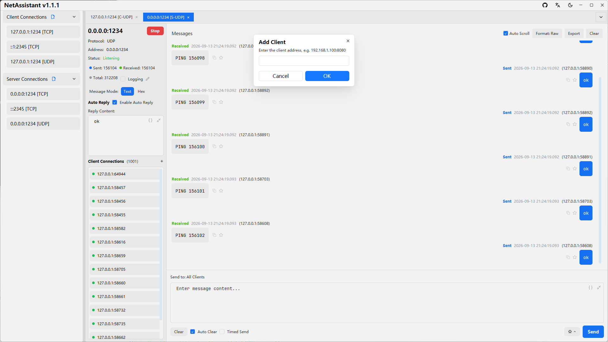
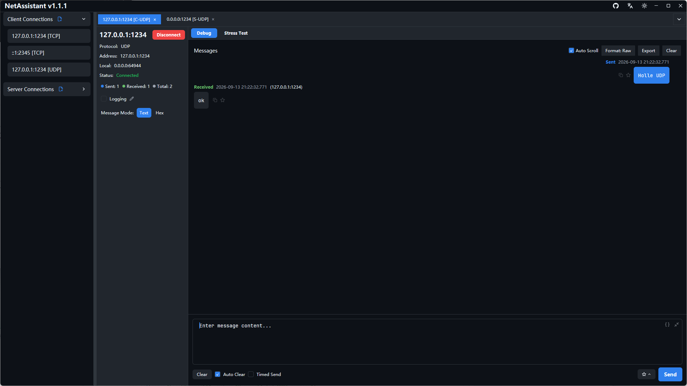

# UDP Broadcast Device Discovery: LAN Debugging Guide

When building HMIs, IoT products or embedded devices, you often need to find what is on the LAN first. Devices may have no screen, get their IP via DHCP and may not support mDNS. **UDP broadcast discovery** is the common solution: send a discovery payload to the broadcast address, and every device replies with its IP, port and capabilities.

Sending the broadcast is easy. Receiving every reply is the hard part. Many debugging tools filter responses by the target address, so replies from other devices disappear. NetAssistant shows all of them and marks the unexpected sources.

> [Download NetAssistant](/en/download) · [TCP/UDP guide](/en/guide/tcp-udp) · [All features](/en/features)

## How UDP broadcast discovery works

UDP is connectionless. A broadcast sends a datagram to every host in the same subnet. Discovery usually has three steps:

1. The host sends a discovery payload to the broadcast address and agreed port
2. Devices reply with their IP, port, device ID and capabilities
3. The host collects the replies into a device list

Common broadcast addresses:

| Address | Meaning | Notes |
| ---- | ---- | ---- |
| `255.255.255.255` | Limited broadcast | Stays within the local subnet; most common |
| `192.168.1.255` | Subnet-directed broadcast | Use your actual subnet, e.g. `192.168.1.x/24` |
| `224.0.0.1` etc. | Multicast address | Not broadcast; devices must join the group |

Broadcast does **not cross routers** by default. If devices are on another subnet, configure directed broadcast, use multicast, or fall back to unicast probing.

## Device discovery with NetAssistant

### 1. Create a UDP client

Create a connection, choose UDP and the client role. Set the remote address to the broadcast address (for example `192.168.1.255`) and the port used by the device discovery protocol.

### 2. Send the discovery payload

Enter the payload expected by the device, in text or hex mode, and send it. Then wait for replies.

### 3. See every device reply

NetAssistant does not filter replies by target address: every device response appears in the receive view. Replies from unexpected source addresses are highlighted in **light red**, with an “unexpected address reply” tooltip on hover.

That way you neither lose other devices' responses nor confuse them with the target address you entered.

### 4. Copy device addresses

Double-click a message source to copy `ip:port`, which makes it easy to paste device details into configuration or a ticket.

### 5. Manually add clients in UDP server mode

UDP is connectionless, so a UDP server cannot detect clients automatically. In server mode, click `[+ Add client]`, enter the target IP and port, and send to that device proactively.

## Troubleshooting missing replies

- **Wrong broadcast address**: confirm your subnet; `192.168.1.0/24` usually means `192.168.1.255`
- **Wrong port**: the discovery port may differ from the service port; check the device docs
- **Device uses multicast**: a broadcast will not reach a multicast-only listener
- **Firewall**: allow the UDP port on the host
- **Different subnet**: broadcast does not cross routers
- **Wrong payload format**: some devices require a magic value, length or checksum
- **Wrong interface**: on multi-NIC hosts, make sure the broadcast leaves the correct interface

## Broadcast vs multicast

| Dimension | UDP broadcast | UDP multicast |
| ---- | ---- | ---- |
| Complexity | Low | Medium; devices must join a group |
| Scope | One subnet | Can cross subnets with IGMP support |
| Bandwidth impact | Every host on the LAN receives it | Only group members process it |
| Scale | Small, simple networks | Many devices or complex networks |
| Typical use | LAN discovery, DHCP | Streaming, device clusters, service discovery |

For a small, simple LAN, broadcast is enough. For many devices or routed networks, prefer multicast.

## FAQ

### Which UDP broadcast address should I use?

Use the subnet-directed broadcast address such as `192.168.1.255` for `192.168.1.0/24`, or `255.255.255.255`. Broadcast does not cross routers by default.

### Why do I get no replies after sending a broadcast?

Check the broadcast address and port, whether the device only listens on multicast, the local firewall, the subnet, and the discovery payload format. Confirm with a packet capture that the broadcast was sent.

### Should I use broadcast or multicast?

Broadcast is simpler but limited to one LAN; multicast saves bandwidth and can cross subnets, which suits larger or more complex networks.

### Does NetAssistant filter replies from unexpected addresses?

No. Every reply is shown, and unexpected sources are highlighted in light red with a tooltip.

### Can I send to multiple devices at once?

Broadcast reaches every device in the same subnet. For targeted sends, manually add client addresses in UDP server mode.

## Related pages

- [TCP/UDP debugging guide](/en/guide/tcp-udp)
- [UDP debug tool](/en/udp-debug-tool)
- [TCP/UDP stress testing](/en/tcp-stress-test)
- [NetAssist alternative comparison](/en/compare/netassist)
- [Download NetAssistant](/en/download)
