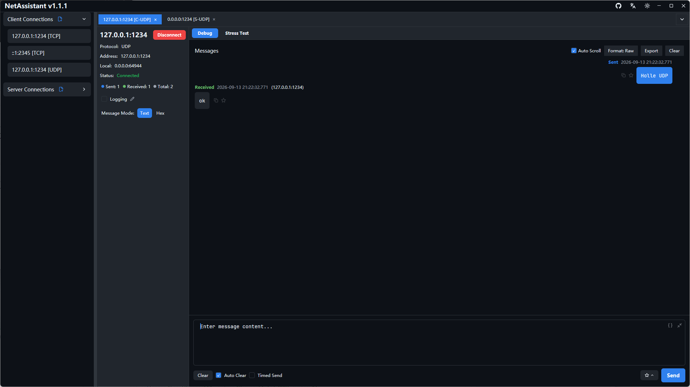
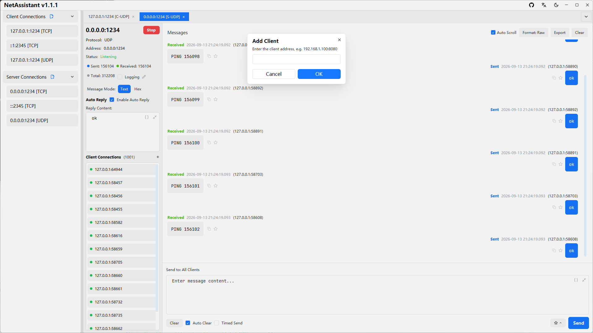

# UDP Debug Tool: Connectionless Send, Receive and Multi-Device Replies

UDP has no handshake and no retransmission: enter an address and send. That makes it the default for device discovery, heartbeats, log shipping and real-time control, and it also makes "sent but no response" hard to diagnose. The NetAssistant UDP debug tool puts client, server and multi-device replies in one window.

> [Download NetAssistant](/en/download) · [TCP/UDP debugging guide](/en/guide/tcp-udp) · [All features](/en/features)

## Who it is for

- **IoT and embedded developers**: verify UDP reporting, commands and heartbeats
- **Device discovery work**: broadcast a discovery command and collect LAN replies
- **Backend developers**: spin up a UDP server and see exactly what the client sent
- **Network policy checks**: confirm whether a UDP port is allowed by a firewall

## Client and server

| Mode | Behavior | Use |
| ---- | ---- | ---- |
| UDP client | Send datagrams to a target address and port | Send commands, simulate reports |
| UDP server | Listen on a local port and receive datagrams | Simulate a device, inspect client traffic |
| Add client manually | Add extra targets to the client list | Send to several devices, keep common targets |

A UDP client does not connect; the target address is the destination. The server simply listens, and each datagram shows its source `ip:port`, which can be copied with a double-click.

## Broadcast and multiple replies

When you send a discovery command to a subnet broadcast address such as `192.168.1.255`, every device on the network may reply. Many tools show only replies from the configured target and silently drop the rest. NetAssistant displays all of them and highlights unexpected sources so no device is missed.

For broadcast address selection, packet capture and common failure causes, see [UDP broadcast device discovery](/en/udp-broadcast-device-discovery).

## Send and receive features

- **Text / hex modes**: hex sends raw bytes, which matters for datagrams containing `0x00`
- **Line ending**: none, LF or CRLF to match the device parser
- **Periodic send**: repeat at a fixed interval for heartbeats or continuous reporting
- **Reply rules**: match by bytes, JSON, regex or checksum and reply automatically
- **File source**: load payloads from a file with UTF-8 / GBK / ANSI decoding, up to 1 MiB
- **Message management**: search, favorites and export to TXT / JSON / CSV, plus optional live logging

## Quick start

1. Create a connection and choose UDP client or server
2. For a client, enter the target address and port; for a server, enter the listening port
3. Type a payload and choose text or hex mode
4. Send, then inspect the reply and its source address in the message view
5. Use **Add client** to maintain several targets
6. Enable periodic send for repeated traffic

## UDP vs TCP for debugging

| Dimension | UDP | TCP |
| ---- | ---- | ---- |
| Connection | Connectionless, send immediately | Handshake required |
| Message boundaries | Preserved per datagram | Byte stream, needs a decoder |
| Reliability | No delivery guarantee, no retransmission | Ordered, reliable, retransmits |
| Broadcast / multicast | Broadcast supported | No broadcast |
| Typical use | Discovery, heartbeats, real-time control | File transfer, long-lived command channels |

Because UDP can drop packets, do not conclude that the peer is broken after one silent send. Check the listening port, firewall rules and payload format first.

## FAQ

### How do I use the UDP debug tool?

Create a UDP client and send to a target, or create a UDP server and listen on a local port. No handshake is involved.

### Why does a send succeed but no reply arrive?

UDP does not guarantee delivery. Check the target listener, firewall rules and payload format.

### How do I receive replies from multiple devices?

Broadcast the command; NetAssistant shows every reply and highlights unexpected sources.

### Does UDP suffer from sticky packets?

No. Datagram boundaries are preserved, though packets can be lost, duplicated or reordered.

### Does it support broadcast and IPv6?

Broadcast sending is supported, and addresses can be IPv4 or IPv6.

## Related pages

- [UDP broadcast device discovery](/en/udp-broadcast-device-discovery)
- [TCP debug tool](/en/tcp-debug-tool)
- [TCP/UDP stress testing](/en/tcp-stress-test)
- [Windows network debugging tool](/en/windows-network-debug-tool)
- [All features](/en/features)
- [Download NetAssistant](/en/download)
