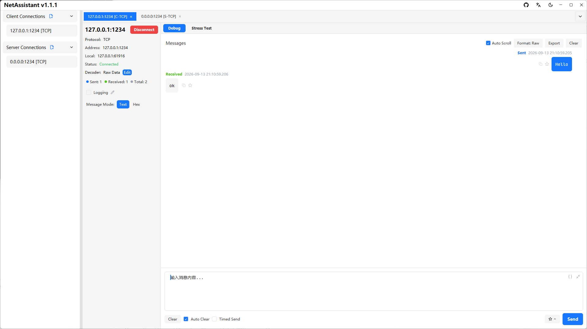

# Windows Network Debugging Tool: TCP/UDP/MQTT Debugging and Stress Testing

If you debug TCP/UDP on Windows, you have probably used **NetAssist** (网络调试助手): small and direct, but Windows-only, closed source, with limited help for TCP sticky packets and no built-in stress testing.

NetAssistant is a free, open-source Windows network debugging tool for Windows 10/11. It combines a TCP/UDP client and server, four TCP decoders, MQTT 3.1.1 debugging, hex send/receive, message management and high-concurrency stress testing in one native desktop app.

> [Download for Windows](/en/download) · [All features](/en/features) · [Getting started](/en/guide/)



## Why Windows users choose NetAssistant

- **Free and open source**: Apache-2.0 licensed, all features available, source on GitHub
- **Sticky-packet decoders**: raw, line-delimited, length-prefix and JSON TCP decoders
- **Built-in stress testing**: QPS plus p50/p95/p99 latency without installing another tool
- **Multiple protocols in one app**: TCP/UDP client and server, MQTT 3.1.1 client, IPv4/IPv6 dual stack
- **Native performance**: Rust + Tokio, fast startup, low memory usage and a GPUI-rendered interface

## Install on Windows

### Option 1: winget (recommended)

```bash
winget install SunJary.NetAssistant
```

Upgrade later with:

```bash
winget upgrade SunJary.NetAssistant
```

### Option 2: installer

Download `netassistant-windows-x86_64-setup.exe` from the [download page](/en/download) and follow the wizard. It creates Start Menu and desktop shortcuts automatically.

### Option 3: portable zip

Download `netassistant-windows-x86_64.zip`, extract it and run `netassistant.exe`.

### ARM64 devices

For Surface Pro X, Snapdragon laptops and other ARM64 devices, download `netassistant-windows-aarch64.zip`. winget and the installer currently provide x64 builds only; the ARM64 build is an automated artifact that has not been fully tested on physical devices.

## Core features

### TCP/UDP client and server

Create TCP client, TCP server, UDP client and UDP server connections in one interface, with multi-tab debugging, saved configurations and local address/port binding.

### TCP sticky packets and four decoders

TCP is a byte stream, so sticky and split packets are unavoidable. NetAssistant provides raw, line-delimited, length-prefix and JSON decoders so the receiver can split messages by protocol boundary instead of counting bytes manually.


### Built-in stress testing

Run high-concurrency TCP/UDP tests in Ping-Pong or throughput mode. See QPS, success rate, active connections, p50/p95/p99 latency and failure breakdown in real time, then export a CSV report. See the [stress testing guide](/en/guide/stress).

### MQTT 3.1.1 debugging

Create an MQTT connection with broker address, client ID, credentials, keep-alive and last-will settings. Add or remove subscriptions at runtime and publish with topic, QoS and retain.

### Built-in toolbox

Convert, checksum, hash, time, JSON and encoding tools live in a permanent tab: hex/text conversion, CRC16/CRC32, MD5/SHA, timestamp conversion and Base64/URL encoding.

## NetAssistant vs NetAssist

| Dimension | NetAssistant | NetAssist |
| ---- | ---- | ---- |
| Platform | Windows / macOS / Linux (x64 + ARM64) | Windows only |
| Open source | Apache-2.0 | Closed source |
| TCP sticky-packet decoders | Raw / line / length-prefix / JSON | Limited |
| Built-in stress testing | QPS + p50/p95/p99 | No |
| IPv6 | Full support | Partial |
| Message export | TXT / JSON / CSV | Limited |
| Auto-reply / periodic send | Yes | Yes |

See the full [tool comparison](/en/comparison), or read the [NetAssist alternative guide](/en/compare/netassist).

## Typical use cases

- **Embedded and hardware debugging**: simulate a device or server to verify protocol formats and error handling
- **Industrial and IoT**: UDP broadcast discovery, hex send/receive and highlighting replies from unexpected addresses
- **Backend verification**: act as a TCP/UDP client or server to validate communication logic
- **Teaching and labs**: free, easy to install and suitable for network programming courses

## System requirements

| Item | Requirement |
| ---- | ---- |
| OS | Windows 10 or later |
| Architecture | x64 or ARM64 |
| Installation | winget, installer or portable zip |
| License | Apache-2.0, free to use |

## FAQ

### How do I install NetAssistant on Windows?

Run `winget install SunJary.NetAssistant` in PowerShell or Terminal, or download the installer/portable zip from the [download page](/en/download).

### Does NetAssistant support Windows 7?

No. NetAssistant requires Windows 10 or later.

### Is there a Windows ARM64 build?

Yes. Download `netassistant-windows-aarch64.zip` for ARM64 devices.

### How is NetAssistant different from NetAssist?

NetAssist is Windows-only and closed source. NetAssistant is free, open source and cross-platform, with four TCP decoders and built-in stress testing. See the [comparison](/en/comparison) for details.

### Is it free?

Yes. NetAssistant is released under the Apache-2.0 license and all features are free.

### Does it support IPv6?

Yes. Connections accept IPv4 or IPv6 addresses such as `::1` or `fe80::xxxx` in both client and server modes.

## Related pages

- [Mac network debugging tool](/en/mac-network-debug-tool)
- [Linux network debugging tool](/en/linux-network-debug-tool)
- [TCP/UDP debugging guide](/en/guide/tcp-udp)
- [Download NetAssistant](/en/download)
