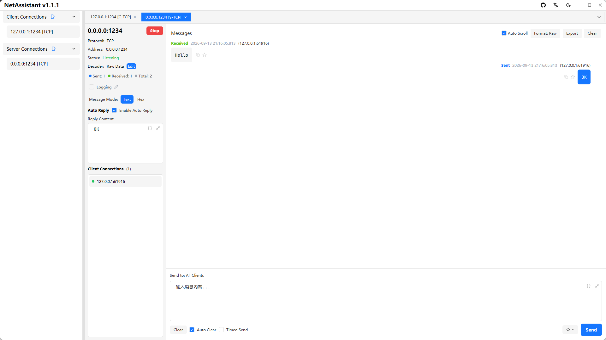
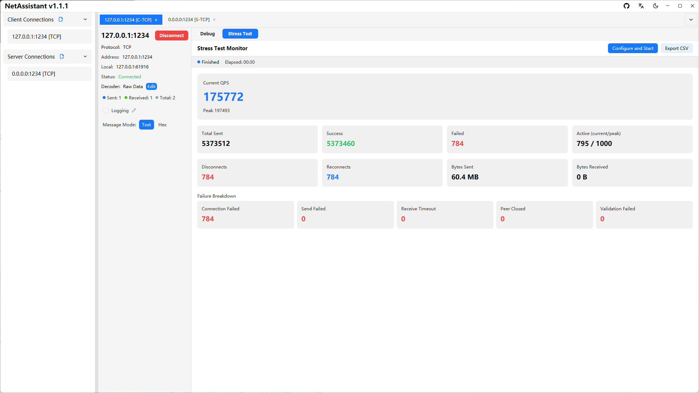

## Capturas de pantalla

### Modo cliente

### Modo servidor

### Cliente MQTT

### Caja de herramientas integrada

### Pruebas de carga

### Modo oscuro

## Por qué NetAssistant

- **Rendimiento excepcional**: Rust + runtime asíncrono Tokio, arranque < 100ms, consumo de memoria < 20MB, conexiones concurrentes a escala de millones
- **Diseñada para depurar**: desde el desarrollo de aplicaciones de red hasta la depuración de hardware y sistemas embebidos, cubre todo el flujo de verificación de comunicaciones
- **Multiplataforma**: compatibilidad total con Windows, Linux y macOS, con compilaciones nativas para x64 y ARM64
- **Código abierto y gratuita**: publicada bajo la licencia Apache-2.0, contribuciones bienvenidas

Para más detalles, consulta [Funciones](/en/features); para empezar, lee la [Guía](/en/guide/). Para ver cómo se compara con NetAssist y herramientas similares, consulta la [Comparación](/en/comparison).

## Descargar por plataforma

- [Herramienta de depuración de red para Windows](/en/windows-network-debug-tool): instalación con winget en un solo comando, Windows 10/11 en x64 y ARM64
- [Herramienta de depuración de red para Mac](/en/mac-network-debug-tool): DMG universal para Apple Silicon e Intel
- [Herramienta de depuración de red para Linux](/en/linux-network-debug-tool): deb, AppImage y tar.gz para x86_64 y ARM64

## Guías populares

- [Alternativa a NetAssist: comparación y migración](/en/compare/netassist)
- [Herramienta de depuración TCP: envío, recepción y delimitación de tramas](/en/tcp-debug-tool)
- [Herramienta de depuración UDP: envío sin conexión y respuestas de múltiples dispositivos](/en/udp-debug-tool)
- [Herramienta de depuración de sockets: escucha de puertos y accesibilidad](/en/socket-debug-tool)
- [Envío hexadecimal: cargas HEX y conversión de texto](/en/hex-send)
- [Depuración Modbus TCP: tramas y CRC16](/en/modbus-tcp)
- [Paquetes pegados en TCP: causas, cuatro soluciones y depuración](/en/tcp-sticky-packet)
- [Guía de depuración MQTT: encuentra páginas por tarea](/en/mqtt)
- [Comparación de clientes MQTT: MQTTX, Explorer y MQTT.fx](/en/compare/)
- [Cliente MQTT: una herramienta ligera de depuración MQTT 3.1.1 / 5.0](/en/mqtt-client)
- [Alternativa a MQTTX: comparación de clientes MQTT ligeros](/en/comparison-mqttx)
- [Tutorial de MQTT: conectar, suscribirse y publicar](/en/guide/mqtt)
- [Solución de problemas de MQTT: conexiones y mensajes perdidos](/en/mqtt-troubleshooting)
- [MQTT TLS: verificación de certificados y autenticación mutua](/en/mqtt-tls)
- [MQTT 5.0: caducidad de sesión y códigos de motivo](/en/mqtt-5)
- [Comparación con la alternativa MQTT Explorer](/en/compare/mqtt-explorer)
- [Comparación con la alternativa MQTT.fx](/en/compare/mqtt-fx)
- [Preguntas frecuentes sobre MQTT](/en/mqtt-faq)
- [Instalación del cliente MQTT en Linux](/en/mqtt-client-linux)
- [Pruebas de carga TCP/UDP: QPS y latencia p99](/en/tcp-stress-test)
- [Descubrimiento de dispositivos por difusión UDP: búsqueda en LAN y solución de problemas](/en/udp-broadcast-device-discovery)
