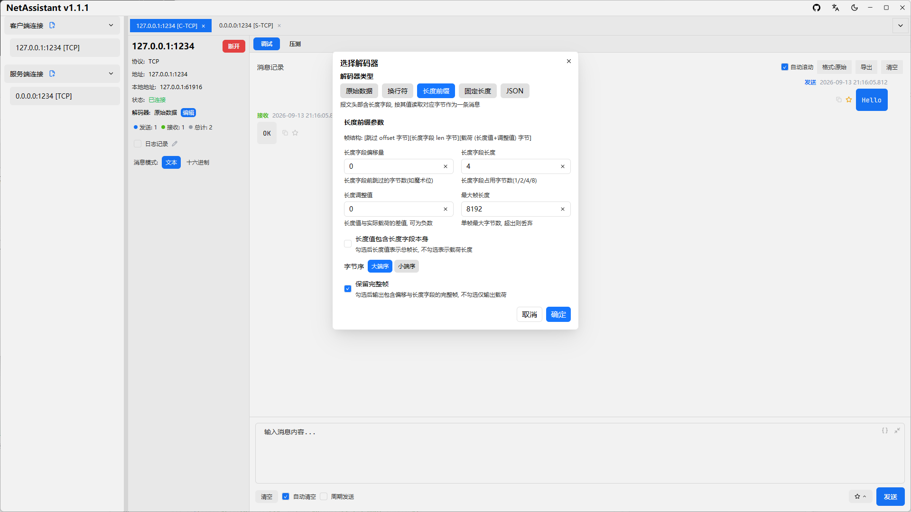
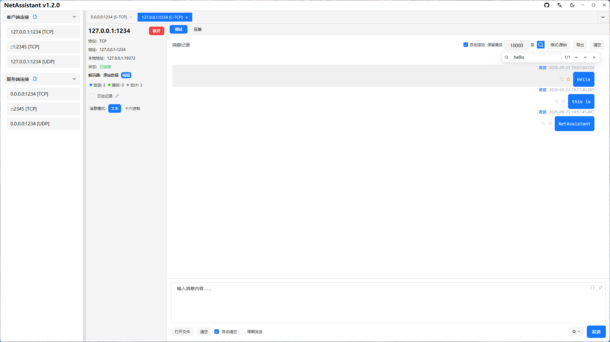
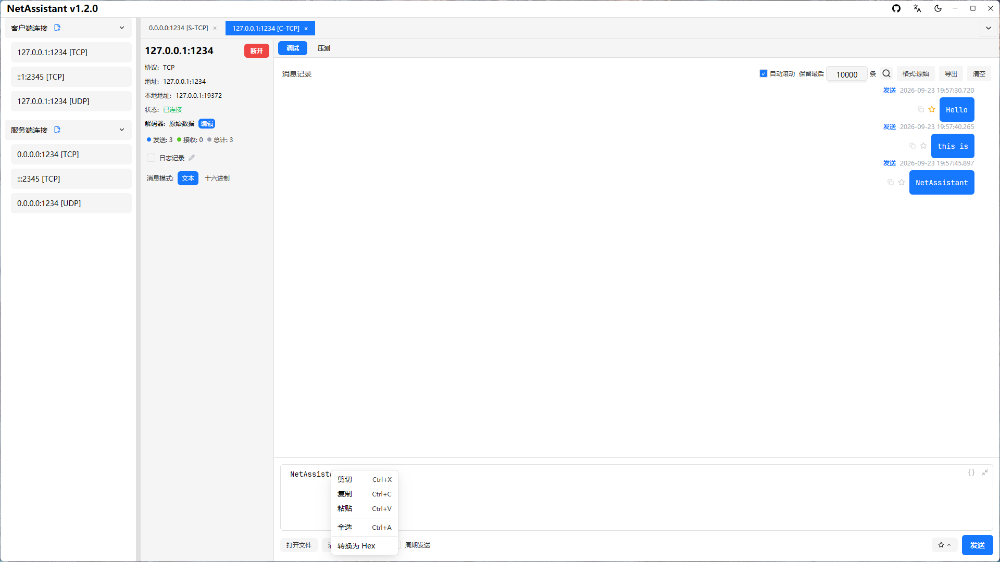
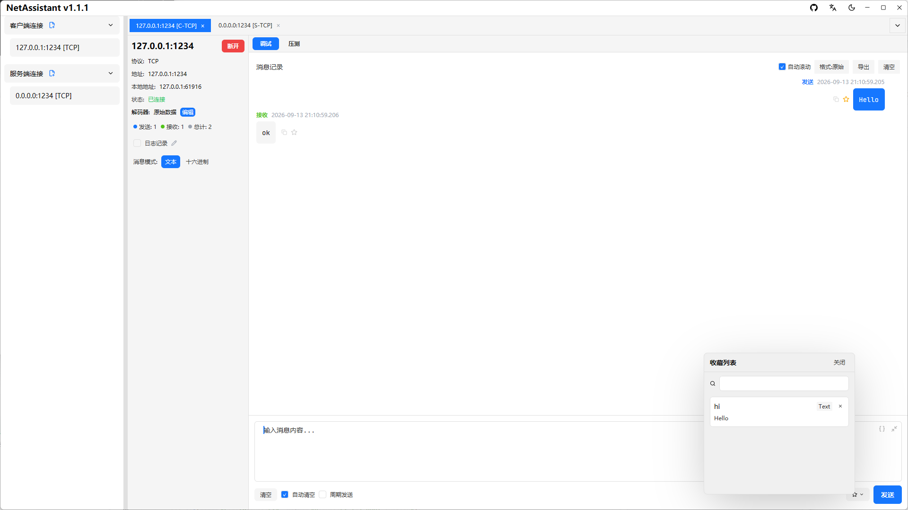
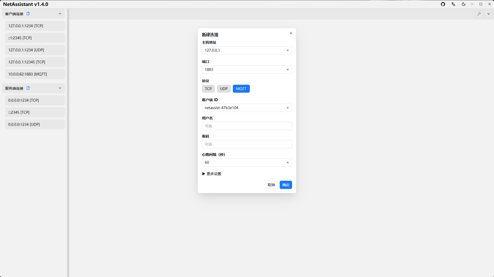
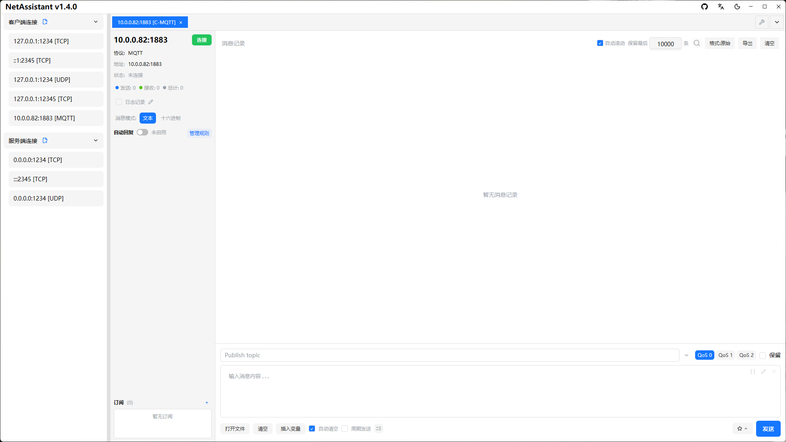
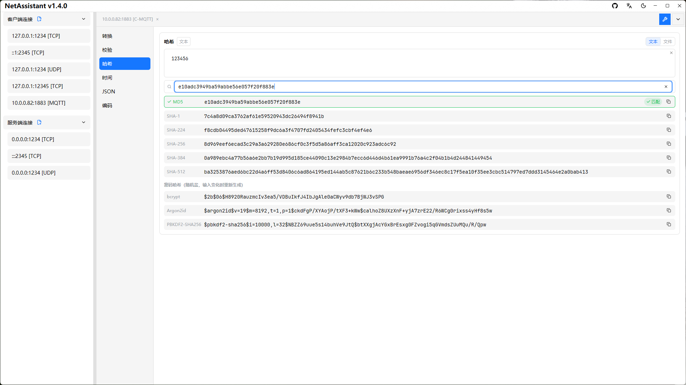
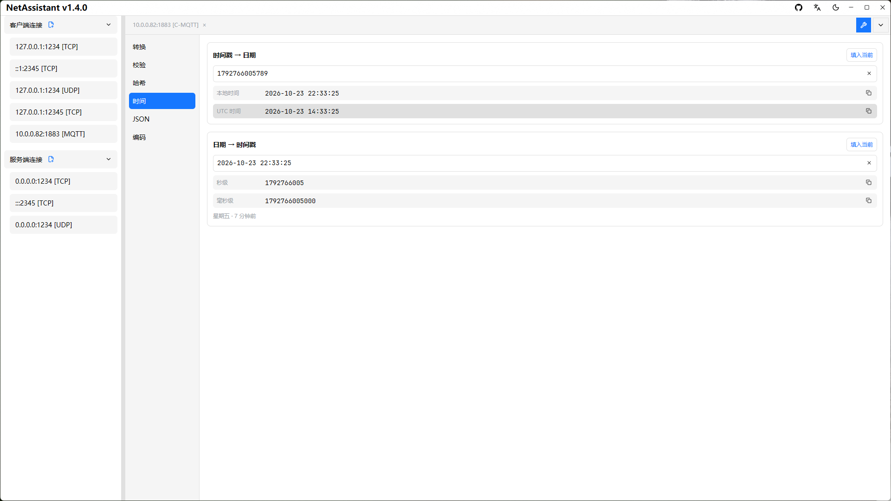
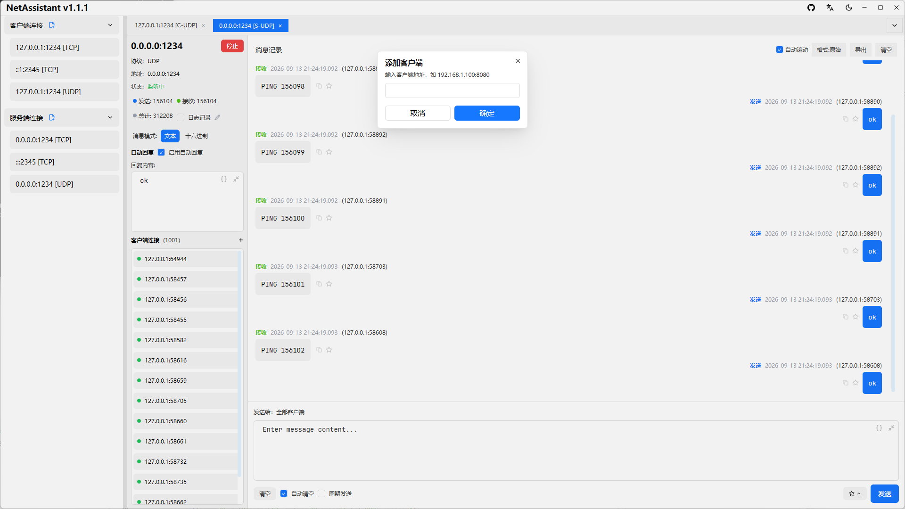

# 功能特性

NetAssistant 是一个基于 Rust 构建的高性能、现代化的**跨平台**网络调试工具，专为开发者设计，支持 Windows、Linux 和 macOS 系统，x64 与 ARM64 均有原生构建。

## 核心功能

- **多协议支持**：完整支持 TCP/UDP 客户端和服务端模式，以及 MQTT 3.1.1 客户端
- **内置工具箱**：标签栏右侧扳手图标打开常驻工具箱，左侧分组切换「转换 / 校验 / 哈希 / 时间 / JSON / 编码」，输入即出结果，结果行可一键复制
- **IPv4/IPv6 双栈**：同时支持 IPv4 和 IPv6 协议，适应各种网络环境
- **多种 TCP 解码器**：支持原始数据、基于行的解码、长度前缀解码和 JSON 解码，满足不同协议格式需求，有效解决 TCP 粘包问题
- **JSON 格式化**：发送框在文本模式提供「美化/压缩」按钮格式化待发送内容；接收区顶部可切换「原始/美化/压缩」全局显示格式，非 JSON 内容原样返回
- **聊天式报文记录**：直观展示报文交互过程，便于调试和分析
- **配置持久化**：自动保存连接配置，下次启动直接使用
- **文件数据源**：从本地文件读取内容作为报文填入发送框，支持 UTF-8 / GBK / ANSI 编码选择与内容预览，文件大小以可读格式显示，上限 1 MiB
- **ASCII ↔ Hex 双向互转**：文本/十六进制模式切换时按 UTF-8 整体互转，右键菜单可「转换为 Hex / 转换为文本」并在结果窗口中复制；不可打印字节以 `\xNN` 转义，往返转换字节级一致

## 消息管理功能

- **复制消息**：快速复制单条消息内容到剪贴板，支持文本和十六进制两种格式
- **消息文本可选中**：气泡正文支持拖选、双击选词、三击选行与 `Ctrl/Cmd+C` 复制；右键菜单可复制选中或全文，并对选中内容（未选中时对整条消息）执行文本 ⇄ Hex 转换与六种校验，拖选时高亮实时跟随鼠标
- **双击复制来源**：双击消息来源地址复制 `ip:port`；MQTT 连接下双击 topic 标签复制原始 topic
- **收藏消息**：将重要消息添加到收藏夹，支持为收藏项添加备注说明，并提供关键字搜索
- **实时日志记录**：手动开启后所有收发消息实时异步写入日志文件（每条 flush 落盘），支持自定义保存路径，断开连接自动刷新关闭
- **随时手动导出**：可随时导出当前消息记录为 TXT/JSON/CSV 格式文件，便于归档、分享和二次分析
- **UDP 广播回复智能展示**：针对上位机/物联网设备发现场景优化，向广播地址发送指令后接收所有设备回复，非预期地址的回复用红色高亮标识，不丢失重要响应
- **连接配置编辑**：已保存的连接配置支持直接编辑修改，无需删除重建
- **消息搜索**：`Ctrl+F` 或点击工具栏放大镜唤起非模态搜索浮层，实时显示命中计数 `i/n`，`Enter` / `Shift+Enter` 或上/下按钮环形跳转，命中项整行高亮并滚动到视口
- **消息条数上限**：可配置「保留最后 N 条」（默认 10000，`0` 表示不限制），超出后自动淘汰最早的消息以控制内存占用；与自动滚动联动，关闭自动滚动时不淘汰消息

## 自动化测试功能

- **回复规则**：按连接的规则引擎，用字节级条件（包含字节、定长精确/掩码匹配、前缀+长度区间、偏移字节/整数、帧尾、正则、来源地址（支持 CIDR）、JSON 字段、校验值验算等，可「全部/任一/取反」任意嵌套）匹配收到的报文并自动应答；JSON 字段条件支持 `data.items[0].temp` 等路径与 `== / != / > / >= / < / <= / 包含 / 存在` 运算符；应答支持接收帧变量与动态变量，可单独设置编码方式；规则按连接隔离，支持启用/停用、拖拽排序、触发统计与编辑内联试跑
- **消息变量**：发送框、定时任务与回复规则统一支持 `${seq}`、时间、`${uuid}`、`${random:min:max}` 等通用变量，以及 `${rx.*}` 接收帧变量、`${rx.json:路径}` JSON 字段取值、发送时生成的校验值与 `${= 表达式 }`
- **发送任务与定时任务**：导入文件或粘贴多行后可逐行发送（可设间隔、循环与轮次）；每个连接可添加定时任务按固定间隔循环发送心跳，两者均可在任务面板查看进度、暂停/继续/停止
- **周期发送功能**：按设定间隔重复发送当前输入框内容，用于长时间稳定性测试或模拟设备心跳
- **压力测试功能**：内置 TCP/UDP 高并发压力测试引擎，详见[压力测试指南](/guide/stress)

## MQTT 调试

- **MQTT 3.1.1 客户端**：集成在客户端连接体系中，新建连接选择 MQTT 后填写 Broker 地址与端口（默认 1883）、Client ID、用户名/密码与 KeepAlive；「更多设置」可配置 Clean Session 与遗嘱消息（topic / payload / QoS / retain）
- **订阅管理**：运行时添加 / 编辑 / 取消订阅，无需重连；订阅严格按连接隔离，断线自动重连后自动恢复订阅
- **发布消息**：发送区设置 topic、QoS（0/1/2）与 retain，payload 沿用文本 / Hex 模式；topic 输入框右侧下拉可复用当前连接最近发送过的 topic（连同 QoS 与 retain），历史按连接持久化，最多保留 20 条
- **消息展示**：每条消息显示 topic 标签（retain 消息带标记），双击 topic 标签可复制原始 topic；消息记录、搜索、导出、JSON 格式化、回复规则等既有能力全部复用
- **自动回复**：应答自动回发到收到消息的 topic；周期发送同样按当前发布 topic 发送
- **协议约束**：MQTT 下隐藏解码器与「结尾字符」，不提供压测、逐行发送与定时任务；首版暂不支持 TLS、MQTT 5.0 与 MQTT over WebSocket

## 内置工具箱

点击标签栏右侧的扳手图标即可打开工具箱。工具箱是常驻标签页，不可关闭；左侧分组切换纯切换，各组输入独立保留，输入即出结果：

- **转换**：文本 → Hex、Hex → 文本两个独立输入块
- **校验**：输入 Hex 字节序列，即时给出 XOR / Sum8 / LRC / CRC16-Modbus / CRC16-CCITT-FALSE / CRC32 六种结果
- **哈希**：MD5 / SHA-1 / SHA-224 / SHA-256 / SHA-384 / SHA-512 摘要；bcrypt / Argon2id / PBKDF2-SHA256 密码哈希（随机盐）；文件摘要（可多选算法、单遍读取）与哈希对比（粘贴哈希后按长度自动识别算法并标记匹配）
- **时间**：时间戳 → 日期（本地 / UTC，自动识别秒与毫秒）、日期 → 时间戳（秒 / 毫秒，附星期与相对时间），支持 ISO 8601 与「填入当前」
- **JSON**：美化 / 压缩，标准 JSON 解析失败时回退 JSON5 宽松语法（无引号 key、单引号、尾逗号、注释）
- **编码**：Base64 编码 / 解码、URL 编码 / 解码

## 现代化界面

- **暗黑模式支持**：自动适应系统主题，提供舒适的夜间使用体验
- **多标签页管理**：同时管理多个连接，方便切换和对比
- **客户端消息查看**：在服务端模式下，可选择特定客户端查看其消息
- **UDP 手动添加客户端**：在 UDP 服务端模式下，可手动添加客户端地址，便于主动向指定地址发送数据
- **键盘快捷键**：`Ctrl+Enter` 发送、`Ctrl+Tab` / `Ctrl+1..9` / `Ctrl+W` 管理标签页、`Ctrl+F` 搜索消息、`Ctrl+N` 新建连接、`Ctrl+K` 聚焦消息输入框，任何焦点状态下均生效

## 技术亮点

### ⚡ 极速性能

- **Rust 驱动**：零成本抽象、内存安全、无垃圾回收
- **Tokio 异步运行时**：基于 epoll/kqueue 的高性能事件循环，支持百万级并发连接

### 🎨 现代化界面

- **GPUI 框架**：GPU 加速渲染与文本渲染，流畅 60fps 体验
- **自适应主题**：自动适应系统亮色/暗色模式
- **响应式设计**：适应不同屏幕尺寸的自适应布局

### 🔧 架构设计

- **压测引擎独立成层**：零 GPUI 依赖的纯逻辑设计，便于复用与测试；基于令牌桶的速率限制，精准控制发送频率
- **核心逻辑与 UI 解耦**：消息处理器独立于界面层，网络协议层与界面层清晰分离

## 性能指标

开发过程中使用内置压测功能对 NetAssistant 自身进行了高并发测试，借此发现并优化了多个性能瓶颈（消息批量更新、批量日志写入等）：

| 指标 | 表现 |
| ---- | ---- |
| 启动时间 | < 100ms |
| 内存占用 | < 20MB |
| UI 响应 | 60fps 渲染 |

## 使用场景

- **开发者通信验证**：后端开发者对接硬件前模拟硬件发送数据；测试客户端与服务端之间的通信逻辑和数据格式，验证服务端的正确性和鲁棒性
- **硬件设备测试**：硬件工程师测试传感器、控制器等设备；嵌入式开发者验证资源受限系统的网络协议栈实现与传输效率
- **服务性能压测**：对自研服务端进行并发吞吐、延迟分布和稳定性评估，快速定位性能瓶颈
