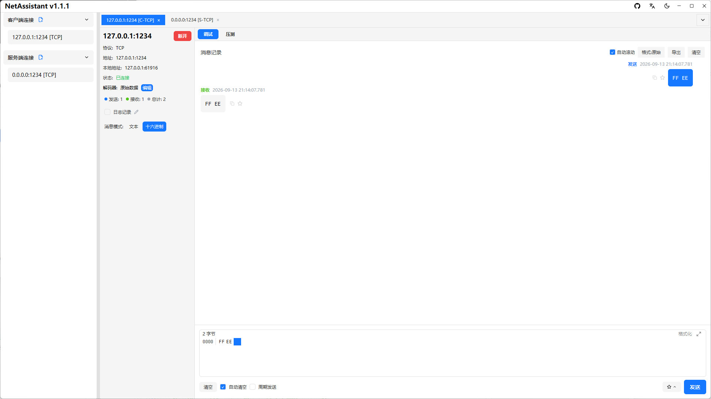
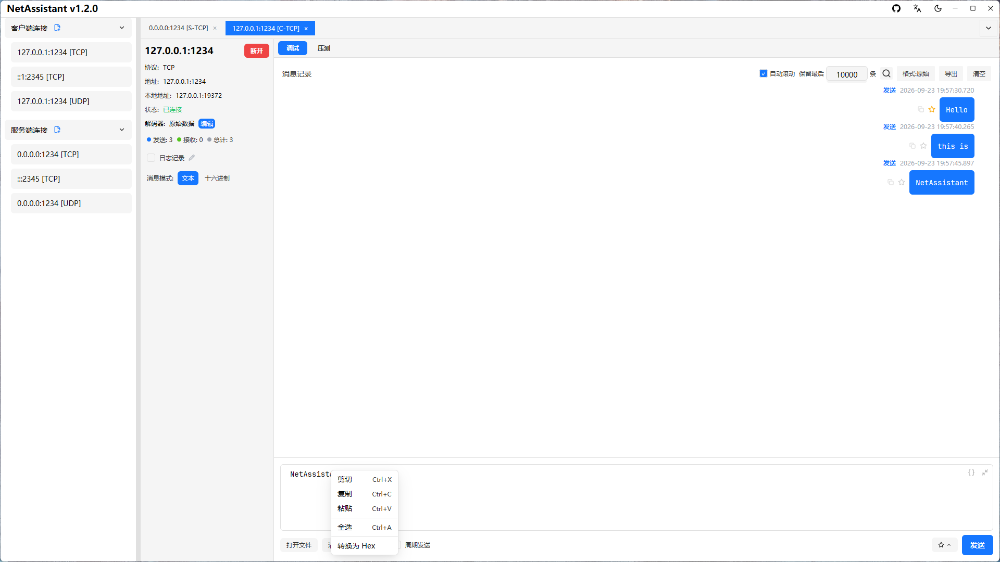

# 十六进制发送：直接控制发出的每一个字节

文本模式适合 JSON、AT 指令和日志，但二进制协议不认字符串。帧头 `AA 55`、寄存器地址 `0x00 0x0A`、结束符 `0D 0A`，这些都需要按字节发出去。NetAssistant 的 **Hex 模式**发送的就是原始字节，而不是把“AA 55”这几个字符当文本发出去。

> [下载 NetAssistant](/download) · [TCP 调试工具](/tcp-debug-tool) · [全部功能](/features)

## 适合谁

- **二进制协议联调**：自定义帧头、长度、命令字、校验位
- **设备指令调试**：下发含 `0x00` 或不可打印字符的控制帧
- **协议复现**：从抓包或手册里复制一段 Hex 原样重放
- **校验核对**：发送前先算 CRC，再和响应帧比对

## 文本模式与 Hex 模式

| 模式 | 输入 `41 42` 时实际发送 | 适用 |
| ---- | ---- | ---- |
| 文本 | 字符 `4` `1` 空格 `4` `2` 的 UTF-8 字节 | JSON、AT 指令、可读日志 |
| Hex | 两个字节 `0x41` `0x42` | 二进制帧、定长协议、校验字段 |

最常见的错误是：报文已经按 Hex 写好了，却忘了切换模式，结果对端收到一串 ASCII 字符。发送前先确认模式，再看接收区的显示格式。

## 双向转换与转义

- 发送框在文本与 Hex 模式间切换时，按 UTF-8 整体转换
- 消息气泡右键可「转换为 Hex / 转换为文本」，结果在独立窗口中展示并可复制
- 工具箱「转换」分组提供文本 → Hex、Hex → 文本两个独立输入块
- 不可打印字节以 `\xNN` 转义，往返转换字节级一致，不会因为显示而丢失数据
- 对选中内容（未选中时对整条消息）可执行六种校验：XOR / Sum8 / LRC / CRC16-Modbus / CRC16-CCITT-FALSE / CRC32

## 一个完整的发送流程

以自定义帧 `AA 55 | 长度 | 命令 | 数据 | CRC16` 为例：

1. 按协议拼出除校验外的字节，例如 `AA 55 04 01 00 02 03 04`
2. 在工具箱「校验」中输入这段 Hex，取 CRC16 结果
3. 把校验值按协议要求的字节序追加到末尾
4. 切换到 Hex 模式，粘贴完整帧并发送
5. 接收区保持 Hex 显示，逐字节核对响应

需要周期下发时开启周期发送；需要自动应答时，用回复规则按字节条件匹配请求并返回固定帧。

## 文件数据源

报文很长或来自固件、抓包导出时，不必手工粘贴：文件数据源可从本地文件读取内容填入发送框，支持 UTF-8 / GBK / ANSI 编码选择与内容预览，文件大小以可读格式显示，单文件上限 **1 MiB**。

## 常见问题

### 十六进制发送和文本发送有什么区别？

文本按 UTF-8 编码发送输入内容；Hex 把你输入的十六进制按字节解释后原样发送。

### 文本和 Hex 怎么互转？

切换模式时整体转换，消息右键菜单和工具箱也能单项转换，往返字节级一致。

### 不可打印字符怎么显示？

以 `\xNN` 转义显示，例如 `0x00` 显示为 `\x00`。

### 能发送文件内容吗？

可以。文件数据源支持 UTF-8 / GBK / ANSI，单文件上限 1 MiB。

### 支持串口十六进制发送吗？

不支持。Hex 收发用于 TCP/UDP/MQTT，NetAssistant 不提供串口功能。

## 相关页面

- [Modbus TCP 调试](/modbus-tcp)
- [TCP 调试工具](/tcp-debug-tool)
- [TCP 粘包与拆包](/tcp-sticky-packet)
- [Windows 网络调试助手](/windows-network-debug-tool)
- [全部功能](/features)
- [下载 NetAssistant](/download)
