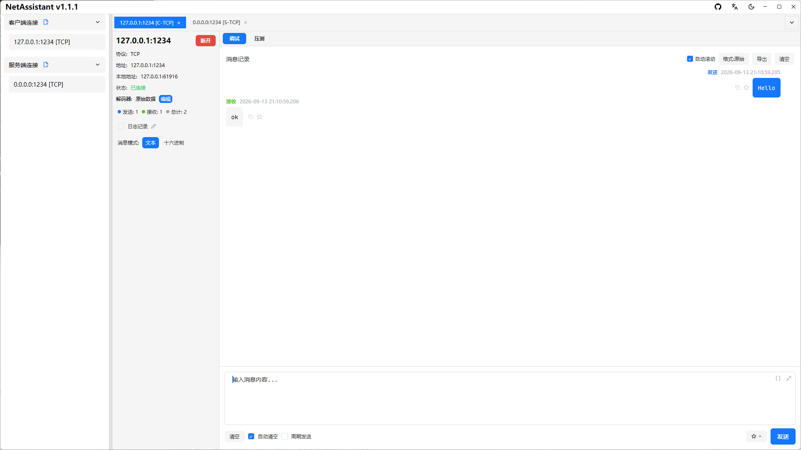
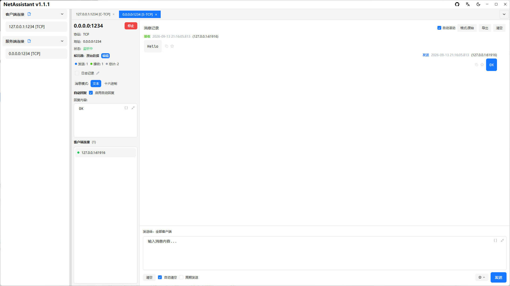
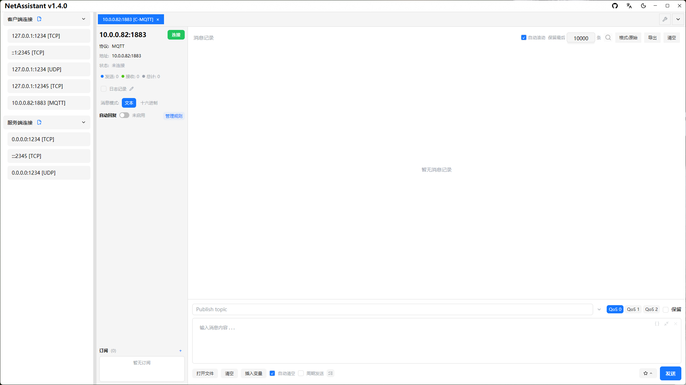
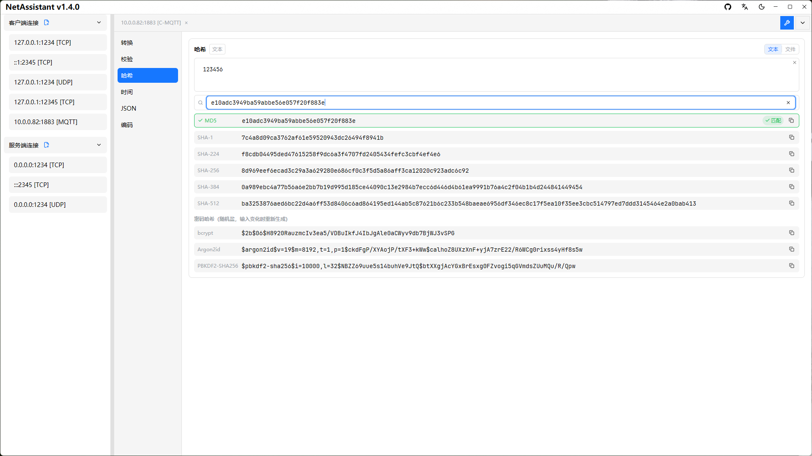
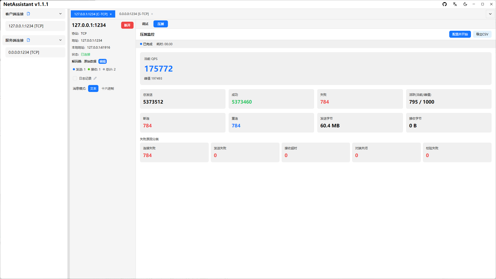
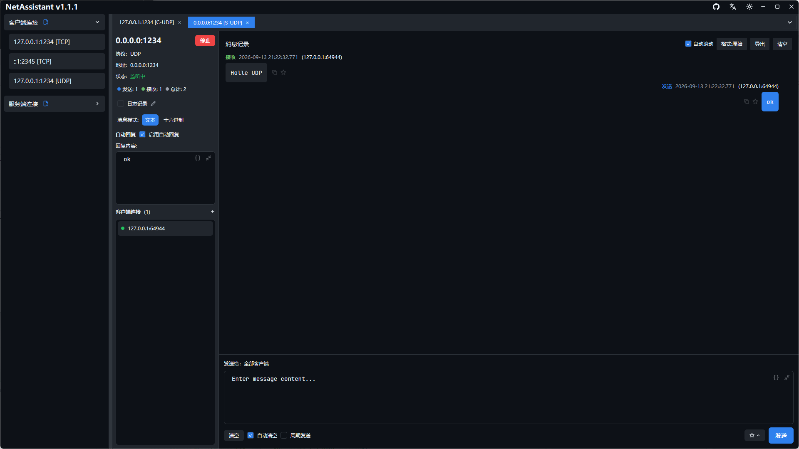

## 界面预览

### 客户端模式

### 服务端模式

### MQTT 客户端

### 内置工具箱

### 压力测试

### 暗黑模式

## 为什么选择 NetAssistant

- **极速性能**：Rust + Tokio 异步运行时，启动 < 100ms，内存占用 < 20MB，百万级并发连接能力
- **专为调试而生**：从网络应用开发到硬件、嵌入式调试，覆盖通信验证全流程
- **跨平台**：Windows、Linux、macOS 全平台支持，x64 与 ARM64 均有原生构建
- **开源免费**：基于 Apache-2.0 许可证，欢迎参与贡献

更多功能细节请查看 [功能特性](/features)，上手请阅读 [使用指南](/guide/)。想了解它与网络调试助手等工具的区别，可参考[网络调试工具对比](/comparison)；其他疑问见[常见问题](/faq)。

## 按平台下载

- [Windows 网络调试助手](/windows-network-debug-tool)：winget 一条命令安装，支持 Windows 10/11（x64 与 ARM64）
- [macOS 网络调试助手](/mac-network-debug-tool)：Universal DMG，支持 Apple Silicon 与 Intel
- [Linux 网络调试助手](/linux-network-debug-tool)：deb / AppImage / tar.gz，支持 x86_64 与 ARM64

## 热门内容

**TCP/UDP 调试**

- [TCP 调试工具：收发、解码与粘包处理](/tcp-debug-tool)
- [UDP 调试工具：无连接收发与多设备回复](/udp-debug-tool)
- [Socket 调试工具：端口监听与连通性排查](/socket-debug-tool)
- [十六进制发送：HEX 收发与文本转换](/hex-send)
- [Modbus TCP 调试：报文构造与 CRC16 校验](/modbus-tcp)
- [TCP 粘包与拆包：原因、四种解决方案与调试方法](/tcp-sticky-packet)
- [TCP/UDP 压测：QPS 与 p99 延迟测试](/tcp-stress-test)
- [UDP 广播设备发现：局域网设备搜索与排查](/udp-broadcast-device-discovery)
- [TCP/UDP 调试教程：连接、收发与自动回复](/guide/tcp-udp)
- [压力测试教程：QPS 与延迟分位数](/guide/stress)

**MQTT 调试**

- [MQTT 调试指南：按任务查找页面](/mqtt)
- [MQTT 客户端：轻量级 MQTT 3.1.1 / 5.0 调试工具](/mqtt-client)
- [MQTT 调试教程：连接、订阅与发布](/guide/mqtt)
- [MQTT 排错：连接失败与订阅收不到消息](/mqtt-troubleshooting)
- [MQTT TLS：证书校验与双向认证](/mqtt-tls)
- [MQTT 5.0：会话过期与原因码](/mqtt-5)
- [MQTT 常见问题](/mqtt-faq)
- [Linux MQTT 客户端安装](/mqtt-client-linux)

**对比与选型**

- [NetAssist 替代品：网络调试助手对比与迁移](/compare/netassist)
- [MQTT 客户端对比：MQTTX / Explorer / MQTT.fx](/compare/)
- [MQTTX 替代品：轻量 MQTT 客户端对比与选型](/comparison-mqttx)
- [MQTT Explorer 替代品对比](/compare/mqtt-explorer)
- [MQTT.fx 替代品对比](/compare/mqtt-fx)

