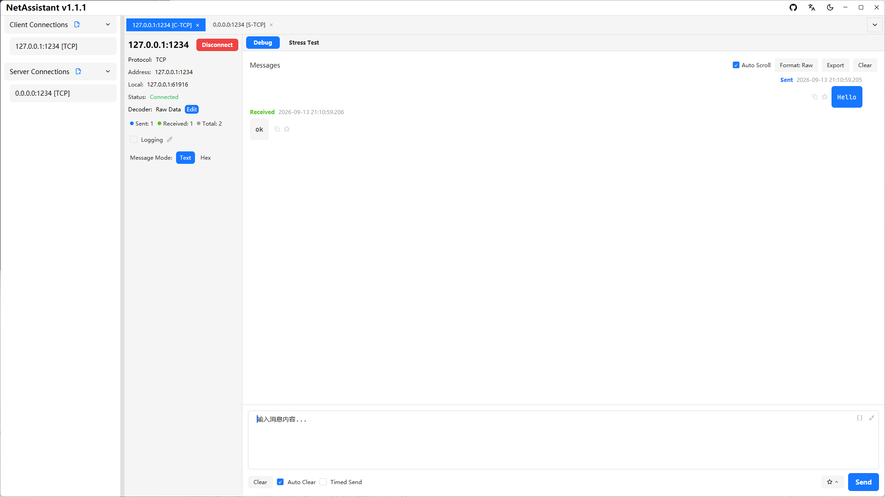
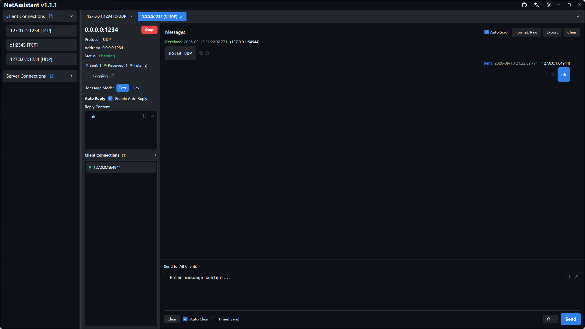

## スクリーンショット

### クライアントモード

### サーバーモード

### MQTT クライアント

### 内蔵ツールボックス

### 負荷テスト

### ダークモード

## NetAssistant を選ぶ理由

- **圧倒的なパフォーマンス**: Rust + Tokio の非同期ランタイム。起動は 100ms 未満、メモリ使用量は 20MB 未満、数百万レベルの同時接続に対応
- **デバッグのために設計**: ネットワークアプリ開発からハードウェア・組み込みのデバッグまで、通信検証のワークフロー全体をカバー
- **クロスプラットフォーム**: Windows、Linux、macOS に完全対応。x64 と ARM64 のネイティブビルドを提供
- **オープンソースで無料**: Apache-2.0 ライセンスで公開、コントリビューション歓迎

詳しくは[機能紹介](/en/features)、使い方は[ガイド](/en/guide/)をご覧ください。NetAssist などのツールとの違いは[比較](/en/comparison)で確認できます。

## プラットフォーム別ダウンロード

- [Windows ネットワーク診断ツール](/en/windows-network-debug-tool): winget でコマンド 1 行インストール、Windows 10/11 の x64 と ARM64 に対応
- [Mac ネットワーク診断ツール](/en/mac-network-debug-tool): Apple Silicon と Intel の両方に対応したユニバーサル DMG
- [Linux ネットワーク診断ツール](/en/linux-network-debug-tool): x86_64 と ARM64 向けの deb、AppImage、tar.gz

## 人気のガイド

- [NetAssist 代替: 比較と移行](/en/compare/netassist)
- [TCP デバッグツール: 送信・受信とフレーミング](/ja/tcp-debug-tool)
- [UDP デバッグツール: コネクションレス送信と複数デバイスの返信](/ja/udp-debug-tool)
- [ソケットデバッグツール: ポート待ち受けと到達性](/en/socket-debug-tool)
- [HEX 送信: HEX ペイロードとテキスト変換](/en/hex-send)
- [Modbus TCP デバッグ: フレームと CRC16](/en/modbus-tcp)
- [TCP スティッキーパケット: 原因・4 つの解決策・デバッグ](/en/tcp-sticky-packet)
- [MQTT デバッグガイド: タスク別にページを探す](/en/mqtt)
- [MQTT クライアント比較: MQTTX、Explorer、MQTT.fx](/en/compare/)
- [MQTT クライアント: 軽量な MQTT 3.1.1 / 5.0 デバッグツール](/ja/mqtt-client)
- [MQTTX 代替: 軽量 MQTT クライアントの比較](/en/comparison-mqttx)
- [MQTT チュートリアル: 接続・サブスクライブ・パブリッシュ](/en/guide/mqtt)
- [MQTT トラブルシューティング: 接続とメッセージ欠落](/en/mqtt-troubleshooting)
- [MQTT TLS: 証明書検証と相互認証](/en/mqtt-tls)
- [MQTT 5.0: セッション有効期限と理由コード](/en/mqtt-5)
- [MQTT Explorer 代替の比較](/en/compare/mqtt-explorer)
- [MQTT.fx 代替の比較](/en/compare/mqtt-fx)
- [MQTT FAQ](/en/mqtt-faq)
- [Linux への MQTT クライアントインストール](/en/mqtt-client-linux)
- [TCP/UDP 負荷テスト: QPS と p99 レイテンシ](/en/tcp-stress-test)
- [UDP ブロードキャストによるデバイス探索: LAN 検索とトラブルシューティング](/en/udp-broadcast-device-discovery)
