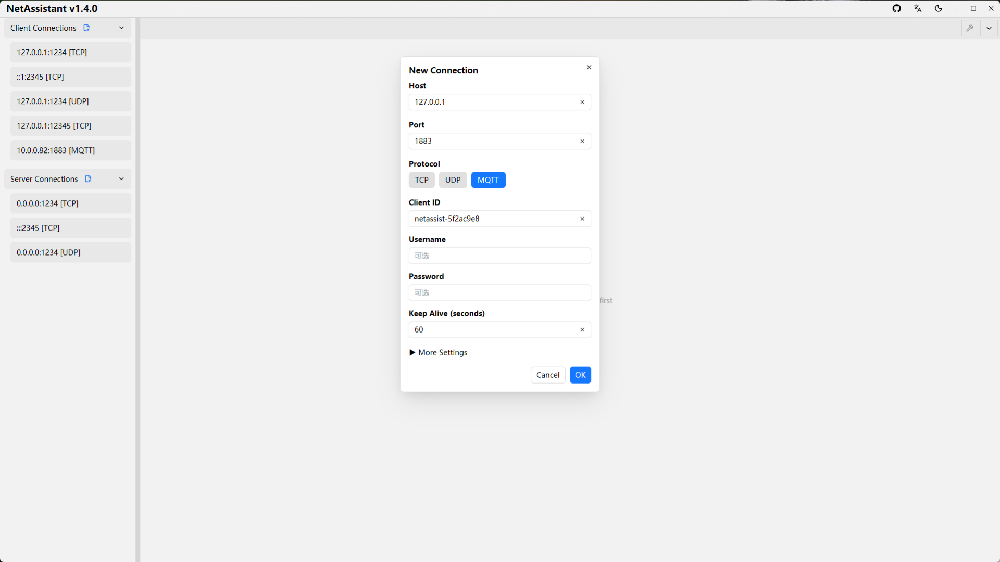

# MQTT クライアント: 軽量なサブスクライブ・パブリッシュ・デバッグ

デバイスがパブリッシュしているか、トピックが正しいか、QoS が機能しているかを確かめるために、たまにブローカーへ接続するだけなら、Electron 製クライアントをインストールするのは大げさです。NetAssistant は **MQTT クライアント**（MQTT 3.1.1 / 5.0）を TCP/UDP ツールと同じアプリに内蔵しており、Rust 製でメモリ使用量は約 20MB です。

**位置づけ**: MQTTX のような専用クライアントに対する、軽量でシナリオ重視の代替手段です。日常的なサブスクライブ、パブリッシュ、TLS の作業には十分で、低メモリ環境、Windows の現場端末、TCP/UDP と並行して MQTT をデバッグする場面ではより手軽に使えます。MQTTX のすべての機能を置き換えることは目的としておらず、MQTT over WebSocket、スクリプト、データ可視化には対応していません。MQTT 5.0 も基本機能のみのため、そうした用途では MQTTX の方が適しています。

> [NetAssistant をダウンロード](/ja/download) · [MQTTX との詳細比較](/en/comparison-mqttx) · [すべての機能](/en/features)

## 対象ユーザー

- **IoT・組み込み開発者**: デバイスのレポート、プラットフォームからのコマンド、トピック設計を確認
- **バックエンド開発者**: ブローカーへ素早く接続し、サブスクリプションの経路を確認
- **アプリを増やしたくない開発者**: TCP/UDP と MQTT のデバッグを 1 つのツールに集約
- **低メモリ環境**: たまの MQTT 確認のために数百 MB のクライアントを使いたくない場合

**向かない用途**: MQTT over WebSocket、ユーザープロパティなどの完全な 5.0 機能、スクリプト、大規模な接続管理。これらには MQTTX や EMQX などの専用クライアントをお使いください。

## 主な機能

### 接続設定

ブローカーのアドレスとポート（デフォルトは 1883）、Client ID、ユーザー名／パスワード、キープアライブを指定して MQTT 接続を作成します。プロトコルバージョンは 5.0（デフォルト）または 3.1.1 を選択できます。追加設定ではクリーンセッションと遺言メッセージ（トピック / ペイロード / QoS / retain）を設定できます。

接続名は任意です。設定すると接続一覧とタブタイトルに名前が表示され（アドレスは情報パネルに、一覧では `name @ host:port [PROTOCOL]` として表示されます）、空の場合はアドレスが使われます。接続を右クリックすると「接続名を変更」「接続を複製」を選べます。複製すると元の設定が新しい接続に引き継がれ、MQTT では新しい Client ID が生成されるため、2 つのクライアントが同じブローカーで互いを切断し合うことはありません。

### MQTT over TLS

TLS を有効にすると接続が暗号化され、3.1.1 と 5.0 の両方で利用できます。証明書の検証には 3 つのモードがあります:

- **システムルート**（デフォルト）: システムのトラストストアで検証
- **カスタム CA**: PEM ファイルのパスをファイル選択ダイアログで指定。プライベート CA を使うブローカー向け
- **検証スキップ**: 証明書の検証を行わない。自己署名証明書のテスト専用で、通信自体は暗号化されます

相互 TLS ではクライアント証明書と秘密鍵（PEM、PKCS#8 / PKCS#1 / SEC1）を任意で指定できます。両方をペアで指定する必要があります。ALPN は任意で、カンマ区切り。空の場合は送信されません。保存されるのは証明書のファイルパスのみで、PEM の内容は保存されません。証明書の期限切れ、ホスト名の不一致、信頼できない証明書チェーンなどでハンドシェイクに失敗した場合は、分かりやすい原因と対処方法が表示されます。

### MQTT 5.0（オプション）

**プロトコルバージョン**で **5.0**（新しい接続のデフォルト）と **3.1.1** を切り替えられます。5.0 を選択すると、追加設定に 2 つの接続プロパティが表示されます:

- **セッション有効期限（秒）**: 空欄なら送信しません。0 は切断時にセッションを破棄し、正の値はその時間まで保持します。
- **受信最大値**: 1〜65535。空欄なら送信しません。同時に処理中の QoS 1/2 パブリッシュ数の上限を指定します。

5.0 では、拒否された CONNACK、失敗した SUBACK、ブローカー起点の DISCONNECT のいずれも理由コードとブローカーの理由文字列を表示します。Clean Start は Clean Session スイッチを共用し、Client ID が空の場合は強制的に有効になります。ユーザープロパティ、Will Delay、サブスクリプション識別子、共有サブスクリプションなどの高度な機能には対応していません。QoS、retain、遺言メッセージは 3.1.1 と同じ動作です。

### サブスクリプション管理

再接続せずに、実行中いつでもサブスクリプションを追加・編集・削除できます。サブスクリプションは接続ごとに分離され、自動再接続後は有効なエントリだけが復元されます。各サブスクリプションには独立したスイッチがあり、ブローカーが確認（SUBACK）して初めて点灯します。失敗または 10 秒のタイムアウトでそのエントリは理由付きで無効化されます（MQTT 5 では「認可されていない」を区別できますが、3.1.1 は拒否されたとしか報告できません）。オフの状態は永続化され、再起動や再接続後も維持されます。オフライン時、クリーンセッションの接続ではエントリを直接オフにできますが、永続セッション（3.1.1 で Clean Session オフ、または 5.0 で Clean Start オフかつセッション有効期限が正の値）ではブローカー側にサブスクリプションが残るため、接続してから解除する必要があります。一覧はサイドバーいっぱいに表示され、必要に応じてスクロールします。ホバーでトピック全体を確認でき、ダブルクリックでコピーできます。

### パブリッシュ

トピック、QoS（0/1/2）、retain を設定し、ペイロードはテキストと HEX モードに対応しています。トピックのドロップダウンには現在の接続で最近使ったトピックが QoS と retain とともに表示され、接続ごとに最大 20 件まで保持されます。

パブリッシュに失敗すると、右上に通知が表示され、対象トピックと理由が示されます。ブローカーに拒否された QoS 1/2 のパブリッシュでは理由コードが表示され（MQTT 5 は「認可されていない」などのケースを区別できますが、3.1.1 の PUBACK には理由コードがなく、ローカルの送信エラーしか報告できません）、QoS 0 はブローカーからの確認自体がないため、ローカルの配信失敗のみが報告されます。送信タスクや定期送信が同じトピックへ高頻度でパブリッシュする場合、同一の通知は 3 秒に 1 回だけ表示されますが、メッセージログにはすべてのエントリが記録されます。QoS チップにホバーすると、その意味（最大 1 回 / 少なくとも 1 回 / ちょうど 1 回）を確認できます。

### メッセージ表示と管理

各メッセージにはトピックタグが表示され、retain されたメッセージにはマーカーが付きます。トピックタグをダブルクリックすると生のトピックをコピーできます。既存のメッセージログ、検索、エクスポート、JSON 整形、返信ルールは MQTT モードでもすべて利用できます。

### 自動返信と定期送信

自動返信は、メッセージを受信したトピックへそのまま応答をパブリッシュします。定期送信も現在のパブリッシュトピックを使うため、ハートビートやプラットフォームコマンドのシミュレーションに便利です。

## クイックスタート

1. 接続を作成し、**MQTT** を選択
2. ブローカーのアドレス、ポート、Client ID、認証情報を入力
3. 接続後、`device/+/status` などのサブスクリプションを追加
4. トピック、QoS、retain、ペイロードを入力してパブリッシュ
5. 受信メッセージを確認。デバッグ時は検索やエクスポートを活用

## NetAssistant と MQTTX の比較

| 観点 | NetAssistant | MQTTX |
| ---- | ---- | ---- |
| 構成 | Rust + GPUI ネイティブ | Electron + Vue |
| メモリ | 約 20MB | 数百 MB |
| MQTT バージョン | MQTT 3.1.1 / 5.0（基本機能） | MQTT 3.1.1 / 5.0（より完全） |
| TLS / WebSocket | TLS 対応（3 種の検証モード、相互 TLS）、WebSocket 非対応 | 両方対応 |
| スクリプト | なし | あり |
| 接続管理 | 基本的なマルチ接続 | より高度 |
| TCP/UDP デバッグとの統合 | 同一アプリ | 別アプリ |
| 価格 | 無料・オープンソース | 無料 |

結論: **基本的な MQTT デバッグには NetAssistant、WebSocket・スクリプト・より充実した 5.0 機能には MQTTX** を選んでください。詳しくは [MQTTX との比較](/en/comparison-mqttx)をご覧ください。

## FAQ

### NetAssistant は MQTT 5.0 に対応していますか？

はい。NetAssistant は MQTT 3.1.1 と 5.0 を選択可能なプロトコルバージョンとして提供しています。5.0 モードではバージョン選択、セッション有効期限、受信最大値、理由コードに対応しますが、ユーザープロパティやサブスクリプション識別子などの高度な機能は提供していません。

### MQTT over TLS や WebSocket に対応していますか？

TLS に対応しており、MQTT over WebSocket には対応していません。接続設定で TLS を有効にし、システムルート、カスタム CA、検証スキップから選択できます。相互 TLS 用のクライアント証明書と秘密鍵も任意で指定でき、3.1.1 と 5.0 の両方に適用されます。

### NetAssistant は MQTTX の代わりになりますか？

軽量なデバッグ用途では代わりになります。日常的なサブスクライブ、パブリッシュ、TLS の作業、低メモリ環境、Windows の現場端末、TCP/UDP と並行した MQTT デバッグなどに適しています。MQTT over WebSocket、スクリプト、データ可視化、より充実した 5.0 機能が必要な場合は MQTTX の方が適しています。

### QoS 2 と retain に対応していますか？

はい。パブリッシュでは QoS 0/1/2 と retain に対応しています。サブスクリプションは実行中に追加・編集・削除でき、再接続後も復元されます。

### 無料ですか？

はい。NetAssistant は Apache-2.0 のオープンソースで、すべての機能を利用できます。

## 関連ページ

- [MQTT チュートリアル: 接続・サブスクライブ・パブリッシュ](/en/guide/mqtt)
- [MQTT トラブルシューティング](/en/mqtt-troubleshooting)
- [MQTT TLS の設定](/en/mqtt-tls)
- [MQTT 5.0 クライアント](/en/mqtt-5)
- [MQTT テストのシナリオ](/en/mqtt-testing)
- [MQTTX との比較](/en/comparison-mqttx)
- [MQTT Explorer との比較](/en/compare/mqtt-explorer)
- [MQTT.fx との比較](/en/compare/mqtt-fx)
- [MQTT FAQ](/en/mqtt-faq)
- プラットフォーム別インストール: [Windows](/en/mqtt-client-windows)、[macOS](/en/mqtt-client-mac)、[Linux](/en/mqtt-client-linux)
- [TCP/UDP 負荷テスト](/en/tcp-stress-test)
- [すべての機能](/en/features)
- [NetAssistant をダウンロード](/ja/download)
