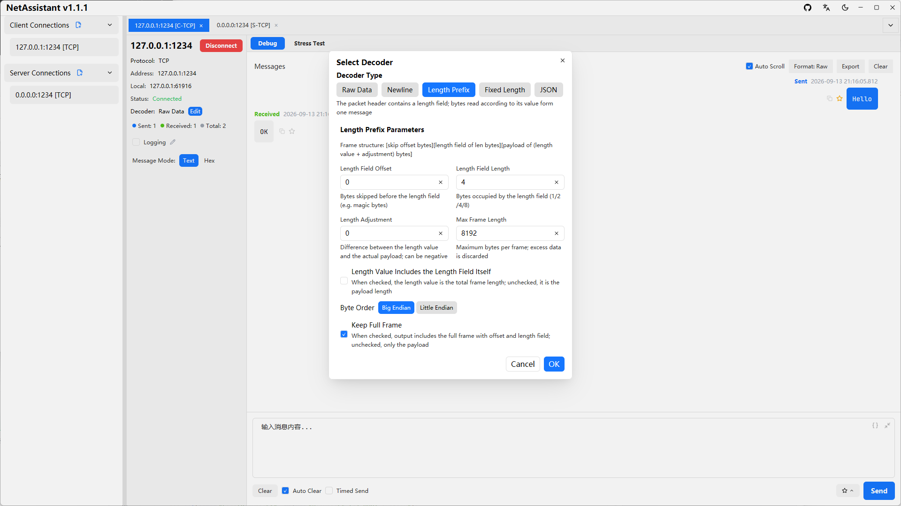
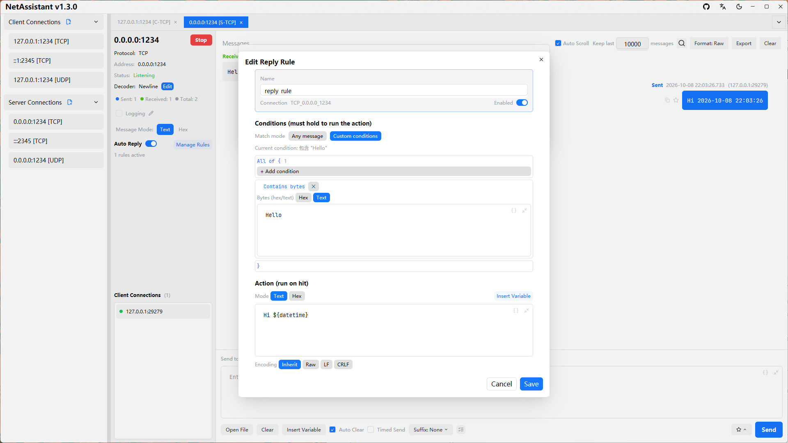

# TCP デバッグツール: 接続・フレーミング・応答

TCP のデバッグでは、主に 3 つの場面でつまずきます。ポートに接続できない、受信したバイトがつながって見える、リクエストに応答が返らない。NetAssistant はクライアント／サーバー接続、4 種のデコーダー、返信ルール、定期送信を 1 つのウィンドウにまとめ、これらをまとめて解決します。

> [NetAssistant をダウンロード](/ja/download) · [TCP/UDP デバッグガイド](/en/guide/tcp-udp) · [すべての機能](/en/features)

## 対象ユーザー

- **組み込み・IoT 開発者**: TCP デバイス、ゲートウェイ、DTU のデバッグ
- **バックエンド開発者**: 使い捨てのスクリプトを書かずに、社内サービスへ生のリクエストを送信
- **プロトコル実装者**: フレームをバイト単位で HEX 表示して確認
- **サーバーをシミュレートしたい人**: ローカルポートで待ち受け、デバイスからの接続を待機

## 3 つの接続モード

| モード | 用途 | 典型的な使い方 |
| ---- | ---- | ---- |
| TCP クライアント | リモートのアドレスとポートに接続 | デバイス、サービスのエンドポイント |
| TCP サーバー | ローカルポートで待ち受け、接続を受け入れる | プラットフォームやデバイスサービスのシミュレーション |
| ローカルバインド | 送信元アドレスや NIC を指定 | マルチ NIC のホスト、送信元 IP の確認 |

IPv4 と IPv6 の両方に対応しています。サーバーモードでは複数のクライアント接続を保持し、それぞれに独立した送受信ビューがあります。

## スティッキーパケットの解決: 4 種のデコーダー

TCP はメッセージの境界を保持しません。どこで 1 つのメッセージが完了するかを決めるのがデコーダーです。NetAssistant は生データ、行区切り、長さプレフィックス、JSON の 4 種を用意しており、独自バイナリ、テキストプロトコル、TLV、TCP 上の JSON に対応します。

デコーダーの選択を誤ると、メッセージがつながって見える最も一般的な原因になります。デコーダーは表示と分割だけに影響し、送信するバイト列は変わりません。境界のルール、トレードオフ、トラブルシューティングは [TCP スティッキーパケット](/en/tcp-sticky-packet)をご覧ください。

## 送信と自動返信

- **テキスト / HEX モード**: テキストは UTF-8 で送信され、HEX は生のバイト列を送信します。`0x00` や印字できないデータを含むフレームでは重要です
- **改行コード**: 継承、なし、LF、CRLF から選択でき、手動で改行を付ける必要がありません
- **定期送信**: 一定間隔で繰り返し送信。ハートビートやデバイスレポートのシミュレーションに便利です
- **返信ルール**: 受信メッセージをバイト列、JSON、正規表現、チェックサムで照合し、自動で返信してサーバーをエミュレートします
- **ファイルから読み込み**: ローカルファイルからペイロードを読み込み、UTF-8 / GBK / ANSI でデコードできます（最大 1 MiB）

## クイックスタート

1. 接続を作成し、TCP クライアントまたはサーバーを選択
2. 接続先のアドレスとポート、またはローカルの待ち受けポートを入力
3. 接続後、プロトコルに合ったデコーダーを選択
4. ペイロードを入力し、テキストまたは HEX モードを選択
5. 自動応答用の返信ルールを追加するか、定期送信を有効化
6. 検索でメッセージを探したり、ログを TXT / JSON / CSV でエクスポート

## 負荷テストを行うタイミング

機能確認が通ったら、JMeter や wrk をインストールする代わりに、内蔵の [TCP/UDP 負荷テスト](/en/tcp-stress-test)で QPS と p99 レイテンシを測定しましょう。

## FAQ

### TCP デバッグツールはどんな問題を解決しますか？

到達性、正しいメッセージのフレーミング、レスポンスの素早い検証です。これは TCP 連携作業の大部分を占める中核です。

### 受信データがつながって届くのはなぜですか？

TCP はメッセージ境界を持たないバイトストリームです。改行、長さプレフィックス、JSON などで境界を定義し、対応するデコーダーを選択してください。

### クライアントとサーバーの両方として使えますか？

はい。両方のモードに対応しており、サーバーモードでは複数のクライアント接続を管理できます。

### IPv6 に対応していますか？

はい。クライアント・サーバーの両モードで IPv4 と IPv6 を利用できます。

### シリアルポートや Unix ソケットに対応していますか？

いいえ。NetAssistant は TCP/UDP/MQTT のネットワーク接続のみを扱うツールで、シリアルポートツールではありません。

## 関連ページ

- [TCP スティッキーパケット](/en/tcp-sticky-packet)
- [TCP/UDP 負荷テスト](/en/tcp-stress-test)
- [ソケットデバッグツール](/en/socket-debug-tool)
- [UDP デバッグツール](/ja/udp-debug-tool)
- [Windows ネットワーク診断ツール](/en/windows-network-debug-tool)
- [すべての機能](/en/features)
