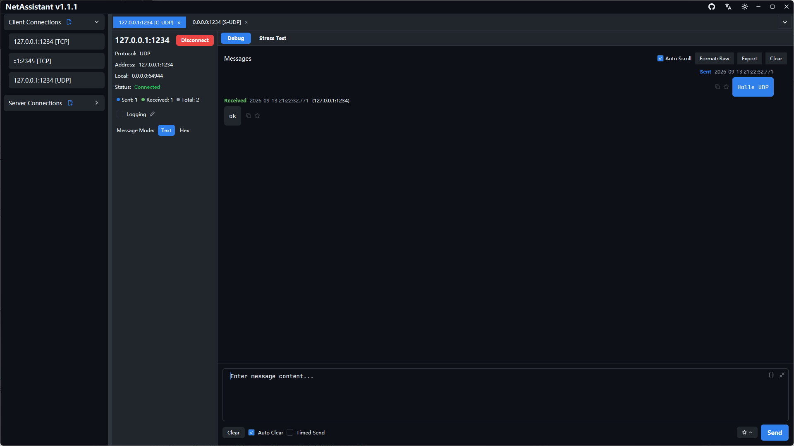
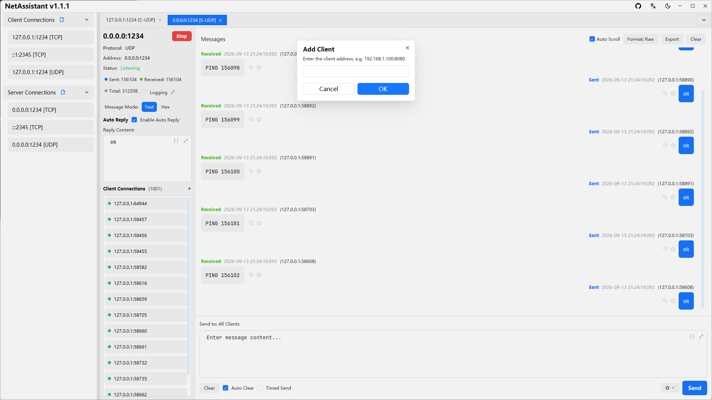

# UDP デバッグツール: コネクションレス送受信と複数デバイスの返信

UDP にはハンドシェイクも再送もありません。アドレスを入力して送信するだけです。そのためデバイス探索、ハートビート、ログ転送、リアルタイム制御の定番プロトコルになっていますが、その一方で「送ったのに応答がない」問題の切り分けが難しくなります。NetAssistant の UDP デバッグツールは、クライアント、サーバー、複数デバイスの返信を 1 つのウィンドウにまとめます。

> [NetAssistant をダウンロード](/ja/download) · [TCP/UDP デバッグガイド](/en/guide/tcp-udp) · [すべての機能](/en/features)

## 対象ユーザー

- **IoT・組み込み開発者**: UDP のレポート、コマンド、ハートビートを確認
- **デバイス探索の作業**: 探索コマンドをブロードキャストし、LAN 内の返信を収集
- **バックエンド開発者**: UDP サーバーを立ち上げ、クライアントが実際に送った内容を確認
- **ネットワークポリシーの確認**: UDP ポートがファイアウォールで許可されているかを確認

## クライアントとサーバー

| モード | 動作 | 使い方 |
| ---- | ---- | ---- |
| UDP クライアント | 対象のアドレスとポートへデータグラムを送信 | コマンド送信、レポートのシミュレーション |
| UDP サーバー | ローカルポートで待ち受け、データグラムを受信 | デバイスのシミュレーション、クライアント通信の検査 |
| クライアントを手動追加 | クライアント一覧に追加の送信先を登録 | 複数デバイスへの送信、よく使う送信先の保持 |

UDP クライアントは「接続」しません。対象アドレスがそのまま送信先になります。サーバーは単に待ち受けるだけで、各データグラムの送信元 `ip:port` が表示され、ダブルクリックでコピーできます。

## ブロードキャストと複数の返信

`192.168.1.255` のようなサブネットのブロードキャストアドレスに探索コマンドを送ると、ネットワーク上のすべてのデバイスが応答する可能性があります。多くのツールは設定した送信先からの返信だけを表示し、それ以外を黙って破棄します。NetAssistant はすべてを表示し、想定外の送信元を強調表示するため、デバイスを見逃しません。

ブロードキャストアドレスの選び方、パケットキャプチャ、よくある失敗原因は [UDP ブロードキャストによるデバイス探索](/en/udp-broadcast-device-discovery)をご覧ください。

## 送受信の機能

- **テキスト / HEX モード**: HEX は生のバイト列を送信します。`0x00` を含むデータグラムでは重要です
- **改行コード**: なし、LF、CRLF から選択でき、デバイスのパーサーに合わせられます
- **定期送信**: 一定間隔で繰り返し送信。ハートビートや継続的なレポートに便利です
- **返信ルール**: バイト列、JSON、正規表現、チェックサムで照合し、自動で返信します
- **ファイルから読み込み**: ファイルからペイロードを読み込み、UTF-8 / GBK / ANSI でデコードできます（最大 1 MiB）
- **メッセージ管理**: 検索、お気に入り、TXT / JSON / CSV へのエクスポート、任意のリアルタイムログ

## クイックスタート

1. 接続を作成し、UDP クライアントまたはサーバーを選択
2. クライアントなら対象のアドレスとポート、サーバーなら待ち受けポートを入力
3. ペイロードを入力し、テキストまたは HEX モードを選択
4. 送信し、メッセージビューで返信と送信元アドレスを確認
5. **クライアントを追加**で複数の送信先を管理
6. 繰り返し通信する場合は定期送信を有効化

## デバッグにおける UDP と TCP の違い

| 観点 | UDP | TCP |
| ---- | ---- | ---- |
| 接続 | コネクションレスで即時送信 | ハンドシェイクが必要 |
| メッセージ境界 | データグラム単位で保持 | バイトストリームのためデコーダーが必要 |
| 信頼性 | 配信保証なし、再送なし | 順序保証・信頼性あり、再送あり |
| ブロードキャスト / マルチキャスト | ブロードキャスト対応 | ブロードキャストなし |
| 典型的な用途 | 探索、ハートビート、リアルタイム制御 | ファイル転送、長寿命のコマンドチャネル |

UDP はパケットを落とす可能性があるため、1 回応答がなかっただけで相手側の故障と判断しないでください。まず待ち受けポート、ファイアウォールのルール、ペイロードの形式を確認しましょう。

## FAQ

### UDP デバッグツールはどう使いますか？

UDP クライアントを作成して対象へ送信するか、UDP サーバーを作成してローカルポートで待ち受けます。ハンドシェイクはありません。

### 送信は成功するのに返信が来ないのはなぜですか？

UDP は配信を保証しません。対象側のリスナー、ファイアウォールのルール、ペイロードの形式を確認してください。

### 複数デバイスからの返信を受け取るには？

コマンドをブロードキャストしてください。NetAssistant はすべての返信を表示し、想定外の送信元を強調表示します。

### UDP でもスティッキーパケットは発生しますか？

いいえ。データグラムの境界は保持されますが、パケットの損失・重複・順序の入れ替わりは起こり得ます。

### ブロードキャストと IPv6 に対応していますか？

ブロードキャスト送信に対応しており、アドレスは IPv4 でも IPv6 でも使用できます。

## 関連ページ

- [UDP ブロードキャストによるデバイス探索](/en/udp-broadcast-device-discovery)
- [TCP デバッグツール](/ja/tcp-debug-tool)
- [TCP/UDP 負荷テスト](/en/tcp-stress-test)
- [Windows ネットワーク診断ツール](/en/windows-network-debug-tool)
- [すべての機能](/en/features)
- [NetAssistant をダウンロード](/ja/download)
