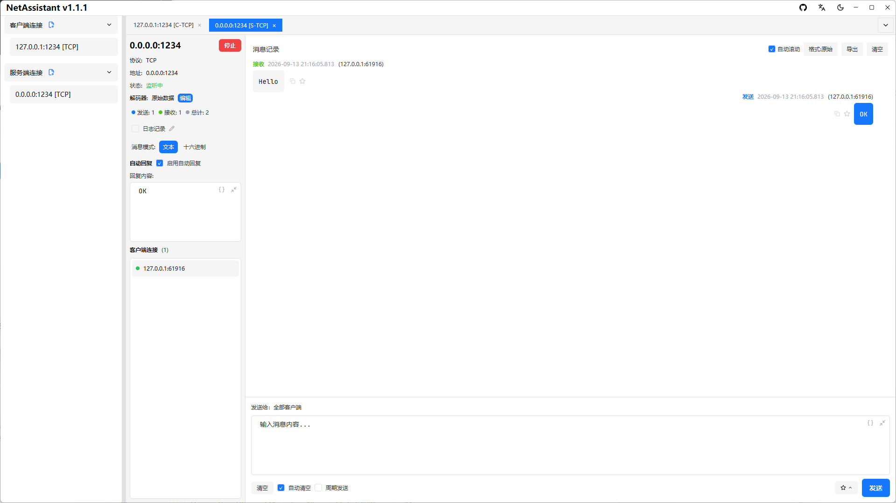

# Linux 网络调试助手：TCP/UDP 调试与压力测试

Linux 上的网络工具很多，但大多数是 `nc`、`socat`、`tcpdump` 这类命令行工具：灵活，却看不到报文交互过程，处理 TCP 粘包要自己写解析，压测还要另找工具。

NetAssistant 是 Linux 上的图形化网络调试助手，免费开源，提供 **deb、AppImage、tar.gz** 三种安装方式，支持 x86_64 与 ARM64（含树莓派）。TCP/UDP 客户端与服务端、四种粘包解码器、MQTT 3.1.1 调试和高并发压力测试都在同一个应用里。

> [下载 Linux 版](/download) · [查看全部功能](/features) · [快速上手](/guide/)



## 为什么 Linux 用户需要 NetAssistant

- **图形化收发调试**：像聊天一样看报文往返，不用在终端里拼 `nc` 参数
- **接收侧粘包解码**：原始数据、行分隔、长度前缀、JSON 四种解码器，自动按协议分帧
- **内置压测**：直接看 QPS 与 p50/p95/p99 延迟，不用额外部署压测服务
- **多平台一致**：Windows、macOS、Linux 同一套操作习惯，配置自动保存
- **ARM64 支持**：树莓派 5、ARM 服务器等设备有原生 aarch64 构建

## 在 Linux 上安装

### 推荐：deb 包（Debian / Ubuntu 及衍生版）

1. 从[下载页](/download)获取 `netassistant-linux-x86_64.deb`
2. 安装并自动解析依赖：

```bash
sudo apt install ./netassistant-linux-x86_64.deb
```

3. 从应用菜单启动，或终端运行 `netassistant`

### AppImage（免安装，适合 Fedora / Arch 等）

```bash
chmod +x netassistant-linux-x86_64.AppImage
./netassistant-linux-x86_64.AppImage
```

首次运行若提示 FUSE 相关错误：

```bash
sudo apt install libfuse2
```

### tar.gz（轻量）

```bash
tar -xzf netassistant-linux-x86_64.tar.gz
chmod +x netassistant
./netassistant
```

裸二进制需要 GTK3 依赖；若启动报缺少 `libgtk-3.so.0`：

```bash
sudo apt install libgtk-3-0
```

### ARM64 / 树莓派

将文件名中的 `x86_64` 替换为 `aarch64`，例如 `netassistant-linux-aarch64.deb`、`netassistant-linux-aarch64.AppImage` 或 `netassistant-linux-aarch64.tar.gz`。ARM64 版本为自动构建产物，未经真机完整测试。

## 核心功能

### TCP/UDP 客户端与服务端

创建 TCP 客户端、TCP 服务端、UDP 客户端与 UDP 服务端连接，支持 IPv4/IPv6、多标签页、本地地址与端口绑定，适合服务端联调和设备模拟。

### TCP 粘包与四种解码器

Linux 服务端最常见的问题之一就是 TCP 粘包。NetAssistant 在接收侧提供原始数据、行分隔、长度前缀、JSON 四种解码器，按协议格式自动拆分消息。


### 内置压力测试

对自研服务端做并发吞吐、延迟分布和稳定性评估：Ping-Pong 与吞吐模式、实时 QPS、p50/p95/p99、失败原因分类、CSV 报告导出。[压力测试指南](/guide/stress)

### MQTT 调试

内置 MQTT 3.1.1 客户端，支持订阅管理、QoS 0/1/2、retain、遗嘱消息与自动回复，适合物联网与 Broker 联调。

### 内置工具箱

转换、校验、哈希、时间、JSON、编码六组工具常驻标签页，包含 Hex/文本互转、CRC16/CRC32、MD5/SHA、时间戳转换、Base64/URL 编解码。

## 和命令行工具的区别

| 维度 | NetAssistant | nc / socat | Wireshark / tshark |
| ---- | ---- | ---- | ---- |
| 形态 | 图形界面 | 命令行 | 抓包分析 |
| 报文交互视图 | 聊天式记录，可搜索/收藏/导出 | 需要自己拼输出 | 以抓包为单位 |
| TCP 粘包解码 | 原始/行/长度前缀/JSON | 需自行解析 | 部分流重组 |
| 内置压测 | QPS + p50/p95/p99 | 无 | 无 |
| 脚本化 | 无 | 强 | 强（tshark） |
| 适合场景 | 图形化联调、协议验证 | 脚本、管道、服务器环境 | 抓包定位、协议分析 |

`nc`/`socat` 的优势是脚本化和无图形环境；Wireshark 擅长抓包定位。NetAssistant 补齐的是**图形化收发、粘包解码和实时压测**这一段。

## 典型使用场景

- **嵌入式 Linux / 树莓派**：在设备上直接做 TCP/UDP 联调，验证传感器与控制指令
- **服务端联调**：作为客户端或服务端模拟对端，验证协议格式与异常处理
- **物联网设备发现**：UDP 广播发送 discovery 指令，展示所有设备回复并高亮非预期地址
- **教学与实验**：在 Linux 桌面环境完成网络编程实验，不依赖 Windows 虚拟机

## 系统要求

| 项目 | 要求 |
| ---- | ---- |
| 系统 | Ubuntu 22.04 及以上或其他主流发行版 |
| 架构 | x86_64 或 ARM64（aarch64） |
| 图形环境 | 需要 GTK3；建议 Vulkan 兼容 GPU |
| 安装方式 | deb、AppImage、tar.gz |
| 许可 | Apache-2.0，免费使用 |

## 常见问题

### Linux 上怎么安装 NetAssistant？

Debian/Ubuntu 及衍生版推荐下载 deb 包，执行 `sudo apt install ./netassistant-linux-x86_64.deb` 自动解析依赖；其他发行版可用 AppImage 或 tar.gz。详见[下载页](/download)。

### AppImage 启动报 FUSE 错误怎么办？

先安装 `libfuse2`：`sudo apt install libfuse2`，然后再运行 AppImage。

### 启动报缺少 libgtk-3.so.0 怎么办？

安装 GTK3：`sudo apt install libgtk-3-0`。裸二进制与 tar.gz 版本需要自行安装该依赖。

### 支持 ARM64 和树莓派吗？

支持。提供 aarch64 的 deb、AppImage 与 tar.gz，可在树莓派 5、ARM 服务器等设备上运行。

### 有命令行版本吗？

目前只提供图形界面版本，没有 CLI。如果需要脚本化测试，可以继续使用 `nc`、`socat`、`iperf` 等命令行工具；NetAssistant 适合需要图形界面、粘包解码和实时指标的场景。

## 相关页面

- [Windows 网络调试助手](/windows-network-debug-tool)
- [macOS 网络调试助手](/mac-network-debug-tool)
- [TCP/UDP 调试指南](/guide/tcp-udp)
- [下载 NetAssistant](/download)
