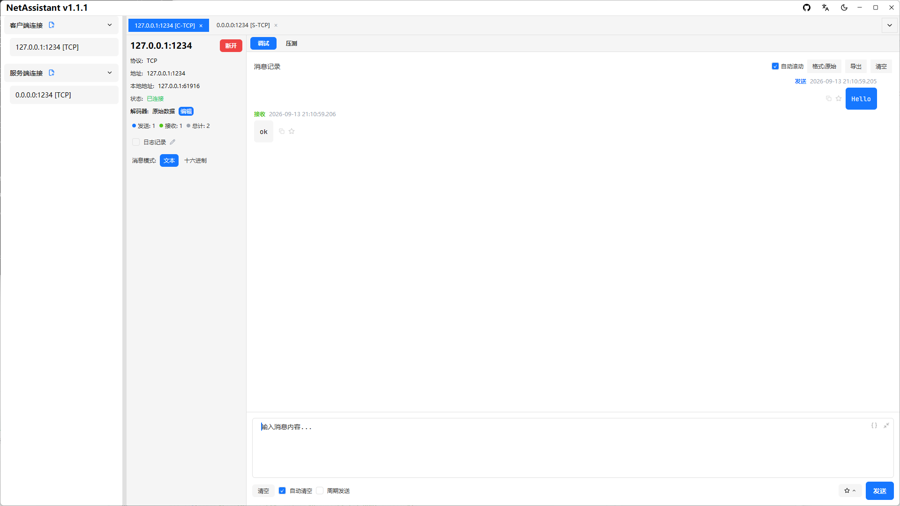
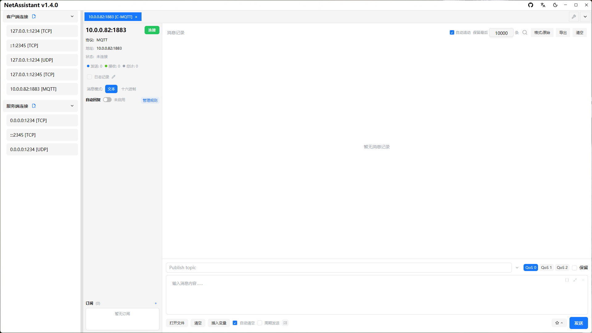

# Mac 网络调试助手：在 macOS 上调试 TCP/UDP

很多开发者从 Windows 换到 Mac 后，第一件不习惯的事就是找不到顺手的网络调试工具：老牌的**网络调试助手（NetAssist）只有 Windows 版**，而 Mac 上能同时做 TCP/UDP 客户端、服务端和粘包处理的工具并不多。

NetAssistant 是 macOS 原生的网络调试助手，支持 Apple Silicon 与 Intel，免费开源。它把 TCP/UDP 客户端与服务端、四种粘包解码器、MQTT 3.1.1 调试、十六进制收发和高并发压力测试放在同一个应用里。

> [下载 macOS 版](/download) · [查看全部功能](/features) · [快速上手](/guide/)

## 为什么 Mac 用户需要 NetAssistant

- **NetAssist 没有 Mac 版**：想在 macOS 上继续用熟悉的调试方式，需要另一个工具
- **原生构建**：Rust + GPUI，不是 Electron 套壳，启动快、内存占用低
- **Apple Silicon 原生支持**：Universal DMG 同时兼容 M1/M2/M3 等 Apple Silicon 与 Intel Mac
- **功能不缺**：TCP/UDP 客户端与服务端、粘包解码、MQTT、工具箱、压力测试
- **体验统一**：暗黑模式跟随系统，多标签页管理多个连接，配置自动保存

## 在 macOS 上安装

### 推荐：Universal DMG

1. 从[下载页](/download)获取 `netassistant-macos-universal.dmg`
2. 打开 DMG，将 NetAssistant 拖入 Applications 文件夹
3. 首次打开若提示“无法验证开发者”，右键点击 NetAssistant → 打开，或在“系统设置 → 隐私与安全性”中选择仍要打开

这是应用未公证时的正常现象，并非应用损坏，不需要关闭 Gatekeeper。

### 备选：zip

下载 `netassistant-macos-universal.zip`，解压即用，会保留可执行权限。

## 核心功能

### TCP/UDP 客户端与服务端

在 Mac 上创建 TCP 客户端、TCP 服务端、UDP 客户端与 UDP 服务端连接，支持 IPv4/IPv6、双栈地址、多标签页并行调试和本地端口绑定。

### TCP 粘包与四种解码器

接收侧支持原始数据、行分隔、长度前缀、JSON 四种解码器，按协议格式自动拆分粘包；发送与接收均支持文本/十六进制模式。

### 内置压力测试

无需另装压测工具，直接对自研服务端做并发吞吐与延迟评估：实时 QPS、p50/p95/p99、失败原因分类，支持 CSV 报告导出。[压力测试指南](/guide/stress)

### MQTT 调试

内置 MQTT 3.1.1 客户端，支持订阅管理、QoS 0/1/2、retain、遗嘱消息与自动回复，适合物联网设备与 Broker 联调。

### 内置工具箱

转换、校验、哈希、时间、JSON、编码六组工具常驻标签页，调试协议时不用在浏览器和编辑器之间来回切换。

## 和其他 Mac 工具的区别

| 维度 | NetAssistant | Packet Sender | Wireshark |
| ---- | ---- | ---- | ---- |
| 定位 | TCP/UDP 收发调试 | 多协议收发工具 | 抓包分析 |
| 客户端/服务端 | TCP/UDP 均支持 | 支持 | 不做收发交互 |
| 接收侧粘包解码 | 原始/行/长度前缀/JSON | 无 | 部分流重组 |
| 内置压测 | QPS + 延迟分位数 | 基础 | 无 |
| 脚本/CLI | 无 | 支持 | tshark |
| 开源 | Apache-2.0 | 开源 | GPL |

Packet Sender 的优势是协议覆盖更广（SSL/DTLS、HTTP、CLI 自动化）；Wireshark 擅长抓包分析。NetAssistant 的定位是**在 Mac 上快速做 TCP/UDP 收发、粘包处理和压测**。

## 典型使用场景

- **嵌入式与物联网**：Mac 上通过 UDP 广播发现设备，十六进制收发，按来源地址区分回复
- **后端接口联调**：作为 TCP/UDP 客户端或服务端验证通信逻辑与异常处理
- **协议学习与教学**：在 Mac 上完成 TCP/UDP 报文实验，不依赖 Windows 虚拟机
- **多平台切换**：同一套配置和操作习惯在 Windows、Linux、macOS 之间复用

## 系统要求

| 项目 | 要求 |
| ---- | ---- |
| 系统 | macOS 10.15 或更高版本 |
| 架构 | Apple Silicon 与 Intel（Universal） |
| 安装方式 | Universal DMG 或 zip |
| 许可 | Apache-2.0，免费使用 |

## 常见问题

### Mac 上能用网络调试助手吗？

老牌的 NetAssist 仅支持 Windows，没有 macOS 版本。NetAssistant 是 macOS 原生的网络调试助手，可替代 NetAssist 完成 TCP/UDP 调试。

### 支持 Apple Silicon 吗？

支持。macOS 版本提供 Universal DMG，同时兼容 Apple Silicon 与 Intel，macOS 10.15 及以上均可运行。

### 提示“无法验证开发者”怎么办？

右键点击 NetAssistant 选择“打开”，或在“系统设置 → 隐私与安全性”中选择仍要打开即可。这是未公证应用的正常提示，不需要关闭 Gatekeeper。

### 和 Packet Sender 有什么区别？

Packet Sender 的协议覆盖更广，支持 SSL/DTLS、HTTP 客户端与 CLI 自动化；NetAssistant 更专注 TCP/UDP 收发调试，内置接收侧粘包解码和压力测试。想继续用 NetAssist 的操作方式，可看 [NetAssist 替代指南](/compare/netassist)；完整对比见[同类工具对比](/comparison)。

### 支持 MQTT 吗？

支持 MQTT 3.1.1 客户端，包含订阅管理、QoS 0/1/2、retain 与遗嘱消息；暂不支持 MQTT 5.0、TLS 与 MQTT over WebSocket。

## 相关页面

- [Windows 网络调试助手](/windows-network-debug-tool)
- [Linux 网络调试助手](/linux-network-debug-tool)
- [TCP/UDP 调试指南](/guide/tcp-udp)
- [下载 NetAssistant](/download)
