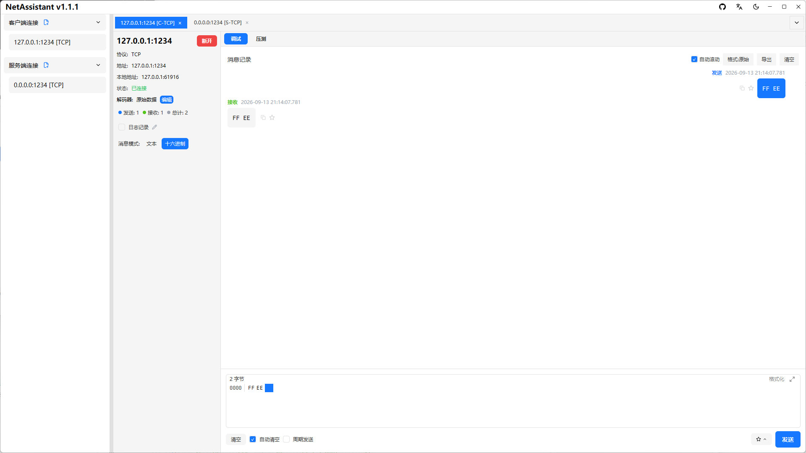
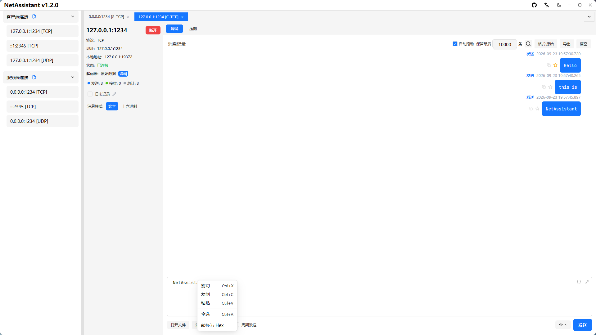

# Modbus TCP 调试：用十六进制报文直接对话

先说明边界：**NetAssistant 不是 Modbus 协议客户端**。它不识别功能码、寄存器地址或数据模型，也不提供点表。它提供的是 TCP 连接和十六进制收发——你按 Modbus 规范构造字节，工具原样发出并显示响应。对需要看清每一字节的联调场景，这反而更直接。

> [下载 NetAssistant](/download) · [TCP 调试工具](/tcp-debug-tool) · [全部功能](/features)



## 适合谁

- **PLC / 网关联调**：验证设备 502 端口是否响应、返回帧结构是否正确
- **协议开发**：逐字节比对请求与响应，确认 MBAP 长度、单元标识符
- **故障复现**：手工重放一条报文，判断问题在报文还是业务逻辑
- **快速验证**：不想为一次调试安装完整的 Modbus 主站软件

## Modbus TCP 帧结构

一条 Modbus TCP 报文由 MBAP 报文头和 PDU 组成：

| 字段 | 长度 | 说明 |
| ---- | ---- | ---- |
| 事务标识符 | 2 字节 | 请求与响应配对，可用序号 |
| 协议标识符 | 2 字节 | Modbus 固定为 `00 00` |
| 长度 | 2 字节 | 后续字节数（单元标识符 + PDU） |
| 单元标识符 | 1 字节 | 从站地址，网关场景常用 |
| 功能码 | 1 字节 | 如 03 读保持寄存器、06 写单寄存器 |
| 数据 | N 字节 | 起始地址、数量或写入值 |

注意：**Modbus TCP 没有 CRC**。完整性由 TCP 和 MBAP 长度字段保证。`CRC16-Modbus` 是 Modbus RTU 的校验算法，只应附加在 RTU 帧末尾。

## 示例：读取保持寄存器

读取从站 1 的起始地址 0、10 个保持寄存器：

```text
00 01 00 00 00 06 01 03 00 00 00 0A
```

- `00 01`：事务标识符
- `00 00`：协议标识符
- `00 06`：长度 = 单元标识符(1) + 功能码(1) + 数据(4)
- `01`：单元标识符
- `03`：读保持寄存器
- `00 00`：起始地址
- `00 0A`：寄存器数量 10

一条正常的响应可能是：

```text
00 01 00 00 00 05 01 03 02 00 64
```

`00 64` 即十进制 100。如果功能码变成 `83`，说明返回了异常码，需要查设备手册确认是地址非法、数量越界还是权限问题。

## 在 NetAssistant 中怎么做

1. 新建 TCP 客户端，连接设备 IP 与 502 端口
2. 发送区切换到 Hex 模式，粘贴完整报文
3. 点击发送，在接收区查看响应；保持 Hex 显示便于逐字节比对
4. 需要周期轮询时开启周期发送，把请求间隔设为采集周期
5. 需要模拟从站时，新建 TCP 服务端监听 502，并用回复规则按请求字节自动返回响应



## CRC16-Modbus 用在哪

调试 Modbus RTU（串口）时，报文末尾需要 2 字节 CRC，低字节在前。NetAssistant 工具箱的「校验」分组提供 `CRC16-Modbus`：输入去掉 CRC 的 Hex 字节序列即可得到校验值。由于 NetAssistant 不提供串口能力，这个结果主要用于：

- 核对设备手册或抓包中的 RTU 帧校验是否正确
- 为网关、转换器准备 RTU 报文字节

Modbus TCP 帧不需要也不会校验这个值。

## 常见问题

### NetAssistant 是 Modbus 协议客户端吗？

不是。它只提供 TCP 连接与十六进制收发，功能码和数据模型需要你自己构造。

### Modbus TCP 需要 CRC 吗？

不需要。MBAP 含长度字段，完整性由 TCP 保证；CRC16-Modbus 属于 RTU 帧。

### 怎么构造一条请求？

按「事务号 + 0000 + 长度 + 单元号 + 功能码 + 数据」拼接，在 Hex 模式下发送即可。

### 能模拟 Modbus 从站吗？

可以到字节层：TCP 服务端监听 502，用回复规则返回预设 Hex。寄存器模型和异常码需要真实设备或专用模拟器。

### 为什么设备没有响应？

检查端口是否为 502、单元标识符是否正确、长度字段是否与实际字节数一致，以及设备是否只接受 RTU over TCP 封装。

## 相关页面

- [十六进制发送](/hex-send)
- [TCP 调试工具](/tcp-debug-tool)
- [TCP 粘包与拆包](/tcp-sticky-packet)
- [Windows 网络调试助手](/windows-network-debug-tool)
- [全部功能](/features)
- [下载 NetAssistant](/download)
