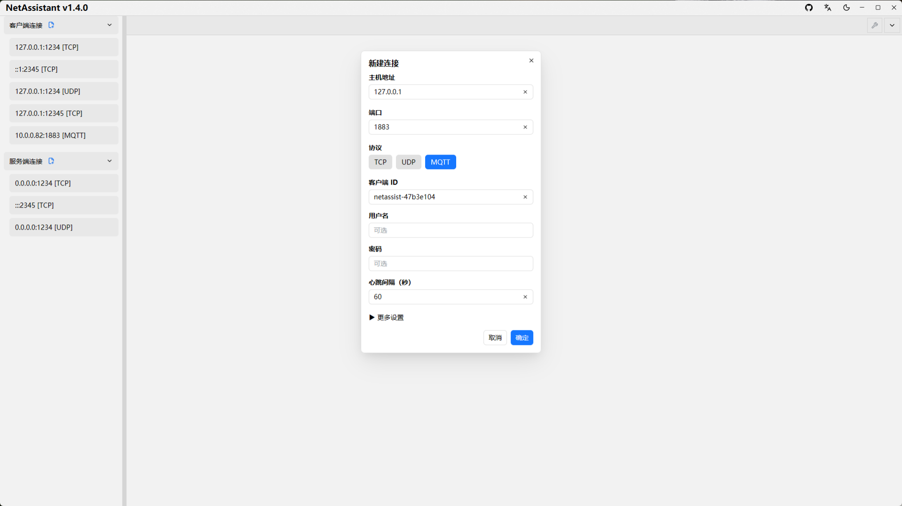
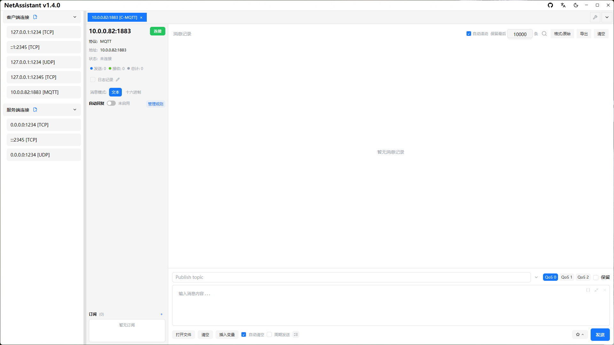

# 轻量级 MQTT 客户端：订阅、发布与调试

如果你只是偶尔连一下 Broker，验证设备有没有发消息、topic 对不对、QoS 有没有生效，专门装一个 Electron 客户端并不划算。NetAssistant 内置 **MQTT 3.1.1 客户端**，和 TCP/UDP 调试在同一个应用里，Rust 原生构建，内存约 20MB。

先说清楚边界：它适合基础 MQTT 调试，**不是 MQTTX 的完整替代品**。MQTT 5.0、TLS、WebSocket 和脚本自动化暂不支持。

> [下载 NetAssistant](/download) · [和 MQTTX 的详细对比](/comparison-mqttx) · [全部功能](/features)

## 适合谁

- **物联网/嵌入式开发者**：验证设备上报、平台下发和 topic 设计
- **后端开发者**：快速连 Broker 发一条消息，确认订阅链路是否正常
- **需要少装一个客户端的人**：TCP/UDP 联调和 MQTT 调试用同一个工具
- **低内存环境**：不想为偶尔的 MQTT 调试常驻几百 MB 内存

**不适合**：需要 MQTT 5.0 属性、TLS 双向认证、WebSocket、脚本自动化或大量连接管理的场景，建议使用 MQTTX、EMQX 或其他专业客户端。

## 核心功能

### 连接配置

新建连接选择 MQTT，填写 Broker 地址与端口（默认 1883）、Client ID、用户名/密码与 KeepAlive。「更多设置」可配置 Clean Session 与遗嘱消息（topic / payload / QoS / retain）。

### 订阅管理

运行时添加、编辑或取消订阅，不需要重连。订阅严格按连接隔离；断线自动重连后会恢复订阅。订阅列表占满侧栏高度，超出时在框内滚动，悬停可看完整 topic，双击复制 topic。

### 发布消息

发送区设置 topic、QoS（0/1/2）与 retain，payload 沿用文本/Hex 模式。topic 输入框右侧下拉可复用当前连接最近发送过的 topic，连同 QoS 与 retain 一起回填，每个连接最多保留 20 条。

### 消息展示与管理

每条消息显示 topic 标签，retain 消息带标记；双击 topic 标签可复制原始 topic。消息记录、搜索、导出、JSON 格式化和回复规则等既有能力全部复用。

### 自动回复与周期发送

自动回复会把应答发回收到消息的 topic；周期发送也按当前发布 topic 发送。适合模拟设备心跳或平台下行指令。

## 快速开始

1. 新建连接，协议选择 **MQTT**
2. 填写 Broker 地址、端口、Client ID 与认证信息
3. 连接成功后，在订阅栏添加 topic（如 `device/+/status`）
4. 在发送区填写 topic、QoS、retain 与 payload，点击发布
5. 在消息区查看订阅到的消息，必要时用搜索或导出定位问题

## 和 MQTTX 的区别

| 维度 | NetAssistant | MQTTX |
| ---- | ---- | ---- |
| 技术栈 | Rust + GPUI 原生 | Electron + Vue |
| 内存占用 | 约 20MB | 日常几百 MB |
| MQTT 版本 | MQTT 3.1.1 | MQTT 3.1.1 / 5.0 |
| TLS / WebSocket | 暂不支持 | 支持 |
| 脚本自动化 | 无 | 支持 |
| 连接管理 | 基础多连接 | 更完善 |
| 与 TCP/UDP 调试集成 | 同一应用 | 独立应用 |
| 价格 | 免费开源 | 免费 |

结论：**基础 MQTT 3.1.1 调试选 NetAssistant，需要完整 MQTT 生态选 MQTTX**。详细差异见 [MQTTX 对比](/comparison-mqttx)。

## 常见问题

### 支持 MQTT 5.0 吗？

暂不支持。当前实现的是 MQTT 3.1.1，适合基础订阅、发布与设备联调。

### 支持 TLS 或 WebSocket 吗？

暂不支持。当前只支持 TCP 直连 Broker，不支持 TLS、MQTT over WebSocket 和 MQTT 5.0。

### 能替代 MQTTX 吗？

基础订阅、发布与轻量调试可以覆盖；需要 MQTT 5.0、TLS、脚本自动化或大规模连接管理时，MQTTX 更合适。

### 支持 QoS 2 和 retain 吗？

支持。发布时可选 QoS 0/1/2 与 retain；订阅在运行时管理，断线重连后自动恢复。

### 免费吗？

免费。NetAssistant 基于 Apache-2.0 许可证开源，全部功能可用。

## 相关页面

- [MQTTX 对比](/comparison-mqttx)
- [TCP/UDP 压力测试](/tcp-stress-test)
- [全部功能](/features)
- [下载 NetAssistant](/download)
