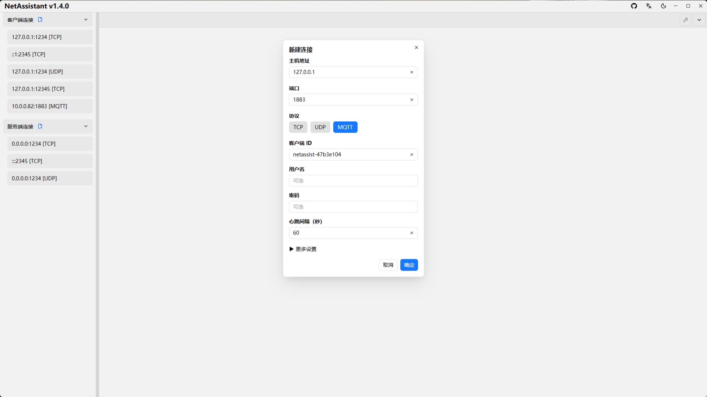
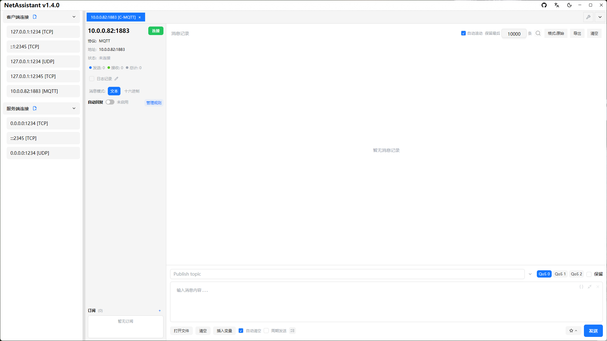

# 轻量级 MQTT 客户端：订阅、发布与调试

如果你只是偶尔连一下 Broker，验证设备有没有发消息、topic 对不对、QoS 有没有生效，专门装一个 Electron 客户端并不划算。NetAssistant 内置 **MQTT 客户端**（MQTT 3.1.1 / 5.0），和 TCP/UDP 调试在同一个应用里，Rust 原生构建，内存约 20MB。

先说清楚边界：它适合基础 MQTT 调试，**不是 MQTTX 的完整替代品**。TLS 与 MQTT 5.0 已经支持（5.0 覆盖基础特性），MQTT over WebSocket 与脚本自动化仍不支持。

> [下载 NetAssistant](/download) · [和 MQTTX 的详细对比](/comparison-mqttx) · [全部功能](/features)

## 适合谁

- **物联网/嵌入式开发者**：验证设备上报、平台下发和 topic 设计
- **后端开发者**：快速连 Broker 发一条消息，确认订阅链路是否正常
- **需要少装一个客户端的人**：TCP/UDP 联调和 MQTT 调试用同一个工具
- **低内存环境**：不想为偶尔的 MQTT 调试常驻几百 MB 内存

**不适合**：需要 MQTT over WebSocket、用户属性等完整 5.0 特性、脚本自动化或大量连接管理的场景，建议使用 MQTTX、EMQX 或其他专业客户端。

## 核心功能

### 连接配置

新建连接选择 MQTT，填写 Broker 地址与端口（默认 1883）、Client ID、用户名/密码与 KeepAlive；协议版本可选 3.1.1（默认）与 5.0。「更多设置」可配置 Clean Session 与遗嘱消息（topic / payload / QoS / retain）。

### MQTT over TLS

开启 TLS 后连接经加密传输，对 3.1.1 与 5.0 同时生效。证书校验分三档：

- **系统根证书**（默认）：按系统信任链校验证书
- **自定义 CA**：填 PEM 文件路径，「选择文件」可直接回填，适合自建 CA 签发的 Broker 证书
- **跳过校验**：不校验证书，仅用于自签证书联调，传输仍然加密

双向认证可选填客户端证书与私钥（PEM，支持 PKCS#8 / PKCS#1 / SEC1），需成对填写；ALPN 可选、逗号分隔，留空不下发。连接配置只保存证书文件路径、不保存 PEM 内容。证书过期、主机名不匹配、证书链不受信任等握手失败会给出可读原因与处置建议。

### MQTT 5.0（可选）

连接表单的「协议版本」可切换 **3.1.1**（默认）与 **5.0**。选 5.0 后，「更多设置」会多出两个连接属性：

- **会话过期（秒）**：留空不下发；填 0 表示断开即过期，大于 0 时 broker 在过期前保留会话。
- **接收最大值**：1-65535，留空不下发，用于限定 broker 可同时在途的 QoS 1/2 报文数。

5.0 下 CONNACK 连接被拒、SUBACK 订阅失败与 broker 主动 DISCONNECT 都会显示具体原因码与 broker 说明；Clean Start 沿用 Clean Session 开关，Client ID 为空时强制 clean start。当前版本不提供用户属性、Will Delay、订阅标识符、共享订阅等高级特性，QoS、retain、遗嘱与 3.1.1 行为一致。

### 订阅管理

运行时添加、编辑或取消订阅，不需要重连。订阅严格按连接隔离；断线自动重连后会恢复订阅。订阅列表占满侧栏高度，超出时在框内滚动，悬停可看完整 topic，双击复制 topic。

### 发布消息

发送区设置 topic、QoS（0/1/2）与 retain，payload 沿用文本/Hex 模式。topic 输入框右侧下拉可复用当前连接最近发送过的 topic，连同 QoS 与 retain 一起回填，每个连接最多保留 20 条。

### 消息展示与管理

每条消息显示 topic 标签，retain 消息带标记；双击 topic 标签可复制原始 topic。消息记录、搜索、导出、JSON 格式化和回复规则等既有能力全部复用。

### 自动回复与周期发送

自动回复会把应答发回收到消息的 topic；周期发送也按当前发布 topic 发送。适合模拟设备心跳或平台下行指令。

## 快速开始

1. 新建连接，协议选择 **MQTT**
2. 填写 Broker 地址、端口、Client ID 与认证信息
3. 连接成功后，在订阅栏添加 topic（如 `device/+/status`）
4. 在发送区填写 topic、QoS、retain 与 payload，点击发布
5. 在消息区查看订阅到的消息，必要时用搜索或导出定位问题

## 和 MQTTX 的区别

| 维度 | NetAssistant | MQTTX |
| ---- | ---- | ---- |
| 技术栈 | Rust + GPUI 原生 | Electron + Vue |
| 内存占用 | 约 20MB | 日常几百 MB |
| MQTT 版本 | MQTT 3.1.1 / 5.0（基础特性） | MQTT 3.1.1 / 5.0（更完整） |
| TLS / WebSocket | TLS 支持（三档校验、双向认证）；WebSocket 不支持 | 均支持 |
| 脚本自动化 | 无 | 支持 |
| 连接管理 | 基础多连接 | 更完善 |
| 与 TCP/UDP 调试集成 | 同一应用 | 独立应用 |
| 价格 | 免费开源 | 免费 |

结论：**基础 MQTT 调试选 NetAssistant，需要 WebSocket、脚本自动化或完整 5.0 特性选 MQTTX**。详细差异见 [MQTTX 对比](/comparison-mqttx)。

## 常见问题

### 支持 MQTT 5.0 吗？

支持。协议版本可在 3.1.1 与 5.0 之间切换，5.0 覆盖会话过期、接收最大值、原因码等基础能力；用户属性、订阅标识符、共享订阅等高级特性暂未提供。

### 支持 TLS 或 WebSocket 吗？

支持 TLS，不支持 MQTT over WebSocket。TLS 证书校验可选系统根证书、自定义 CA 或跳过校验，并支持客户端证书与私钥做双向认证。

### 能替代 MQTTX 吗？

基础订阅、发布与轻量调试可以覆盖；需要 MQTT over WebSocket、脚本自动化、数据可视化或更完整的 5.0 特性时，MQTTX 更合适。

### 支持 QoS 2 和 retain 吗？

支持。发布时可选 QoS 0/1/2 与 retain；订阅在运行时管理，断线重连后自动恢复。

### 免费吗？

免费。NetAssistant 基于 Apache-2.0 许可证开源，全部功能可用。

## 相关页面

- [MQTTX 对比](/comparison-mqttx)
- [TCP/UDP 压力测试](/tcp-stress-test)
- [全部功能](/features)
- [下载 NetAssistant](/download)
