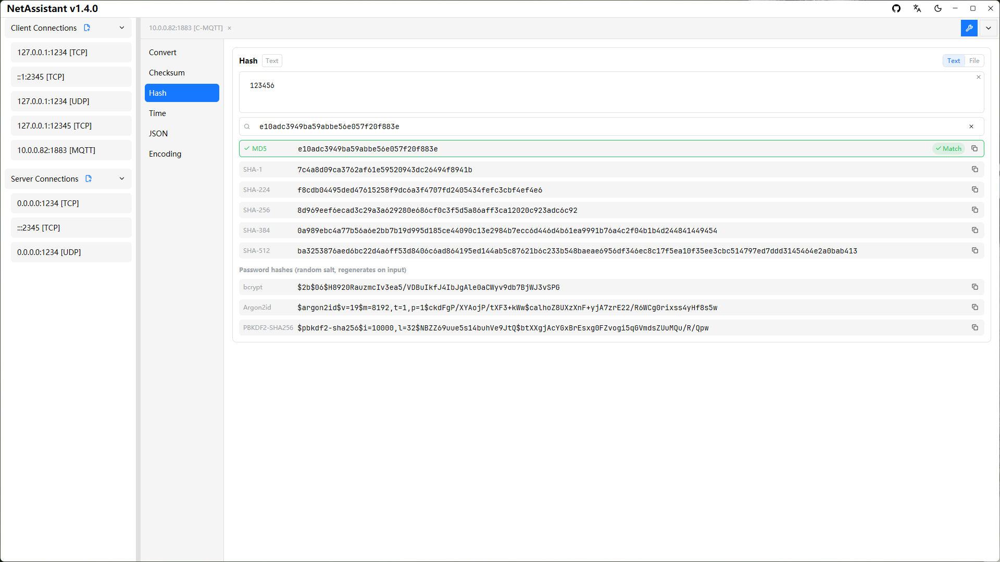

## Capturas de tela

### Modo cliente

### Modo servidor

### Cliente MQTT

### Caixa de ferramentas integrada

### Teste de carga

### Modo escuro

## Por que NetAssistant

- **Desempenho excepcional**: runtime assíncrono Rust + Tokio, inicialização < 100ms, consumo de memória < 20MB, conexões simultâneas na casa dos milhões
- **Feito para depuração**: do desenvolvimento de aplicações de rede à depuração de hardware e sistemas embarcados, cobrindo todo o fluxo de validação de comunicação
- **Multiplataforma**: suporte completo a Windows, Linux e macOS, com builds nativos para x64 e ARM64
- **Open source e gratuito**: distribuído sob a licença Apache-2.0, contribuições são bem-vindas

Para mais detalhes, veja [Recursos](/en/features); para começar, leia o [Guia](/en/guide/). Para comparar com o NetAssist e ferramentas semelhantes, consulte a [Comparação](/en/comparison).

## Download por plataforma

- [Ferramenta de depuração de rede para Windows](/en/windows-network-debug-tool): instalação em um único comando com winget, Windows 10/11 em x64 e ARM64
- [Ferramenta de depuração de rede para Mac](/en/mac-network-debug-tool): DMG universal para Apple Silicon e Intel
- [Ferramenta de depuração de rede para Linux](/en/linux-network-debug-tool): deb, AppImage e tar.gz para x86_64 e ARM64

## Guias populares

- [Alternativa ao NetAssist: comparação e migração](/en/compare/netassist)
- [Ferramenta de depuração TCP: envio, recebimento e framing](/en/tcp-debug-tool)
- [Ferramenta de depuração UDP: envio sem conexão e respostas de vários dispositivos](/en/udp-debug-tool)
- [Ferramenta de depuração de socket: escuta de porta e verificação de alcance](/en/socket-debug-tool)
- [Envio em hexadecimal: payloads HEX e conversão para texto](/en/hex-send)
- [Depuração Modbus TCP: frames e CRC16](/en/modbus-tcp)
- [Sticky packets TCP: causas, quatro soluções e depuração](/en/tcp-sticky-packet)
- [Guia de depuração MQTT: encontre páginas por tarefa](/en/mqtt)
- [Comparativo de clientes MQTT: MQTTX, Explorer e MQTT.fx](/en/compare/)
- [Cliente MQTT: ferramenta leve de depuração MQTT 3.1.1 / 5.0](/en/mqtt-client)
- [Alternativa ao MQTTX: comparativo de clientes MQTT leves](/en/comparison-mqttx)
- [Tutorial MQTT: conectar, assinar e publicar](/en/guide/mqtt)
- [Solução de problemas MQTT: conexões e mensagens ausentes](/en/mqtt-troubleshooting)
- [MQTT TLS: verificação de certificado e autenticação mútua](/en/mqtt-tls)
- [MQTT 5.0: expiração de sessão e códigos de motivo](/en/mqtt-5)
- [Comparativo da alternativa MQTT Explorer](/en/compare/mqtt-explorer)
- [Comparativo da alternativa MQTT.fx](/en/compare/mqtt-fx)
- [FAQ MQTT](/en/mqtt-faq)
- [Instalação do cliente MQTT no Linux](/en/mqtt-client-linux)
- [Teste de carga TCP/UDP: QPS e latência p99](/en/tcp-stress-test)
- [Descoberta de dispositivos via broadcast UDP: busca na LAN e solução de problemas](/en/udp-broadcast-device-discovery)
