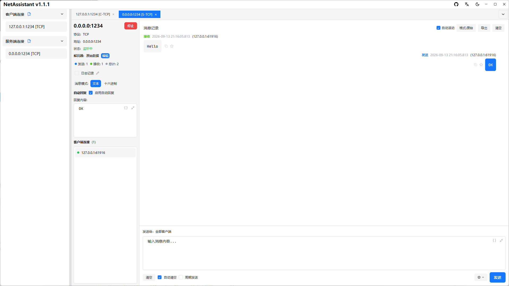
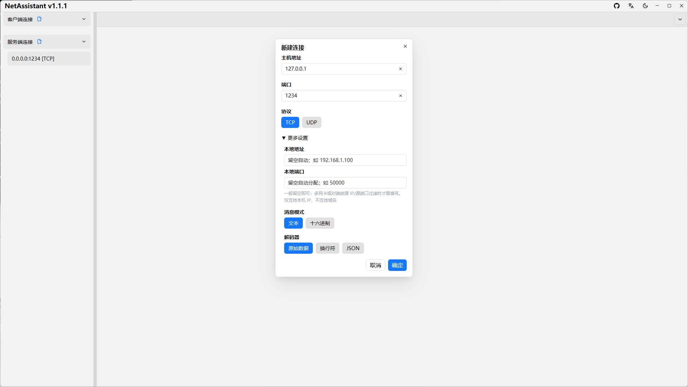

# Socket 调试工具：从端口到原始字节

“Socket 调试”通常指直接操作 TCP/UDP 端点：不经过业务应用，自己连一个端口、自己监听一个端口，看看连接能不能建立、字节能不能收发。NetAssistant 提供的就是这类能力——TCP/UDP 客户端与服务端、本地地址绑定、IPv4/IPv6 和 Hex 收发。

> [下载 NetAssistant](/download) · [TCP/UDP 调试指南](/guide/tcp-udp) · [全部功能](/features)

## 适合谁

- **验证端口可达性**：确认服务是否在监听、防火墙是否放行
- **模拟客户端/服务端**：在真实设备或服务上线前先跑通链路
- **多网卡环境**：指定本地地址，验证从哪块网卡、哪个源 IP 发出
- **协议联调**：直接收发原始字节，排除上层框架干扰

## 一个 Socket 调试工具包含什么

| 能力 | 说明 |
| ---- | ---- |
| TCP 客户端 | 连接指定 `ip:port`，验证握手与收发 |
| TCP 服务端 | 监听本地端口，接受并管理多个连接 |
| UDP 客户端 | 向目标地址发送数据报，无需建链 |
| UDP 服务端 | 监听本地端口，接收并显示来源地址 |
| 本地地址绑定 | 指定源地址或监听地址，适配多网卡 |
| IPv4 / IPv6 | 两种地址族均可使用 |

## 常见排查流程

### 端口连不上

1. 用 TCP 客户端连接目标 `ip:port`
2. 连接被拒绝（Connection refused）：目标主机可达，但端口没有进程监听
3. 连接超时：更可能是防火墙丢包、路由不通或地址错误
4. 本机先起一个 TCP 服务端监听同一端口，排除工具本身的问题

### 监听端口失败

- 端口被其他进程占用，换一个高位端口验证
- 端口小于 1024 时在部分系统上需要更高权限
- 绑定的本地地址不属于本机网卡
- 安全软件拦截了监听行为

### 收到数据但看不懂

切换 Hex 模式查看原始字节；如果是对端主动推送，注意 TCP 是字节流，可能需要配合 [解码器处理粘包](/tcp-sticky-packet)。

## 和串口助手的区别

Socket 调试工具面向网络端点，串口助手面向 COM 口、波特率和串口帧。两者解决的是不同层的问题。NetAssistant **不提供串口或 Unix Domain Socket 调试**，如果你需要 RS-232/RS-485、AT 串口指令或本地进程间 Socket，应使用串口调试工具或系统自带工具。

## 快速开始

1. 新建连接，选择 TCP 或 UDP、客户端或服务端
2. 客户端填写目标地址与端口；服务端填写监听端口
3. 多网卡环境可在高级设置中指定本地地址
4. 连接或监听成功后，在发送区输入内容并选择文本/Hex
5. 观察接收区消息与连接状态，必要时导出记录

## 常见问题

### Socket 调试工具是做什么的？

直接操作 TCP/UDP 端点，连接远端端口或监听本地端口，收发原始字节并观察连接状态。

### 能调试串口或 Unix Domain Socket 吗？

不能。只支持 TCP/UDP/MQTT 网络连接，不含串口与 Unix Socket。

### 监听端口失败怎么办？

检查端口占用、权限、绑定地址和防火墙，换高位端口可快速排除权限问题。

### 能测试端口通不通吗？

可以。TCP 客户端连接成功即端口可达；被拒绝通常是未监听，超时多为防火墙或路由问题。

## 相关页面

- [TCP 调试工具](/tcp-debug-tool)
- [UDP 调试工具](/udp-debug-tool)
- [TCP 粘包与拆包](/tcp-sticky-packet)
- [Windows 网络调试助手](/windows-network-debug-tool)
- [全部功能](/features)
- [下载 NetAssistant](/download)
