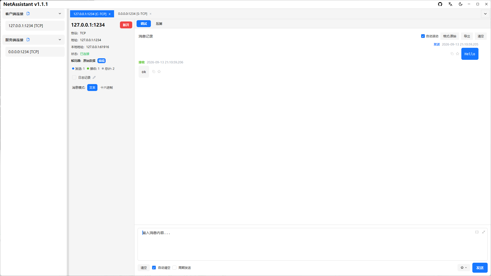
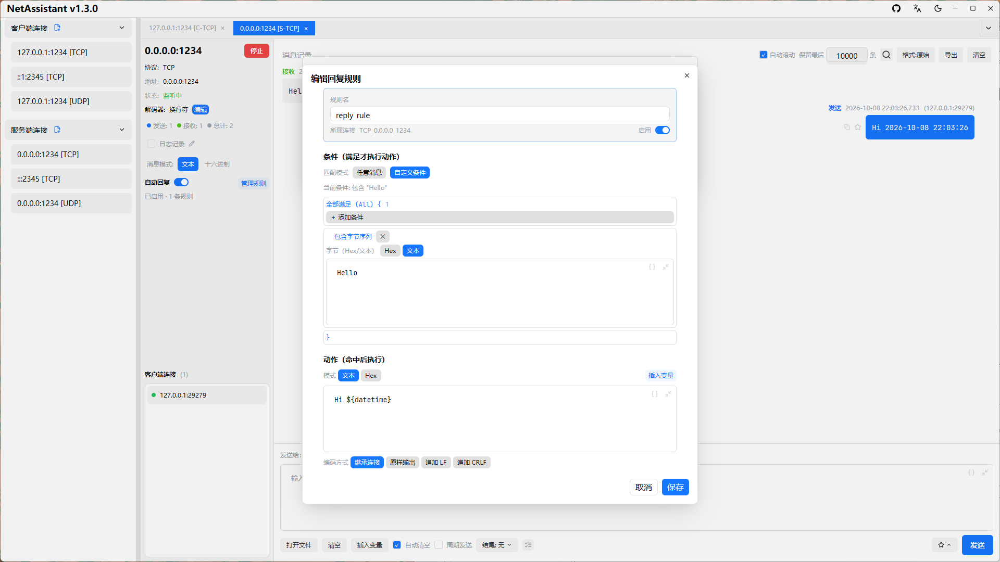

# TCP 调试工具：连得上、分得清、回得快

做设备联调或后端接口验证时，TCP 调试通常卡在三个地方：端口连不上、收到的数据粘成一团、发出去后收不到对端应答。NetAssistant 把这三件事放在同一个界面里：客户端/服务端连接、四种解码器、回复规则与周期发送。

> [下载 NetAssistant](/download) · [TCP/UDP 调试指南](/guide/tcp-udp) · [全部功能](/features)

## 适合谁

- **嵌入式/物联网开发者**：和 TCP 设备、网关、DTU 联调，验证上报与下发
- **后端开发者**：不写临时脚本，直接向自研服务发一条原始报文看响应
- **协议对接人员**：按十六进制逐字节检查帧结构
- **需要模拟服务端的人**：本地监听端口，等待设备主动连接

## 三种连接方式

| 模式 | 用途 | 典型场景 |
| ---- | ---- | ---- |
| TCP 客户端 | 主动连接远端地址与端口 | 连接设备、测试服务端接口 |
| TCP 服务端 | 监听本地端口并接受连接 | 模拟设备接入平台、验证客户端行为 |
| 本地地址绑定 | 指定发出的源地址或监听网卡 | 多网卡环境、验证来源 IP |

地址支持 IPv4 与 IPv6。服务端模式下可以同时保留多个客户端连接，每个连接独立收发。

## 解决粘包：四种解码器

TCP 不保证消息边界，解码器决定“什么时候算一条完整消息”。

| 解码器 | 边界规则 | 适用协议 |
| ---- | ---- | ---- |
| 原始数据 | 收到多少显示多少 | 自定义二进制协议、只看原始字节 |
| 基于行 | 按换行符切分 | 文本协议、AT 指令、日志流 |
| 长度前缀 | 先读长度字段，再读对应字节数 | 二进制协议、TLV、私有帧格式 |
| JSON | 按完整 JSON 对象切分 | JSON 行协议、RPC 调试 |

选错解码器是“消息看起来粘在一起”的最常见原因。解码器只影响显示与切分，不改变实际发送的字节。详细原理与排查步骤见 [TCP 粘包与拆包](/tcp-sticky-packet)。

## 发送与自动响应

- **文本 / Hex 模式**：文本模式按 UTF-8 发送，Hex 模式直接发送原始字节，适合含 `0x00` 或不可打印字符的帧
- **结尾字符**：可选择继承、无、LF 或 CRLF，避免手动补换行
- **周期发送**：按固定间隔重复发送，用于心跳、保活或模拟设备上报
- **回复规则**：按字节、JSON、正则或校验和条件匹配收到的消息，自动回一条预设内容，用来模拟服务端应答
- **文件数据源**：从本地文件读取报文填入发送框，支持 UTF-8 / GBK / ANSI 编码，单文件上限 1 MiB

## 快速开始

1. 新建连接，选择 TCP 客户端或服务端
2. 客户端填写目标地址与端口；服务端填写监听端口
3. 连接成功后，在接收区选择与协议匹配的解码器
4. 在发送区输入报文，选择文本或 Hex 模式
5. 需要自动应答时添加回复规则，需要持续上报时开启周期发送
6. 用搜索定位关键字，或把当前记录导出为 TXT / JSON / CSV

## 什么时候需要压测

功能验证通过后，如果还想知道服务端能扛多少并发、p99 延迟是多少，用内置的 [TCP/UDP 压力测试](/tcp-stress-test)，不必再装 JMeter 或 wrk。

## 常见问题

### TCP 调试工具主要解决什么问题？

确认能否连上、把字节流正确切分成消息、快速验证应答链路，这三件事覆盖了大部分 TCP 联调场景。

### 为什么收到的数据粘在一起？

TCP 是字节流，没有消息边界。需要在应用层用换行、长度前缀或 JSON 等规则切分，并选择对应解码器。

### 能同时做 TCP 客户端和服务端吗？

可以。两种模式都支持，服务端模式下可同时管理多个客户端连接。

### 支持 IPv6 吗？

支持。客户端与服务端均可使用 IPv4 或 IPv6 地址。

### 支持串口或 Unix Socket 吗？

不支持。NetAssistant 只处理 TCP/UDP/MQTT 网络连接，不包含串口调试功能。

## 相关页面

- [TCP 粘包与拆包](/tcp-sticky-packet)
- [TCP/UDP 压力测试](/tcp-stress-test)
- [Socket 调试工具](/socket-debug-tool)
- [UDP 调试工具](/udp-debug-tool)
- [Windows 网络调试助手](/windows-network-debug-tool)
- [全部功能](/features)
