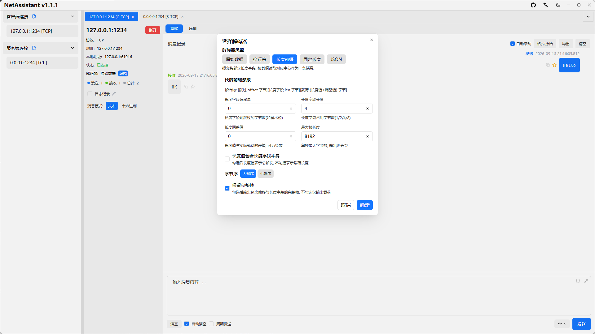

# TCP 粘包与拆包：原因、四种解决方案与调试方法

**一句话结论**：TCP 是字节流协议，本身不保留“消息边界”。粘包不是 TCP 的 bug，而是应用层没有定义好消息从哪里开始、到哪里结束。解决办法只有一类：在应用层做分帧，常用定长、分隔符、长度前缀、自描述格式四种方案。

## 什么是 TCP 粘包和拆包

假设客户端连续发送三条消息：

```text
消息 A：hello
消息 B：world
消息 C：netassistant
```

接收方调用 `recv` 时，可能读到：

| 情况 | 一次 recv 的内容 | 现象 |
| ---- | ---- | ---- |
| 正常 | `hello`、`world`、`netassistant` 分三次读到 | 符合直觉 |
| 粘包 | `helloworldnetassistant` 一次读到 | 多条消息粘在一起 |
| 拆包 | 先读到 `hel`，再读到 `loworld` | 一条消息被拆开 |
| 混合 | 先读到 `hellowor`，再读到 `ldnetassistant` | 两种情况同时出现 |

所以“粘包”和“拆包”本质是同一个问题：**接收方无法仅凭字节流判断消息边界**。

## 为什么会产生粘包

- **TCP 面向字节流**：TCP 只保证字节顺序和可靠性，不保留发送方的 `write` 边界
- **Nagle 算法**：小包可能被合并后再发送，减少网络开销
- **MSS/MTU 限制**：大消息会在 IP/TCP 层被分段，接收方需要多次读取
- **接收缓冲区**：内核会把多次到达的数据合并，`recv` 一次可能取走多条消息
- **发送方连续写**：循环里连续 `send` 多条小消息，接收方很容易一次读到

关键点：即使关闭 Nagle、每次发送后 sleep，也不能保证“一次 send 对应一次 recv”。依赖这个假设的代码在生产环境迟早会出问题。

## 四种解决方案

### 方案一：定长消息

每条消息固定长度，不足补空格或零。接收方每次读固定字节数。

- 优点：实现最简单，解析开销低
- 缺点：浪费带宽，长度变化时需要重新设计协议
- 适用：固定结构的二进制指令、老式工控协议

### 方案二：分隔符

用特殊字符或字符序列作为消息结束标记，例如换行符 `\n`、`\r\n`、`\0` 或自定义分隔符。

- 优点：可读性好，适合文本协议
- 缺点：消息内容里出现分隔符时需要转义；二进制数据不适用
- 适用：AT 指令、日志、JSON Lines、Redis 协议这类文本场景

### 方案三：长度前缀

在消息前面加一个固定长度的长度字段，接收方先读长度，再读对应字节数的负载。

```text
+----------+------------------+
| 4 字节长度 |     N 字节负载     |
+----------+------------------+
```

- 优点：二进制友好，解析高效，边界明确
- 缺点：需要约定字节序、长度字段大小和最大帧长
- 适用：自定义二进制协议、RPC、游戏协议、物联网设备协议

### 方案四：自描述格式

使用 JSON、Protobuf、MessagePack 等自带结构的格式，由解析器判断一个完整对象是否结束。注意：JSON over TCP 仍然需要分帧，通常配合换行或长度前缀使用。

- 优点：可扩展，字段变更方便
- 缺点：解析成本更高，JSON 体积较大
- 适用：配置下发、业务消息、调试接口

### 四种方案对比

| 方案 | 边界如何确定 | 优点 | 缺点 | 典型场景 |
| ---- | ---- | ---- | ---- | ---- |
| 定长 | 固定字节数 | 最简单、最快 | 不灵活、浪费带宽 | 固定指令 |
| 分隔符 | 特殊字符 | 可读性好 | 需转义、不适合二进制 | 文本协议、日志 |
| 长度前缀 | 长度字段 | 二进制友好、高效 | 需约定字节序与上限 | 自定义二进制协议 |
| 自描述 | 格式自身结构 | 可扩展 | 解析成本高、体积大 | JSON/Protobuf 消息 |

## 代码示例

### 长度前缀：Python 接收端

```python
import struct

MAX_FRAME = 1024 * 1024  # 1 MiB，防止恶意长度

def recv_exact(sock, n):
    buf = b""
    while len(buf) < n:
        chunk = sock.recv(n - len(buf))
        if not chunk:
            raise ConnectionError("connection closed")
        buf += chunk
    return buf

def recv_frame(sock):
    header = recv_exact(sock, 4)
    (length,) = struct.unpack(">I", header)  # 大端 uint32
    if length > MAX_FRAME:
        raise ValueError(f"frame too large: {length}")
    return recv_exact(sock, length)
```

发送端对应写入 `struct.pack(">I", len(payload)) + payload`。

### 分隔符：按换行拆分

```python
buffer = b""

while True:
    chunk = sock.recv(4096)
    if not chunk:
        break
    buffer += chunk
    while b"\n" in buffer:
        line, buffer = buffer.split(b"\n", 1)
        handle(line)  # 处理完整的一行
```

注意保留 `buffer` 中未完成的部分，不要每次 `recv` 后直接清空。

## 用 NetAssistant 调试粘包

NetAssistant 在接收侧提供四种解码器，可以直接对比“原始字节”和“按协议分帧后的消息”：

1. 新建 TCP 客户端或服务端连接
2. 在解码器中选择**原始数据 / 行分隔 / 长度前缀 / JSON**
3. 发送测试报文，观察接收区是否正确拆分
4. 切换到十六进制模式，检查长度字段、分隔符和字节序
5. 需要长时间观察时，用搜索、收藏和导出定位异常帧



长度前缀解码器需要设置长度字段的字节数与字节序；行分隔解码器需要设置分隔符；JSON 解码器按完整 JSON 对象分帧。

## 常见误区

- **“粘包是 TCP 的缺陷”**：不是。TCP 只提供字节流，消息边界本来就该由应用层定义
- **“加大接收缓冲区就能解决”**：缓冲区只会改变读取时机，不能定义消息边界
- **“每次发送后 sleep 一下就行”**：只能降低概率，不能保证正确
- **“UDP 也有粘包”**：UDP 是数据报协议，保留消息边界；但存在丢包、乱序和超过 MTU 后的分片问题，不能和 TCP 粘包混为一谈
- **“HTTP 没有这个问题，所以 TCP 没问题”**：HTTP 自己做了 Content-Length、chunked 或帧长度，这正是应用层分帧

## 常见问题

### TCP 粘包和拆包有什么区别？

粘包是一次读到多条消息，拆包是一条消息被拆成多次读取。两者本质相同：TCP 不保留消息边界，应用层需要自己分帧。

### 为什么本地测试正常，线上却出现粘包？

本地发送间隔大、数据量小，一次 `send` 往往对应一次 `recv`；线上受 Nagle、缓冲区合并、网络延迟和并发影响，读取边界会变化。

### 长度前缀应该用大端还是小端？

双方约定一致即可，推荐网络字节序（大端）。常见做法是 4 字节大端无符号整数，并设置最大帧长。

### 分隔符应该选什么？

选消息内容中不会出现的字符序列。文本协议常用 `\n` 或 `\r\n`；如果内容可能包含分隔符，需要转义，或改用长度前缀。

### HTTP 为什么没有粘包问题？

HTTP 在应用层定义了消息边界：HTTP/1.1 使用 `Content-Length` 或 chunked，HTTP/2 使用带长度字段的帧。

### UDP 有粘包吗？

UDP 是数据报协议，保留消息边界，不存在 TCP 意义上的粘包；但有丢包、乱序、重复和分片问题。

## 相关页面

- [TCP/UDP 调试指南](/guide/tcp-udp)
- [TCP 调试工具](/tcp-debug-tool)
- [NetAssistant 功能特性](/features)
- [NetAssist 替代对比](/compare/netassist)
- [下载 NetAssistant](/download)
