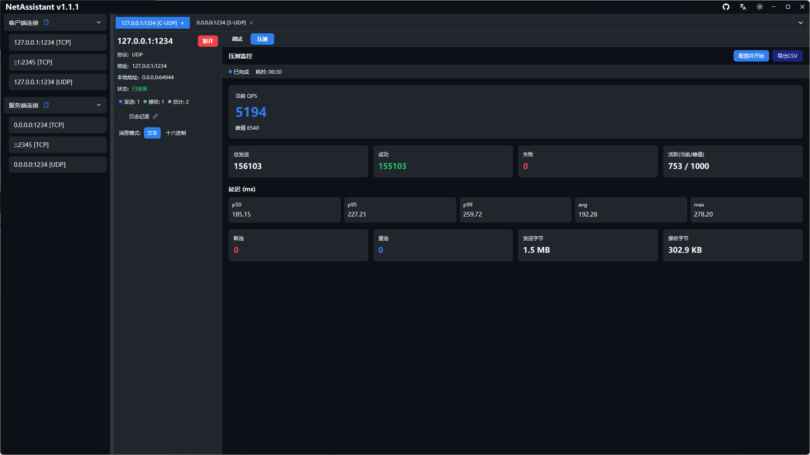
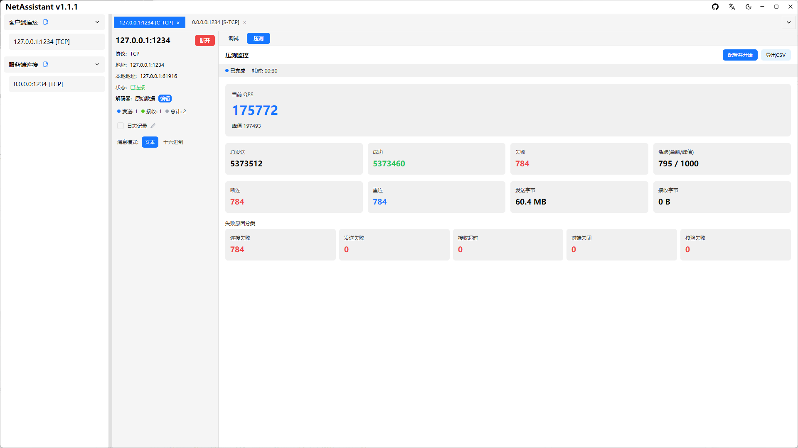

# TCP/UDP 压力测试：QPS、p99 延迟与失败分类

服务端能不能扛住并发，不能靠“感觉”。NetAssistant 内置 TCP/UDP 压测引擎，不用再装 JMeter、wrk 或写脚本，填好目标地址和并发数就能看到 QPS、p50/p95/p99 延迟和失败原因。

压测引擎是独立逻辑层，基于令牌桶控制发送速率，支持 Ping-Pong 与吞吐两种模式、短连接与长连接。

> [下载 NetAssistant](/download) · [压测使用指南](/guide/stress) · [全部功能](/features)

## 适合什么场景

- **自研 TCP/UDP 服务端**：验证接口在多并发下的吞吐与延迟
- **设备并发连接**：模拟多个客户端上线、心跳与断线重连
- **长稳测试**：持续发送，观察失败率、断连和资源变化
- **压测前后对比**：同一配置下比较优化前后的 QPS 与 p99

## 两种压测模式

| 模式 | 行为 | 统计 | 适用场景 |
| ---- | ---- | ---- | ---- |
| Ping-Pong（往返） | 发送后等待响应 | RTT、p50/p95/p99、平均/最大延迟 | 接口性能、请求响应型协议 |
| 吞吐模式 | 只发送，不等待响应 | QPS、发送成功率、流量 | 最大吞吐、单向推送 |

连接模式支持**短连接**（每次请求新建连接）与**长连接**。短连接更接近连接建立成本高的场景，长连接更适合持续吞吐测试。

## 配置步骤

1. 打开标签页上的「压测」入口
2. 填写目标地址、端口、并发客户端数、发送速率与消息内容
3. 消息内容可使用变量模板，避免所有请求完全相同
4. 按需设置结尾字符（继承 / 无 / LF / CRLF）
5. 选择压测模式与连接模式
6. 点击开始；配置会自动保存，下次打开自动回填

## 变量模板

| 模板 | 含义 |
| ---- | ---- |
| `${seq}` | 全局序号 |
| `${worker_id}` | 线程 ID |
| `${counter}` | 本地计数 |
| `${timestamp}` | 时间戳 |
| `${uuid}` | 随机 UUID |
| `${random:min:max}` | 随机整数 |

用变量模板可以让每条报文不同，避免服务端或中间设备做了去重、缓存或合并。

## 实时指标

- **QPS**：当前值与峰值
- **发送统计**：总发送 / 成功 / 失败
- **连接统计**：活跃连接（当前/峰值）、断连/重连
- **流量统计**：收发字节
- **延迟分位数**：p50 / p95 / p99 / 平均 / 最大（仅 Ping-Pong 模式）
- **失败原因分类**：连接失败 / 发送失败 / 接收超时 / 对端关闭 / 校验失败

失败原因分类比单纯的“失败数”更有用：连接失败通常是端口、防火墙或 backlog 问题；接收超时可能是服务端处理慢；对端关闭要看服务端是否主动断连。

## 报告导出

测试结束后可导出 CSV 统计报告，包含 QPS、延迟分位数、成功/失败数与失败原因，方便贴到 issue、压测记录或优化对比表里。测试过程中点击停止按钮可随时终止。

## 和 JMeter、wrk 的区别

| 维度 | NetAssistant | JMeter / wrk |
| ---- | ---- | ---- |
| 形态 | 图形界面，开箱即用 | 脚本/配置驱动 |
| 协议 | 原始 TCP/UDP | HTTP 为主，TCP 需插件或脚本 |
| 上手成本 | 低，填写参数即可 | 较高，需要脚本与场景设计 |
| 分布式压测 | 不支持 | 支持 |
| 持续集成 | 不适合 | 适合 |
| 适用阶段 | 联调、临时验证、快速对比 | 完整压测体系、回归与容量评估 |

NetAssistant 的定位是**开发联调阶段的快速压测**，不是 JMeter/wrk 的替代品。需要分布式、脚本化和长期回归时，仍然应该用专业压测平台。

## 压测建议

- 先做小流量预热，再逐步提高并发，避免一上来打满
- 压测机和被测服务尽量在同一网段，排除公网抖动
- 同时观察服务端 CPU、内存、连接数和错误日志
- 长连接看吞吐，短连接看连接建立成本
- 不要对没有授权的服务做压测

## 常见问题

### 怎么对 TCP 服务端做压力测试？

打开压测页，填写目标地址、端口、并发数、发送速率和消息内容，选择模式与连接方式，点击开始即可。

### QPS 和 p99 延迟应该看哪个？

两者一起看。QPS 反映吞吐能力，p99 反映尾部延迟；只看其中一个容易得出错误结论。

### 支持 UDP 压测吗？

支持。TCP 与 UDP 都可以使用 Ping-Pong 或吞吐模式。

### 支持短连接吗？

支持。短连接每次请求新建连接，长连接复用连接。

### 能导出报告吗？

可以，测试结束后导出 CSV，包含 QPS、延迟分位数与失败原因。

### 和 JMeter、wrk 有什么区别？

JMeter/wrk 更适合脚本化、分布式和持续集成；NetAssistant 适合图形化、原始 TCP/UDP 协议的快速验证。

## 相关页面

- [压力测试使用指南](/guide/stress)
- [TCP 调试工具](/tcp-debug-tool)
- [TCP 粘包与拆包](/tcp-sticky-packet)
- [全部功能](/features)
- [下载 NetAssistant](/download)
