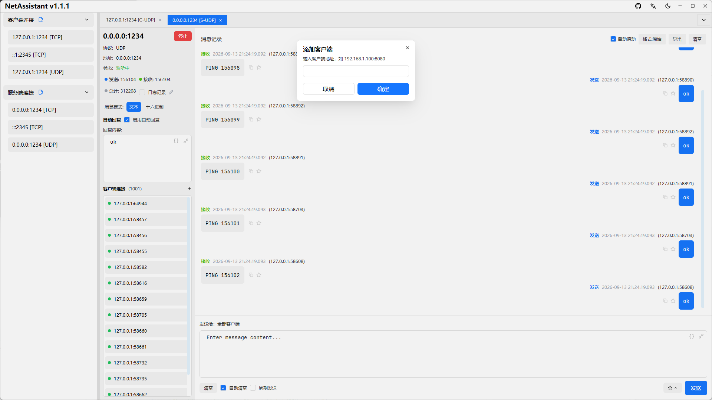
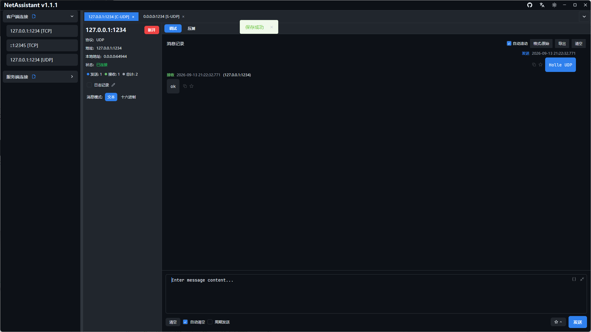

# UDP 广播设备发现：局域网设备调试方法

做上位机、物联网或嵌入式开发时，经常需要先找到局域网里有哪些设备：设备可能没有屏幕，IP 是 DHCP 分配的，也不一定支持 mDNS。**UDP 广播设备发现**是最常见的做法：向广播地址发一条 discovery 指令，所有设备把 IP、端口和能力信息回给你。

难点不在“发广播”，而在“收全回复”。很多调试工具会按目标地址过滤，只显示你填的那个 IP 的回复，其他设备响应就被丢掉了。NetAssistant 的做法是：全部显示，并把非预期来源标出来。

> [下载 NetAssistant](/download) · [TCP/UDP 调试指南](/guide/tcp-udp) · [全部功能](/features)

## 什么是 UDP 广播设备发现

UDP 是无连接协议，广播是把数据报发给同一子网内的所有主机。设备发现通常分三步：

1. 上位机向广播地址和约定端口发送 discovery 报文
2. 设备收到后，把自己的 IP、端口、设备 ID 等信息回复给上位机
3. 上位机汇总回复，得到设备列表

常见广播地址：

| 地址 | 含义 | 说明 |
| ---- | ---- | ---- |
| `255.255.255.255` | 受限广播 | 只在本机所在网段内传播，最常用 |
| `192.168.1.255` | 子网定向广播 | 假设本机是 `192.168.1.x/24`，按实际网段替换 |
| `224.0.0.1` 等 | 组播地址 | 不是广播；需要设备加入对应组播组 |

广播默认**不跨路由器**。如果设备在另一个网段，需要配置定向广播、使用组播，或改为单播探测。

## 用 NetAssistant 做设备发现

### 1. 新建 UDP 客户端

新建连接，协议选择 UDP，角色选择客户端。远端地址填广播地址（如 `192.168.1.255`），端口填设备约定的发现端口。

### 2. 发送 discovery 报文

在发送区填入设备要求的 discovery 内容，文本或十六进制都可以。点击发送后，等待设备回复。

### 3. 查看所有设备回复

NetAssistant 不会按目标地址过滤回复：所有设备的响应都会显示在接收区。来自非目标地址的回复会用**浅红色高亮**标识，鼠标悬停显示“非预期地址的回复”提示。

这样既不会丢掉其他设备的响应，也能一眼区分“我填的目标地址”和“广播带来的其他设备”。

### 4. 复制设备地址

双击消息来源地址即可复制 `ip:port`，方便把设备信息贴到配置或工单里。

### 5. UDP 服务端模式手动添加客户端

UDP 是无连接协议，服务端无法天然感知客户端。在 UDP 服务端模式下，可以点击 `[+添加客户端]`，输入目标 IP 和端口，主动向指定设备发送消息。

## 收不到回复怎么排查

- **广播地址不对**：确认本机网段，例如 `192.168.1.0/24` 对应 `192.168.1.255`
- **端口不对**：发现端口不一定是设备业务端口，查设备文档
- **设备用组播**：如果设备只监听组播组，广播收不到回复
- **防火墙拦截**：检查本机防火墙是否允许该 UDP 端口
- **不在同一子网**：广播默认不跨路由器，确认设备和电脑在同一网段
- **报文格式不对**：有些设备要求固定 magic、长度或校验，先抓包对比
- **绑定地址不对**：多网卡电脑要确认广播从正确网卡发出

## 广播和组播怎么选

| 维度 | UDP 广播 | UDP 组播 |
| ---- | ---- | ---- |
| 实现复杂度 | 低 | 中，需要加入组播组 |
| 传播范围 | 同一子网 | 可跨网段（需 IGMP/交换机支持） |
| 带宽影响 | 网内所有主机都会收到 | 只有组成员处理 |
| 适用规模 | 小规模、简单网络 | 设备多、网络复杂 |
| 典型场景 | 局域网设备发现、DHCP | 视频流、设备集群、服务发现 |

设备数量少、网络简单时，广播足够；设备多或需要跨网段时，优先考虑组播。

## 常见问题

### UDP 广播地址应该填什么？

常见做法是子网定向广播地址，例如 `192.168.1.255`（本机为 `192.168.1.x/24`）；也可以使用 `255.255.255.255`。广播默认不跨路由器。

### 为什么发送广播后收不到设备回复？

可能是广播地址/端口不对、设备使用组播、防火墙拦截、不在同一子网，或 discovery 报文格式不符合设备要求。先用 Wireshark 确认广播包是否发出。

### 广播和组播应该选哪个？

广播简单但只适合同一局域网；组播更节省带宽、可跨网段，适合设备多或网络复杂的场景。

### NetAssistant 会过滤非目标地址的回复吗？

不会。所有设备回复都会显示，非目标地址的来源会用浅红色高亮，悬停有提示。

### 能同时向多个设备发送吗？

广播会送达同一子网内的所有设备；如果需要定向发送，可以在 UDP 服务端模式手动添加客户端地址。

## 相关页面

- [TCP/UDP 调试指南](/guide/tcp-udp)
- [UDP 调试工具](/udp-debug-tool)
- [TCP/UDP 压力测试](/tcp-stress-test)
- [NetAssist 替代对比](/compare/netassist)
- [下载 NetAssistant](/download)
