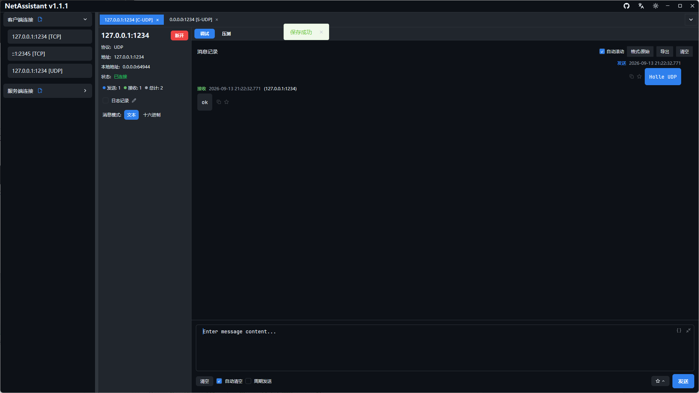
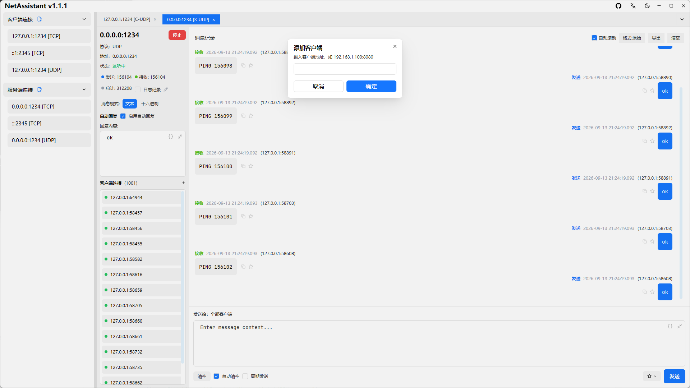

# UDP 调试工具：无连接收发与多设备回复

UDP 没有握手、没有重传，填好地址就能发。这让它成为设备发现、心跳上报、日志推送和实时控制的常用协议，也让“发出去了但没反应”变得难以判断。NetAssistant 的 UDP 调试工具把客户端、服务端和多设备回复放在同一个界面里。

> [下载 NetAssistant](/download) · [TCP/UDP 调试指南](/guide/tcp-udp) · [全部功能](/features)

## 适合谁

- **物联网/嵌入式开发者**：验证设备 UDP 上报、指令下发与心跳
- **做设备发现的人**：向广播地址发 discovery 指令，收集局域网设备回复
- **后端开发者**：快速起一个 UDP 服务端，看客户端到底发了什么
- **排查网络策略的人**：确认某端口 UDP 是否被防火墙放行

## 客户端与服务端

| 模式 | 行为 | 用途 |
| ---- | ---- | ---- |
| UDP 客户端 | 指定目标地址与端口发送数据报 | 向设备或服务发指令、模拟上报 |
| UDP 服务端 | 监听本地端口接收数据报 | 模拟设备、检查客户端实际发送内容 |
| 手动添加客户端 | 在客户端列表中直接补一条目标地址 | 同时向多个设备发送、固定常用目标 |

UDP 客户端不需要“连接”动作，目标地址就是收件人。服务端只需要监听端口，收到数据报时会显示来源 `ip:port`，双击即可复制。

## 广播与多设备回复

向 `192.168.1.255` 这类子网广播地址发送 discovery 指令时，网内所有设备都可能回复。很多工具只显示目标地址的回复，其余响应会被丢掉；NetAssistant 会全部展示，并把非预期来源用浅红色高亮，避免漏掉设备。

具体广播地址选择、抓包排查与常见失败原因，见 [UDP 广播设备发现](/udp-broadcast-device-discovery)。

## 收发能力

- **文本 / Hex 模式**：Hex 模式发送原始字节，适合带 `0x00` 的二进制数据报
- **结尾字符**：可选无、LF 或 CRLF，匹配设备侧解析规则
- **周期发送**：按固定间隔重复发送，模拟心跳或持续上报
- **回复规则**：按字节、JSON、正则或校验和匹配后自动应答
- **文件数据源**：从文件读取报文，支持 UTF-8 / GBK / ANSI，上限 1 MiB
- **消息管理**：搜索、收藏、导出 TXT / JSON / CSV，开启实时日志落盘

## 快速开始

1. 新建连接，选择 UDP 客户端或服务端
2. 客户端填写目标地址与端口；服务端填写监听端口
3. 在发送区输入内容，选择文本或 Hex 模式
4. 点击发送，在接收区查看回复与来源地址
5. 需要同时发多台设备时，用「添加客户端」维护目标列表
6. 需要持续发送时开启周期发送

## UDP 与 TCP 的调试差异

| 维度 | UDP | TCP |
| ---- | ---- | ---- |
| 连接 | 无连接，直接发送 | 需要握手建链 |
| 消息边界 | 保留数据报边界 | 字节流，需要解码器切分 |
| 可靠性 | 不保证送达、不重传 | 有序、可靠、自动重传 |
| 广播/组播 | 支持广播 | 不支持广播 |
| 适用场景 | 设备发现、心跳、实时控制 | 文件传输、长连接指令通道 |

因为 UDP 可能丢包，调试时不要用“发一次没回复”直接判断对端故障，先确认监听端口、防火墙和报文格式。

## 常见问题

### UDP 调试工具怎么用？

新建 UDP 客户端填目标地址直接发送，或新建 UDP 服务端监听本地端口接收，无连接、无需握手。

### 为什么发送成功却收不到回复？

UDP 不保证送达。检查目标端口是否监听、防火墙是否放行、报文格式是否符合设备要求。

### 如何接收多个设备的回复？

向广播地址发送指令，NetAssistant 会显示所有回复并高亮非预期来源。

### UDP 会粘包吗？

不会。UDP 保留数据报边界，但可能丢包、重复或乱序。

### 支持广播和 IPv6 吗？

支持广播发送；地址支持 IPv4 与 IPv6。

## 相关页面

- [UDP 广播设备发现](/udp-broadcast-device-discovery)
- [TCP 调试工具](/tcp-debug-tool)
- [TCP/UDP 压力测试](/tcp-stress-test)
- [Windows 网络调试助手](/windows-network-debug-tool)
- [全部功能](/features)
- [下载 NetAssistant](/download)
