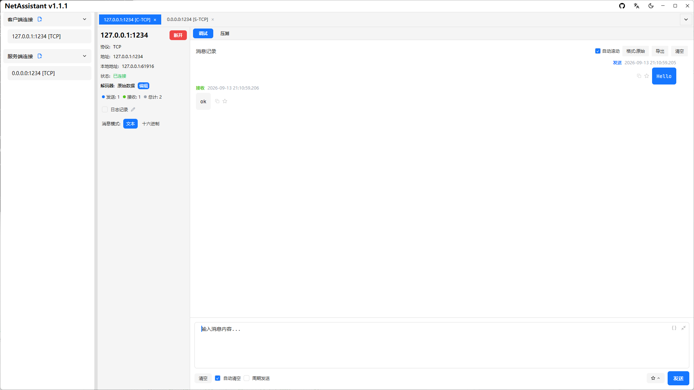

# Windows 网络调试助手：TCP/UDP/MQTT 调试与压测

如果你在 Windows 上做 TCP/UDP 联调，大概率用过**网络调试助手（NetAssist）**：轻量、直接，但只支持 Windows、闭源，遇到 TCP 粘包只能自己对着字节流数长度，压测还得另装工具。

NetAssistant 是面向 Windows 10/11 的免费开源网络调试助手：原生桌面应用，内置 TCP/UDP 客户端与服务端、四种粘包解码器、MQTT 3.1.1 调试、十六进制收发、消息管理与高并发压力测试。安装只需要一条 winget 命令。

> [下载 Windows 版](/download) · [查看全部功能](/features) · [快速上手](/guide/)



## 为什么 Windows 用户选择 NetAssistant

- **免费开源**：Apache-2.0 许可证，全部功能可用，源码托管在 GitHub
- **粘包解码**：原始数据、行分隔、长度前缀、JSON 四种 TCP 解码器，按协议格式自动分帧
- **内置压测**：不用再装 JMeter、wrk 等工具，直接看 QPS 与 p50/p95/p99 延迟
- **一个工具覆盖多种协议**：TCP/UDP 客户端与服务端、MQTT 3.1.1 客户端，IPv4/IPv6 双栈
- **原生性能**：Rust + Tokio 构建，启动快、内存占用低，界面基于 GPUI 渲染

## 在 Windows 上安装

### 方式一：winget（推荐）

```bash
winget install SunJary.NetAssistant
```

后续升级：

```bash
winget upgrade SunJary.NetAssistant
```

### 方式二：安装程序

从[下载页](/download)获取 `netassistant-windows-x86_64-setup.exe`，按向导安装，会自动创建开始菜单与桌面快捷方式。

### 方式三：免安装 zip

下载 `netassistant-windows-x86_64.zip`，解压后直接运行 `netassistant.exe`，适合不想改动系统环境的场景。

### ARM64 设备

Surface Pro X、骁龙笔记本等 ARM64 设备请下载 `netassistant-windows-aarch64.zip`。winget 与安装程序目前仅提供 x64 版本；ARM64 版本为自动构建产物，未经真机完整测试。

## 核心功能

### TCP/UDP 客户端与服务端

同一套界面里创建 TCP 客户端、TCP 服务端、UDP 客户端与 UDP 服务端连接，支持多标签页并行调试、配置自动保存、本地地址与端口绑定。

### TCP 粘包与四种解码器

TCP 是字节流协议，粘包/拆包无法避免。NetAssistant 提供原始数据、行分隔、长度前缀、JSON 四种解码器，接收侧自动按协议边界拆分消息，不用手动数长度。


### 内置压力测试

内置 TCP/UDP 高并发压力测试引擎，支持 Ping-Pong 往返与吞吐两种模式，实时展示 QPS、发送成功率、活跃连接、p50/p95/p99 延迟与失败原因分类，并可导出 CSV 报告。[压力测试指南](/guide/stress)

### MQTT 3.1.1 调试

在同一个工具里新建 MQTT 连接，配置 Broker、Client ID、用户名密码、KeepAlive 与遗嘱消息，运行时添加/取消订阅，按 topic、QoS、retain 发布消息。

### 内置工具箱

转换、校验、哈希、时间、JSON、编码六组工具常驻标签页：Hex/文本互转、CRC16/CRC32、MD5/SHA、时间戳转换、Base64/URL 编解码，输入即出结果。

## 和网络调试助手（NetAssist）的区别

| 维度 | NetAssistant | 网络调试助手（NetAssist） |
| ---- | ---- | ---- |
| 平台 | Windows / macOS / Linux（x64 + ARM64） | 仅 Windows |
| 开源 | Apache-2.0 | 闭源 |
| TCP 粘包解码 | 原始 / 行 / 长度前缀 / JSON | 有限 |
| 内置高并发压测 | QPS + p50/p95/p99 | 无 |
| IPv6 | 完整支持 | 部分支持 |
| 消息导出 | TXT / JSON / CSV | 有限 |
| 自动回复 / 周期发送 | 支持 | 支持 |

完整对比见[同类工具对比](/comparison)；如果你在找 NetAssist 的替代品，见 [NetAssist 替代指南](/compare/netassist)。

## 典型使用场景

- **上位机/嵌入式联调**：模拟设备或服务端收发报文，验证协议格式与异常处理
- **工控与物联网**：UDP 广播发现设备、十六进制收发、按来源地址高亮非预期回复
- **后端接口验证**：作为 TCP/UDP 客户端或服务端，快速验证通信逻辑
- **教学与课程实验**：免费、安装简单，适合网络编程与协议分析课程

## 系统要求

| 项目 | 要求 |
| ---- | ---- |
| 系统 | Windows 10 或更高版本 |
| 架构 | x64 或 ARM64 |
| 安装方式 | winget、安装程序、免安装 zip |
| 许可 | Apache-2.0，免费使用 |

## 常见问题

### Windows 上怎么安装 NetAssistant？

推荐使用 winget：在 PowerShell 或终端执行 `winget install SunJary.NetAssistant`；也可以从[下载页](/download)获取安装程序或免安装 zip。

### 支持 Windows 7 吗？

不支持。NetAssistant 需要 Windows 10 或更高版本，建议使用 Windows 10/11 的 x64 或 ARM64 版本。

### Windows ARM64 设备能用吗？

可以。Surface Pro X、骁龙笔记本等 ARM64 设备请下载 `netassistant-windows-aarch64.zip`，解压后运行 `netassistant.exe`。

### 和网络调试助手（NetAssist）有什么区别？

NetAssist 仅支持 Windows 且闭源；NetAssistant 免费开源、跨平台，内置四种 TCP 粘包解码器和压力测试，消息管理与配置体验也更现代。详细差异与迁移步骤见 [NetAssist 替代指南](/compare/netassist)。

### 收费吗？

不收费。NetAssistant 基于 Apache-2.0 许可证开源，全部功能免费使用。

### 支持 IPv6 吗？

支持。创建连接时地址可填 IPv4 或 IPv6，例如 `::1`、`fe80::xxxx`，客户端与服务端模式均可使用。

## 相关页面

- [macOS 网络调试助手](/mac-network-debug-tool)
- [Linux 网络调试助手](/linux-network-debug-tool)
- [TCP/UDP 调试指南](/guide/tcp-udp)
- [下载 NetAssistant](/download)
