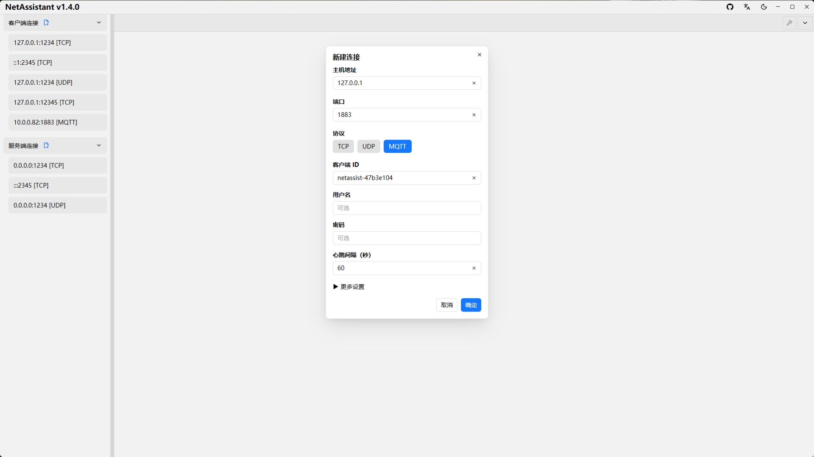
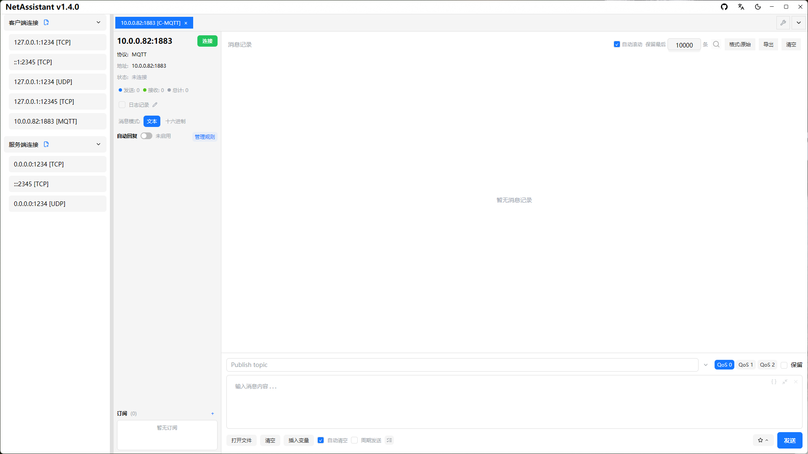

# MQTT 调试教程：从连接到第一条订阅消息

想确认设备有没有上报、平台指令有没有下发，最快的方法是用一个 MQTT 客户端连上 Broker，订阅 topic 再看报文。这篇教程用 NetAssistant 走完完整流程：新建连接 → 连接 Broker → 订阅 → 发布 → 验证，最后给出 TLS 与本地 Broker 的测试方法。

> 已经有连接、只是收不到消息？直接看 [MQTT 连接与订阅排错](/zh/mqtt-troubleshooting)。

## 开始之前

1. 安装 NetAssistant：Windows 可用 `winget install SunJary.NetAssistant`，其他平台见[下载页](/zh/download)。
2. 准备一个可用的 Broker：本地 Mosquitto、EMQX，或云厂商 IoT 平台；需要地址、端口与认证信息。
3. 确认要订阅或发布的 topic；不确定时先查设备端或平台文档，避免靠猜。

## 第 1 步：新建 MQTT 连接

点击左侧 `+新建`，协议选择 **MQTT**，然后填写：

| 字段 | 说明 |
| ---- | ---- |
| 地址 / 端口 | Broker 主机名与端口，明文默认 1883，TLS 默认 8883 |
| Client ID | 同一 Broker 上必须唯一；留空时 5.0 会强制 clean start |
| 用户名 / 密码 | Broker 开启认证时填写，留空表示匿名 |
| KeepAlive | 心跳间隔，默认 60 秒；网络不稳定时可适当调大 |
| 协议版本 | 5.0（默认）或 3.1.1，按 Broker 支持情况选择 |

「更多设置」里可以配置 Clean Session 与遗嘱消息（topic / payload / QoS / retain）。连接名称可留空，填写后列表与标签页会显示名称，方便区分多个环境。



## 第 2 步：连接 Broker

点击 `连接`。连接成功后，详情页会显示当前 Broker、协议版本和连接状态；失败时右上角会给出可读原因：

- 3.1.1 返回 CONNACK 错误码（协议版本不支持、Client ID 被拒、认证失败等）
- 5.0 显示具体原因码，例如 `0x86` 用户名或密码错误、`0x87` 未授权
- TLS 证书过期、主机名不匹配、证书链不受信任会单独提示

如果一直连不上，先按[排错页的第一步](/zh/mqtt-troubleshooting#先做三个快速检查)确认端口与地址。



## 第 3 步：订阅 topic

在左侧「订阅」块点击 `＋`，填写 topic 与 QoS。常用的通配符写法：

- `device/+/status`：`+` 匹配单层，能命中 `device/1/status`，不匹配 `device/1/2/status`
- `device/#`：`#` 匹配多层，必须放在末尾
- `$SYS/#`：以 `$` 开头的系统 topic 需要显式订阅，`#` 不会匹配

每条订阅都有独立开关：打开后等待 Broker 确认（SUBACK）才点亮，失败或 10 秒无响应会自动关闭并提示原因。第一次联调可以先用 `test/#` 验证链路，再收窄到真实 topic。

## 第 4 步：发布消息

在发送区填写 topic、选择 QoS 与 retain，输入 payload 后点击发布：

- **QoS 0**：至多一次，最快，可能丢消息
- **QoS 1**：至少一次，可能重复，适合大多数设备上报
- **QoS 2**：仅一次，开销最大，适合不能重复的指令
- **retain**：Broker 保留最后一条消息，新订阅者会立即收到

先订阅再发布，才能在自己的消息区看到这条消息。topic 输入框右侧的下拉会保留当前连接最近用过的 topic、QoS 与 retain。

## 第 5 步：验证与保存

消息区会按 topic 标签展示收到的报文，retain 消息带标记；双击 topic 标签可复制原始 topic。把侧栏切到「主题」可以看到当前会话出现过的 topic，点击叶子按精确 topic 过滤报文流、点击分支按前缀过滤，右上角「全部主题」恢复；搜索命中文本也会在气泡内高亮。连接配置会自动保存，下次启动直接可用。

发布失败时右上角通知会带上目标 topic 与原因（MQTT 5 可区分无权限等具体原因），相同提示 3 秒内只弹一次，消息日志仍逐条记录。

## 用 TLS 连接（可选）

如果 Broker 使用 8883 或要求加密，在连接配置中开启 TLS，并按证书来源选择校验方式：

- **系统根证书**：Broker 使用公共 CA 签发的证书
- **自定义 CA**：自建 CA 或私有证书链，填 PEM 路径
- **跳过校验**：仅用于自签证书联调，传输仍加密但不验证身份

需要双向认证时，再填客户端证书与私钥（PEM，需成对）。配置细节见 [MQTT TLS 配置](/zh/mqtt-tls) 与 [MQTT over TLS](/zh/mqtt-client#mqtt-over-tls)。

## 本地起一个 Broker 测试

没有现成 Broker 时，可以用 Mosquitto 在本机验证链路。准备一个 `mosquitto.conf`：

```ini
listener 1883
allow_anonymous true
```

启动：

```bash
mosquitto -c mosquitto.conf -v
```

然后在 NetAssistant 中连接 `127.0.0.1:1883`，订阅 `test/#`，向 `test/hello` 发布一条消息即可。该配置只适合本机测试，生产环境请开启认证与 TLS。

## 常见问题

### MQTT 默认端口是多少？

明文 MQTT 默认 1883，TLS 默认 8883。使用 8883 时必须在连接配置中开启 TLS，否则握手会失败；NetAssistant 不支持 MQTT over WebSocket。

### Client ID 可以随便填吗？

同一 Broker 上必须唯一。两个客户端使用相同 Client ID 时，后连接的会把前一个踢下线；用「复制连接」创建副本时，NetAssistant 会自动生成新的 Client ID。

### 订阅成功但收不到消息怎么办？

先确认订阅开关已开启、发布 topic 能被订阅过滤器匹配，再检查 retained、QoS、ACL 与会话设置。完整步骤见 [MQTT 排错](/zh/mqtt-troubleshooting)。

### 支持 MQTT over WebSocket 吗？

不支持。目前只支持 TCP 直连 Broker，WebSocket 接入需要使用 MQTTX 等其他客户端。

### 需要选择 MQTT 5.0 吗？

多数 Broker 用 3.1.1 就能完成订阅与发布。需要会话过期、接收最大值或更具体的失败原因码时选 5.0；用户属性、Will Delay、共享订阅等高级特性暂未提供。

## 下一步

- 连不上或收不到消息：[MQTT 连接与订阅排错](/zh/mqtt-troubleshooting)
- 完整能力与参数说明：[MQTT 客户端](/zh/mqtt-client)
- 和 MQTTX 的差异：[MQTTX 替代品对比](/zh/comparison-mqttx)
- [下载 NetAssistant](/zh/download)
